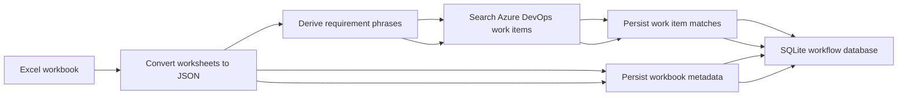

# Matrix_main_26-09-17-8-19am
b
> **Generated by Analyser** | 2026-09-17T15:20:57.322Z
> Total Files: **45** | Size: **353.8 KB** | Lines: **9,487** | Characters: **362,166**
## Directory Structure
f
```
.
├── DevAnalysis/internal-open-source/Matrix/
│   ├── .env.example
│   ├── .gitignore
│   ├── index.html
│   ├── kill.ps1
│   ├── package.json
│   ├── README.md
│   ├── tsconfig.json
│   └── vite.config.ts
├── DevAnat6ysis/internal-open-source/Matrix/output/
│   └── workbook.json
├── DevAnalysis/internal-open-source/Matrix/src/
│   ├── azure-6ddress": "F1",              
"value": null            
"value": null            
}          
]        
},        
{          
"row": 2,          
"cells": [            
{              
"column": 1,              
"address": "A2",              
"value": "Initial Disclosure and Fraud Statement"            
},            
{              
"column": 2,              
"address": "B2",              
"value": null            
},            
{              
"column": 3,              
"address": "C2",              
"value": "The final step will be to record your voice signature. To begin, I'll share a brief disclosure with you, ask you to confirm a couple of items, and then gather your voice signature.\r\n\r\nNew York: “You have a right to apply for this coverage and authorize payment in writing.”\r\n“The final step is to record your voice signature.  This includes questions regarding your desire to enter into an electronic transaction, the amount of Coverage, billing options, and a review of the health questions I asked earlier.  After you respond I will ask you to state your full name and today’s date, which is your signature and authorization to this agreement.”"            
},            
{              
"column": 4,              
"address": "D2",              
"value": "Note: per discussion with Mindy Umthum (Compliance), we can remove the statement \"you have a right to apply for this coverage and authorize payment in writing\" for all states except New York. Aaron deleted this as a result."            
},            
{              
"column": 5,              
"address": "E2",              
"value": null            
},            
{              
"column": 6,              
"address": "F2",              
"value": null            
}          
]        
},        
{          
"row": 3,          
"cells": [            
{              
"column": 1,              
"address": "A3",              
"value": null            
},            
{              
"column": 2,              
"address": "B3",              
"value": "Fraud"            
},            
{              
"column": 3,              
"address": "C3",              
"value": "See 'Fraud Language' tab and populate the appropriate fraud language"            
},            
{              
"column": 4,              
"address": "D3",              
"value": null            
},            
{              
"column": 5,              
"address": "E3",              
"value": null            
},            
{              
"column": 6,              
"address": "F3",              
"value": null            
}          
]        
},        
{          
"row": 4,          
"cells": [            
{              
"column": 1,              
"address": "A4",              
"value": null            
},            
{              
"column": 2,              
"address": "B4",              
"value": "Replace [CMFG] with [MEMBERS] for TAWL and TAWL 2.0"            
},            
{              
"column": 3,              
"address": "C4",              
"value": "I am a licensed and appointed insurance agent representing TruStage Insurance Agency. I offer, sell, and service insurance products underwritten by [CMFG] Life Insurance Company. My employer and I receive compensation through the sale of insurance products. The insurance products are not federally insured, may lose value and are not guaranteed by any other financial institution.\r\n\r\nNew York:  “I am a licensed and appointed insurance agent representing TruStage Insurance Agency. I offer, sell, and service insurance products underwritten by CMFG Life Insurance Company. My employer and I receive compensation through the sale of insurance products. The insurance products are not federally insured, may lose value and are not guaranteed by any other financial institution.”"            
},            
{              
"column": 4,              
"address": "D4",              
"value": null            
},            
{              
"column": 5,              
"address": "E4",              
"value": null            
},            
{              
"column": 6,              
"address": "F4",              
"value": null            
}          
]        
},        
{          
"row": 5,          
"cells": [            
{              
"column": 1,              
"address": "A5",              
"value": "Coverage"            
},            
{              
"column": 2,              
"address": "B5",              
"value": "Prefill applied for coverage amount and type"            
},            
{              
"column": 3,              
"address": "C5",              
"value": "Are you applying for [$5,000] of [term/whole] life insurance [along with a [$25,000] [Accidental Death Benefit Rider]]? "            
},            
{              
"column": 4,              
"address": "D5",              
"value": "Display coverage amount, product type, and if applicable, coverage and name of Rider"            
},            
{              
"column": 5,              
"address": "E5",              
"value": null            
},            
{              
"column": 6,              
"address": "F5",              
"value": null            
}          
]        
},        
{          
"row": 6,          
"cells": [            
{              
"column": 1,              
"address": "A6",              
"value": "Coverage"            
},            
{              
"column": 2,              
"address": "B6",              
"value": "Only required for New York"            
},            
{              
"column": 3,              
"address": "C6",              
"value": "Read when beneficiary type is Person/organization:\r\n“You provided [Beneficiary full name] as your [specify beneficiary class as primary/contingent and percentage share of death benefit as provided] beneficiary. Is this correct? \r\n\r\nRead when beneficiary type is If trust/estate:\r\n\"You provided [Trust/Estate] of [name of proposed insured] as a beneficiary with the identifying details. Is this correct? \""            
},            
{              
"column": 4,              
"address": "D6",              
"value": null            
},            
{              
"column": 5,              
"address": "E6",              
"value": null            
},            
{              
"column": 6,              
"address": "F6",              
"value": null            
}          
]        
},        
{          
"row": 7,          
"cells": [            
{              
"column": 1,              
"address": "A7",              
"value": "Replacement"            
},            
{              
"column": 2,              
"address": "B7",              
"value": "NAIC Model States"            
},            
{              
"column": 3,              
"address": "C7",              
"value": "AL, AK, AZ, AR, CO, CT, HI, IA, KY, LA, ME, MD, MS, MO, MT, NE, NH, NJ, NM, NC, OH, OR, RI, SC, SD, TX, UT, VT, VA, WV, WI"            
},            
{              
"column": 4,              
"address": "D7",              
"value": null            
},            
{              
"column": 5,              
"address": "E7",              
"value": null            
},            
{              
"column": 6,              
"address": "F7",              
"value": null            
}          
]        
},        
{          
"row": 8,          
"cells": [            
{              
"column": 1,              
"address": "A8",              
"value": null            
},            
{              
"column": 2,              
"address": "B8",              
"value": "If \"No\" to existing insurance"            
},            
{              
"column": 3,              
"address": "C8",              
"value": "You indicated you do not currently have life insurance. Is this correct?"            
},            
{              
"column": 4,              
"address": "D8",              
"value": "Existing Insurance Question = Do you have any existing life insurance policies or annuity contracts with our company or any other company?"            
},            
{              
"column": 5,              
"address": "E8",              
"value": null            
},            
{              
"column": 6,              
"address": "F8",              
"value": null            
}          
]        
},        
{          
"row": 9,          
"cells": [            
{              
"column": 1,              
"address": "A9",              
"value": null            
},            
{              
"column": 2,              
"address": "B9",              
"value": "If \"Yes\" to existing insurance but \"No\" to Replacement"            
},            
{              
"column": 3,              
"address": "C9",              
"value": "You indicated you have life insurance but will not be replacing. Is this correct? \r\nTo sign your replacement notice, please state your full name and today's date."            
},            
{              
"column": 4,              
"address": "D9",              
"value": "Replacement Questions for NAIC Model States if Existing Insurance Questions = Yes: \r\nAre you considering discontinuing making premium payments, surrendering, forfeiting, assigning to the insurer, or otherwise terminating your existing policy or contract?\r\n Are you considering using funds from your existing policies or contracts to pay premiums due on the new policy or contract?*"            
},            
{              
"column": 5,              
"address": "E9",              
"value": null            
},            
{              
"column": 6,              
"address": "F9",              
"value": null            
}          
]        
},        
{          
"row": 10,          
"cells": [            
{              
"column": 1,              
"address": "A10",              
"value": null            
},            
{              
"column": 2,              
"address": "B10",              
"value": "If \"Yes\" to existing insurance and \"Yes\" to Replacement"            
},            
{              
"column": 3,              
"address": "C10",              
"value": "You indicated you have life insurance and will be replacing your current coverage. Is this correct?\r\nTo sign your replacement notice, please state your full name and today's date."            
},            
{              
"column": 4,              
"address": "D10",              
"value": null            
},            
{              
"column": 5,              
"address": "E10",              
"value": null            
},            
{              
"column": 6,              
"address": "F10",              
"value": null            
}          
]        
},        
{          
"row": 11,          
"cells": [            
{              
"column": 1,              
"address": "A11",              
"value": null            
},            
{              
"column": 2,              
"address": "B11",              
"value": "Non-Model States"            
},            
{              
"column": 3,              
"address": "C11",              
"value": "CA, DC, DE, FL, GA, ID, IL, IN, KS, MA, MI, MN, ND, NV, NY, OK, PA, TN, WA, WY"            
},            
{              
"column": 4,              
"address": "D11",              
"value": null            
},            
{              
"column": 5,              
"address": "E11",              
"value": null            
},            
{              
"column": 6,              
"address": "F11",              
"value": null            
}          
]        
},        
{          
"row": 12,          
"cells": [            
{              
"column": 1,              
"address": "A12",              
"value": null            
},            
{              
"column": 2,              
"address": "B12",              
"value": "If \"No\" to Replacement"            
},            
{              
"column": 3,              
"address": "C12",              
"value": "You indicated you will not be replacing any coverage you may currently have. Is this correct?"            
},            
{              
"column": 4,              
"address": "D12",              
"value": "Replacement Question = Will the coverage applied for replace, discontinue, or change any existing life coverage or annuities in this or any other company?"            
},            
{              
"column": 5,              
"address": "E12",              
"value": null            
},            
{              
"column": 6,              
"address": "F12",              
"value": null            
}          
]        
},        
{          
"row": 13,          
"cells": [            
{              
"column": 1,              
"address": "A13",              
"value": null            
},            
{              
"column": 2,              
"address": "B13",              
"value": "If \"Yes\" to Replacement"            
},            
{              
"column": 3,              
"address": "C13",              
"value": "You indicated you will be replacing life insurance you currently have. Is this correct?\r\nTo sign your replacement notice, please state your full name and today's date."            
},            
{              
"column": 4,              
"address": "D13",              
"value": "Note: Replacements are not allowed for agent sold in the following states: AR, CA (internal only), FL, NY, OK, RI (internal only), WA, WY (external only)"            
},            
{              
"column": 5,              
"address": "E13",              
"value": "Day 2: 1230CA-LPMLIC"            
},            
{              
"column": 6,              
"address": "F13",              
"value": null            
}          
]        
},        
{          
"row": 14,          
"cells": [            
{              
"column": 1,              
"address": "A14",              
"value": null            
},            
{              
"column": 2,              
"address": "B14",              
"value": "If CA, MA, MN, NV, or PA and \"Yes\" to Replacement"            
},            
{              
"column": 3,              
"address": "C14",              
"value": "See 'Replacement Disclosures' tab and populate the appropriate state disclosure"            
},            
{              
"column": 4,              
"address": "D14",              
"value": null            
},            
{              
"column": 5,              
"address": "E14",              
"value": null            
},            
{              
"column": 6,              
"address": "F14",              
"value": null            
}          
]        
},        
{          
"row": 15,          
"cells": [            
{              
"column": 1,              
"address": "A15",              
"value": null            
},            
{              
"column": 2,              
"address": "B15",              
"value": "NY"            
},            
{              
"column": 3,              
"address": "C15",              
"value": "You indicated you will not be replacing any existing life insurance. Is this correct? "            
},            
{              
"column": 4,              
"address": "D15",              
"value": "Can we get to a recap of the replacement information for the state of New York?"            
},            
{              
"column": 5,              
"address": "E15",              
"value": null            
},            
{              
"column": 6,              
"address": "F15",              
"value": null            
}          
]        
},        
{          
"row": 16,          
"cells": [            
{              
"column": 1,              
"address": "A16",              
"value": null            
},            
{              
"column": 2,              
"address": "B16",              
"value": "FL, WY"            
},            
{              
"column": 3,              
"address": "C16",              
"value": "N/A"            
},            
{              
"column": 4,              
"address": "D16",              
"value": null            
},            
{              
"column": 5,              
"address": "E16",              
"value": null            
},            
{              
"column": 6,              
"address": "F16",              
"value": null            
}          
]        
},        
{          
"row": 17,          
"cells": [            
{              
"column": 1,              
"address": "A17",              
"value": "Billing"            
},            
{              
"column": 2,              
"address": "B17",              
"value": "Direct Bill (not available in NY)"            
},            
{              
"column": 3,              
"address": "C17",              
"value": "I have reviewed the billing authorization language with you and you will receive an initial bill for [premium amount]?"            
},            
{              
"column": 4,              
"address": "D17",              
"value": "Note: premium amount field value - For dollar deviated states, populate theactual premium amount, not $1"            
},            
{              
"column": 5,              
"address": "E17",              
"value": null            
},            
{              
"column": 6,              
"address": "F17",              
"value": null            
}          
]        
},        
{          
"row": 18,          
"cells": [            
{              
"column": 1,              
"address": "A18",              
"value": null            
},            
{              
"column": 2,              
"address": "B18",              
"value": "ACH (payment date not specified)"            
},            
{              
"column": 3,              
"address": "C18",              
"value": "Do you agree I have reviewed the Billing Authorization language with you and you are requesting to have your premium of [premium amount] deducted from your [account type] account [payment frequency]?\r\nYour coverage will start once payment is received and the transaction on your statement will say TRUSTAGE LIFE INS."            
},            
{              
"column": 4,              
"address": "D18",              
"value": null            
},            
{              
"column": 5,              
"address": "E18",              
"value": null            
},            
{              
"column": 6,              
"address": "F18",              
"value": null            
}          
]        
},        
{          
"row": 19,          
"cells": [            
{              
"column": 1,              
"address": "A19",              
"value": null            
},            
{              
"column": 2,              
"address": "B19",              
"value": "ACH (payment date specified)"            
},            
{              
"column": 3,              
"address": "C19",              
"value": "Do you agree I have reviewed the Billing Authorization language with you and you are requesting to have your premium of [premium amount] deducted from your [account type] account [payment frequency] on the [day of the month for deduction] of the month?\r\nWe'll initiate your payment on [insert date]. Your coverage will start once payment is received and the transaction on your statement will say TRUSTAGE LIFE INS."            
},            
{              
"column": 4,              
"address": "D19",              
"value": null            
},            
{              
"column": 5,              
"address": "E19",              
"value": null            
},            
{              
"column": 6,              
"address": "F19",              
"value": null            
}          
]        
},        
{          
"row": 20,          
"cells": [            
{              
"column": 1,              
"address": "A20",              
"value": null            
},            
{              
"column": 2,              
"address": "B20",              
"value": "Credit Card (payment date not specified)"            
},            
{              
"column": 3,              
"address": "C20",              
"value": "Do you understand your billing options and have you requested to have your [payment frequency] payment of [premium amount] charged to your Credit Card?\r\nYour coverage will start once payment is received and the transaction on your statement will say TRUSTAGE LIFE INS."            
},            
{              
"column": 4,              
"address": "D20",              
"value": null            
},            
{              
"column": 5,              
"address": "E20",              
"value": null            
},            
{              
"column": 6,              
"address": "F20",              
"value": null            
}          
]        
},        
{          
"row": 21,          
"cells": [            
{              
"column": 1,              
"address": "A21",              
"value": null            
},            
{              
"column": 2,              
"address": "B21",              
"value": "Credit Card (payment date specified)"            
},            
{              
"column": 3,              
"address": "C21",              
"value": "“Do you understand your billing options and have you requested to have your [payment frequency] payment of [premium amount] charged to your Credit Card on the [day of month for deduction] of the month?\r\nWe'll initiate your payment on [insert date]. Your coverage will start once payment is received and the transaction on your statement will say TRUSTAGE LIFE INS."            
},            
{              
"column": 4,              
"address": "D21",              
"value": null            
},            
{              
"column": 5,              
"address": "E21",              
"value": null            
},            
{              
"column": 6,              
"address": "F21",              
"value": null            
}          
]        
},        
{          
"row": 22,          
"cells": [            
{              
"column": 1,              
"address": "A22",              
"value": null            
},            
{              
"column": 2,              
"address": "B22",              
"value": "All billing methods"            
},            
{              
"column": 3,              
"address": "C22",              
"value": "If you need anything after we conclude today, including anything for your records, or if you need to update that banking info or change how you pay premiums in the future, you can cancel the consent you provide today and tell us how you want to be billed by calling 1-888-888-0375."            
},            
{              
"column": 4,              
"address": "D22",              
"value": null            
},            
{              
"column": 5,              
"address": "E22",              
"value": null            
},            
{              
"column": 6,              
"address": "F22",              
"value": null            
}          
]        
},        
{          
"row": 23,          
"cells": [            
{              
"column": 1,              
"address": "A23",              
"value": "Health"            
},            
{              
"column": 2,              
"address": "B23",              
"value": "If \"NO\" to all health questions"            
},            
{              
"column": 3,              
"address": "C23",              
"value": "\"Next I will ask you to confirm I have accurately recorded your answers to the application health questions asked earlier in our call. \r\nYou answered NO to all of the application's health questions. Is that correct?\""            
},            
{              
"column": 4,              
"address": "D23",              
"value": "N/A for GAWL"            
},            
{              
"column": 5,              
"address": "E23",              
"value": null            
},            
{              
"column": 6,              
"address": "F23",              
"value": null            
}          
]        
},        
{          
"row": 24,          
"cells": [            
{              
"column": 1,              
"address": "A24",              
"value": null            
},            
{              
"column": 2,              
"address": "B24",              
"value": "If \"YES\" to any health questions"            
},            
{              
"column": 3,              
"address": "C24",              
"value": "\"Next I will ask you to confirm I have accurately recorded your answers to the application health questions asked earlier in our call. \r\nYou answered NO to all of the application's health questions EXCEPT: [populate health question(s) answered yes to], to which you answered YES. Is that correct?\""            
},            
{              
"column": 4,              
"address": "D24",              
"value": "N/A for GAWL\r\n\r\nFor populating the health question, only populate the specific condition answered yes to rather than the full health question. Example: Heart Valve Replacement and Depression or Anxiety. \r\n\r\nSeparate multiple conditions answered Yes to with \"and\""            
},            
{              
"column": 5,              
"address": "E24",              
"value": null            
},            
{              
"column": 6,              
"address": "F24",              
"value": null            
}          
]        
},        
{          
"row": 25,          
"cells": [            
{              
"column": 1,              
"address": "A25",              
"value": null            
},            
{              
"column": 2,              
"address": "B25",              
"value": null            
},            
{              
"column": 3,              
"address": "C25",              
"value": "All products other than TAWL 2.0, GAWL , NY SIWL\r\n\r\nPlease confirm that you agree to the following statement: \r\nAll of my statements and answers are true to the best of my knowledge and belief. This application and any supplemental applications will be the basis of any insurance issued. I understand that benefits may be denied during the first 2 years of the effective date if I fail to give true and complete answers in this application, as described in the incontestability provision of the policy, and that this insurance becomes effective only if my application is approved and a policy is issued and my first full premium due is received while I am alive and within 21 days of the policy's effective date and answers to questions concerning my insurability are as stated in this application. Agents are not authorized to determine insurability, void, waive, or change any terms of the application, or make a contract for [CMFG] Life. Do you agree to this statement?"            
},            
{              
"column": 4,              
"address": "D25",              
"value": null            
},            
{              
"column": 5,              
"address": "E25",              
"value": null            
},            
{              
"column": 6,              
"address": "F25",              
"value": null            
}          
]        
},        
{          
"row": 26,          
"cells": [            
{              
"column": 1,              
"address": "A26",              
"value": null            
},            
{              
"column": 2,              
"address": "B26",              
"value": null            
},            
{              
"column": 3,              
"address": "C26",              
"value": "TAWL 2.0 only: \r\n\r\nPlease confirm that you agree to the following statement: \r\nAll of my statements and answers are true to the best of my knowledge and belief. This application and any supplemental applications will be the basis of any insurance issued. I understand that benefits may be denied during the first 2 years of the effective date if I fail to give true and complete answers in this application, as described in the incontestability provision of the policy, and that this insurance becomes effective only if my application is approved and a policy is issued and my first full premium due is received while I am alive and within 21 days of the policy's effective date and answers to questions concerning my insurability are as stated in this application. I will notify MEMBERS Life Insurance Company of any changes in the answers given in the application between the time of application and effective date of coverage. Agents are not authorized to determine insurability, void, waive, or change any terms of the application, or make a contract for MEMBERS Life. \r\n\r\nCA Only\r\nAll of my statements and answers are true to the best of my knowledge and belief. This application and any supplemental applications will be the basis of any insurance issued. I understand that benefits may be denied during the first 2 years of the effective date if I fail to give true and complete answers in this application, as described in the incontestability provision of the policy, and that this insurance becomes effective only if my application is approved and a policy is issued and my first full premium due is received while I am alive and within 21 days of the policy's effective date and answers to questions concerning my insurability are as stated in this application. I agree to immediately notify MEMBERS Life Insurance Company before the policy effective date of any changes in my health or circumstances to the extent that would lead me to change my answers provided on the date I signed the application. Agents are not authorized to determine insurability, void, waive, or change any terms of the application, or make a contract for MEMBERS Life. "            
},            
{              
"column": 4,              
"address": "D26",              
"value": null            
},            
{              
"column": 5,              
"address": "E26",              
"value": null            
},            
{              
"column": 6,              
"address": "F26",              
"value": null            
}          
]        
},        
{          
"row": 27,          
"cells": [            
{              
"column": 1,              
"address": "A27",              
"value": null            
},            
{              
"column": 2,              
"address": "B27",              
"value": null            
},            
{              
"column": 3,              
"address": "C27",              
"value": "GAWL only:\r\n\r\nPlease confirm that you agree to the following statement: \r\nI understand insurance becomes effective only if: (1) a policy is issued; and (2) my first full payment is received while I am alive and within 21 days of my policy’s effective date. I also understand that during the first 2 years, only death from accidental bodily injury is covered. In the case of death from non-accidental causes in the first 2 years, the death benefit will be equal to 110% of the amount of premium paid to provide coverage from the policy effective date to the date of death, less any indebtedness. The full amount of insurance will be payable for death from any cause after the first 2 years."            
},            
{              
"column": 4,              
"address": "D27",              
"value": null            
},            
{              
"column": 5,              
"address": "E27",              
"value": null            
},            
{              
"column": 6,              
"address": "F27",              
"value": null            
}          
]        
},        
{          
{          
"row": 28,          
"cells": [            
{              
"column": 1,              
"address": "A28",              
"value": null            
},            
{              
"column": 2,              
"address": "B28",              
"value": "Replace [CMFG] with [MEMBERS] for TAWL and TAWL 2.0"            
},            
{              
"column": 3,              
"address": "C28",              
"value": "New York SIWL: \r\n\r\nPlease confirm that you agree to the following statement: \r\nAll of my statements and answers are true to the best of my knowledge and belief.  This application will be attached to and made a part of the policy.  This application and any supplemental applications will be the basis of any insurance issued.  I understand benefits may be denied during the first 2 years of the issue date if this application contains material misrepresentations as described in the incontestability provision of the policy; and this insurance becomes effective only if my application is approved and a policy issued and my first full premium due is received while I am alive. Agents are not authorized to determine insurability, void, waive or change any terms of the application, or make a contract for the Company."            
},            
"column": 4,              
"address": "D28",              
"value": null            
},            
{              
"column": 5,              
"address": "E28",              
"value": null            
},            
{              
"column": 6,              
"address": "F28",              
"value": null            
}          
]        
},        
{          
"row": 29,          
"cells": [            
{              
"column": 1,              
"address": "A29",              
"value": "Privacy Notice"            
},            
{              
"column": 2,              
"address": "B29",              
"value": "If AZ, CT, GA, MA, ME, NJ, NV, OH"            
},            
{              
"column": 3,              
"address": "C29",              
"value": "Do you agree & consent to using the internet to access the privacy notice located at www.trustage.com/privacy/2? If you have any problems accessing this site or locating this notice on this site, please call 888-888-3944."            
},            
{              
"column": 4,              
"address": "D29",              
"value": null            
},            
{              
"column": 5,              
"address": "E29",              
"value": null            
},            
{              
"column": 6,              
"address": "F29",              
"value": null            
}          
]        
},        
{          
"row": 30,          
"cells": [            
{              
"column": 1,              
"address": "A30",              
"value": null            
},            
{              
"column": 2,              
"address": "B30",              
"value": "If CA"            
},            
{              
"column": 3,              
"address": "C30",              
"value": "Do you agree & consent to using the internet to access the privacy notice located at www.trustage.com/privacy/CA? If you have any problems accessing this site or locating this notice on this site, please call 888-888-3944."            
},            
{              
"column": 4,              
"address": "D30",              
"value": null            
},            
{              
"column": 5,              
"address": "E30",              
"value": null            
},            
{              
"column": 6,              
"address": "F30",              
"value": null            
}          
]        
},        
{          
"row": 31,          
"cells": [            
{              
"column": 1,              
"address": "A31",              
"value": null            
},            
{              
"column": 2,              
"address": "B31",              
"value": "(All Remaining States) If AL, AK, AR, CO, DC, DE, FL, HI, ID, IL, IN, IA, KS, KY, LA, MD, MI, MN, MS, MO , MT, NE, NH, NM, NY, NC, ND, OK, OR, PA, RI, SC, SD, TN, TX, UT, VT, VA, WA, WV, WI, WY"            
},            
{              
"column": 3,              
"address": "C31",              
"value": "Do you agree & consent to using the internet to access the privacy notice located at www.trustage.com/privacy/1? If you have any problems accessing this site or locating this notice on this site, please call 888-888-3944."            
},            
{              
"column": 4,              
"address": "D31",              
"value": "What about New York? "            
},            
{              
"column": 5,              
"address": "E31",              
"value": null            
},            
{              
"column": 6,              
"address": "F31",              
"value": null            
}          
]        
},        
{          
"row": 32,          
"cells": [            
{              
"column": 1,              
"address": "A32",              
"value": "Signature"            
},            
{              
"column": 2,              
"address": "B32",              
"value": "POS docs via Email Delivery\r\n\r\nEmailed documents may include any of the following:\r\n - Maine Preliminary Summary\r\n - Life Insurance Buyer's Guide\r\n - Pennsylvania Disclosure Statement\r\n - Accelerated Death Benefit Option Disclosure"            
},            
{              
"column": 3,              
"address": "C32",              
"value": "To acknowledge email delivery of [insert document(s)] and to sign your application, please state your full name. [FULL NAME]"            
},            
{              
"column": 4,              
"address": "D32",              
"value": "TAWL 2.0\r\nIf state = ME: To acknowledge email delivery of the Preliminary Summary, Life Insurance Buyer's Guide, and Accelerated Death Benefit Option Disclosure and to sign your application, please state your full name. \r\n\r\nIf state = PA: To acknowledge email delivery of the disclosure statement and Accelerated Death Benefit Option Disclosure and to sign your application, please state your full name. \r\n\r\nAll other states: To acknowledge email delivery of the Accelerated Death Benefit Option Disclosure and to sign your application, please state your full name."            
},            
{              
"column": 5,              
"address": "E32",              
"value": "ALL OTHER PRODUCTS\r\nIf state = ME: To acknowledge email delivery of the Preliminary Summary and Life Insurance Buyer's Guide and to sign your application, please state your full name. \r\n\r\nIf state = PA: To acknowledge email delivery of the disclosure statement and to sign your application, please state your full name. "            
},            
{              
"column": 6,              
"address": "F32",              
"value": null            
}          
]        
},        
{          

"row": 33,          
"cells": [            
{              
"column": 1,              
"address": "A33",              
"value": null            
},            
{              
"column": 2,              
"address": "B33",              
"value": "New York POS docs via Email Delivery\r\n\r\n - NY Preliminary Statement\r\n - Buyer's Guide\r\n - Agent Compensation Disclosure\r\n - Definition of Replacement"            
},            
{              
"column": 3,              
"address": "C33",              
"value": "I have emailed the Preliminary Statement, Buyer's Guide, Agent Compensation Disclosure, and Definition of Replacement to your email [email@email.com]. Did you receive and review the documents in the email?\r\n\r\nDo you agree and consent to the information on the Preliminary Statement?\r\n\r\nTo sign your application, definition of replacement, Preliminary Statement and agent compensation disclosure, first please state your full name. [FULL NAME]"            
},            
{              
"column": 4,              
"value": null            
},            
{              
"column": 5,              
"address": "E33",              
"value": null            
},            
{              
"column": 6,              
"address": "F33",              
"value": null            
}          
]        
},        
{          
"row": 34,          
"cells": [            
{              
"column": 1,              
"address": "A34",              
"value": null            
},            
{              
"column": 2,              
"address": "B34",              
"value": "POS docs via Online Access\r\n\r\nOnline documents may include any of the follwing:\r\n - Life Insurance Buyer's Guide\r\n - Notice of Tax Consequences and Penalties for Senior Customers"            
},            
{              
"column": 3,              
"address": "C34",              
"value": "To agree and consent to using the internet to access [insert document(s)] online and sign your application, please state your full name. [FULL NAME]"            
},            
{              
"column": 4,              
"address": "D34",              
"value": "ALL LIFE PRODUCTS\r\nIf state = GA, IL, WA, WI: To agree and consent to using the internet to access the Life Insurance Buyer's Guide online and sign your application, please state your full name.\r\n\r\nIf state = CA and age >=65: To agree and consent to using the internet to access the Notice of Tax Consequences online and sign your application, please state your full name"            
},            
{              
"column": 5,              
"address": "E34",              
"value": null            
},            
{              
"column": 6,              
"address": "F34",              
"value": null            
}          
]        
},        
{          
"row": 35,          
"cells": [            
{              
"column": 1,              
"address": "A35",              
"value": null            
},            
{              
"column": 2,              
"address": "B35",              
"value": "POS docs via Email Delivery and Online Access"            
},            
{              
"column": 3,              
"address": "C35",              
"value": "To acknowledge email delivery of [insert document(s)], agree and consent to using the internet to access [insert document(s)] online and sign your application, please state your full name. [FULL NAME]"            
},            
{              
"column": 4,              
"address": "D35",              
"value": "TAWL 2.0\r\nIf state = GA, IL, WA, WI: To acknowledge email delivery of the Accelerated Death Benefit Option Disclosure, agree and consent to using the internet to access the Life Insurance Buyer's Guide online and sign your application, please state your full name.\r\n\r\nIf state = CA and age >=65: To acknowledge email delivery of the Accelerated Death Benefit Option Disclosure, agree and consent to using the internet to access the Notice of Tax Consequences online and sign your application, please state your full name"            
},            
{              
"column": 5,              
"address": "E35",              
"value": null            
},            
{              
"column": 6,              
"address": "F35",              
"value": null            
}          
]        
},        
{          
"row": 36,          
"cells": [            
{              
"column": 1,              
"address": "A36",              
"value": null            
},            
{              
"column": 2,              
"address": "B36",              
"value": "POS docs via Signed documents\r\n\r\nSigned documents may include any of the following:\r\n - Ohio Stranger Oriented Life Insurance form\r\n - Replacement Notice"            
},            
{              
"column": 3,              
"address": "C36",              
"value": "To sign the [insert document(s)] and your application, please state your full name. [FULL NAME]"            
},            
{              
"column": 4,              
"address": "D36",              
"value": "TAWL 2.0\r\nIf state = OH and coverage is over $50k: To acknowledge email delivery of the Accelerated Death Benefit Option Disclosure and to sign the Ohio Stranger Oriented Life Insurance form and your application, please state your full name."            
},            
{              
"column": 5,              
"address": "E36",              
"value": "SIWL, TAWL, AND CONVERSION\r\nIf state = OH and coverage is over $50k: To acknowledge email delivery of the Accelerated Death Benefit Option Disclosure and to sign the Ohio Stranger Oriented Life Insurance form and your application, please state your full name."            
},            
{              
"column": 6,              
"address": "F36",              
"value": null            
}          
]        
},        
{          
"row": 37,          
"cells": [            
{              
"column": 1,              
"address": "A37",              
"value": null            
},            
{              
"column": 2,              
"address": "B37",              
"value": "No POS docs"            
},            
{              
"column": 3,              
"address": "C37",              
"value": "To sign your application, please state your full name. [FULL NAME]"            
},            
{              
"column": 4,              
"address": "D37",              
"value": null            
},            
{              
"column": 5,              
"address": "E37",              
"value": null            
},            
{              
"column": 6,              
"address": "F37",              
"value": null            
}          
]        
},        
{          
"row": 38,          
"cells": [            
{              
"column": 1,              
"address": "A38",              
"value": null            
},            
{              
"column": 2,              
"address": "B38",              
"value": "Social Security Number"            
},            
{              
"column": 3,              
"address": "C38",              
"value": "Now, please state the last 4 digits of your social security number [1234]"            
},            
{              
"column": 4,              
"address": "D38",              
"value": "We don’t do SSN for NY today. Can we for consistency or leave it out? "            
},            
{              
"column": 5,              
"address": "E38",              
"value": null            
},            
{              
"column": 6,              
"address": "F38",              
"value": null            
}          
]        
},        
{          
"row": 39,          
"cells": [            
{              
"column": 1,              
"address": "A39",              
"value": null            
},            
{              
"column": 2,              
"address": "B39",              
"value": "Today's Date"            
},            
{              
"column": 3,              
"address": "C39",              
"value": "Can you confirm that today's date is [today's date]?"            
},            
{              
"column": 4,              
"address": "D39",              
"value": null            
},            
{              
"column": 5,              
"address": "E39",              
"value": null            
},            
{              
"column": 6,              
"address": "F39",              
"value": null            
}          
]        
},        
{          
"row": 40,          
"cells": [            
{              
"column": 1,              
"address": "A40",              
"value": "Next Steps"            
},            
{              
"column": 2,              
"address": "B40",              
"value": "All billing methods"            
},            
{              
"column": 3,              
"address": "C40",              
"value": "Thank you for providing your voice signature. Your application is now complete. You will receive confirmation for your personal records. If you have any questions about your application, please contact us at 1-888-888-3942."            
},            
{              
"column": 4,              
"address": "D40",              
"value": null            
},            
{              
"column": 5,              
"address": "E40",              
"value": null            
},            
{              
"column": 6,              
"address": "F40",              
"value": null            
}          
]        
},        
{          
"row": 41,          
"cells": [            
{              
"column": 1,              
"address": "A41",              
"value": null            
},            
{              
"column": 2,              
"address": "B41",              
"value": "New York"            
},            
{              
"column": 3,              
"address": "C41",              
"value": "New York SIWL\r\n\r\nThank you for providing your voice signature. Your application is now complete. You will receive confirmation for your personal records. There are no additional steps that I need you to take at this time. We will begin processing your application and may contact you to request additional information. If you have any questions about your application, please contact us at 888-888-3942.\r\n"            
},            
{              
"column": 4,              
"address": "D41",              
"value": null            
},            
{              
"column": 5,              
"address": "E41",              
"value": null            
},            
{              
"column": 6,              
"address": "F41",              
"value": null            
}          
]        
},        
{          
"row": 42,          
"cells": [            
{              
"column": 1,              
"address": "A42",              
"value": null            
},            
{              
"column": 2,              
"address": "B42",              
"value": null            
},            
{              
"column": 3,              
"address": "C42",              
"value": null            
},            
{              
"column": 4,              
"address": "D42",              
"value": null            
},            
{              
"column": 5,              
"address": "E42",              
"value": null            
},            
{              
"column": 6,              
"address": "F42",              
"value": null            
}          
]        
},        
{          
"row": 43,          
"cells": [            
{              
"column": 1,              
"address": "A43",              
"value": null            
},            
{              
"column": 2,              
"address": "B43",              
"value": null            
},            
{              
"column": 3,              
"address": "C43",              
"value": null            
},            
{              
"column": 4,              
"address": "D43",              
"value": null            
},            
{              
"column": 5,              
"address": "E43",              
"value": null            
},            
{              
"column": 6,              
"address": "F43",              
"value": null            
}          
]        
},        
{          
"row": 44,          
"cells": [            
{              
"column": 1,              
"address": "A44",              
"value": null            
},            
{              
"column": 2,              
"address": "B44",              
"value": null            
},            
{              
"column": 3,              
"address": "C44",              
"value": null            
},            
{              
"column": 4,              
"address": "D44",              
"value": null            
},            
{              
"column": 5,              
"address": "E44",              
"value": null            
},            
{              
"column": 6,              
"address": "F44",              
"value": null            
}          
]        
},        
{          
"row": 45,          
"cells": [            
{              
"column": 1,              
"address": "A45",              
"value": null            
},            
{              
"column": 2,              
"address": "B45",              
"value": null            
},            
{              
"column": 3,              
"address": "C45",              
"value": null            
},            
{              
"column": 4,              
"address": "D45",              
"value": null            
},            
{              
"column": 5,              
"address": "E45",              
"value": null            
},            
{              
"column": 6,              
"address": "F45",              
"value": null            
}          
]        
},        
{          
"row": 46,          
"cells": [            
{              
"column": 1,              
"address": "A46",              
"value": null            
},            
{              
"column": 2,              
"address": "B46",              
"value": null            
},            
{              
"column": 3,              
"address": "C46",              
"value": null            
},            
{              
"column": 4,              
"address": "D46",              
"value": null            
},            
{              
"column": 5,              
"address": "E46",              
"value": null            
},            
{              
"column": 6,              
"address": "F46",              
"value": null            
}          
]        
},        
{          
"row": 47,          
"cells": [            
{              
"column": 1,              
"address": "A47",              
"value": null            
},            
{              
"column": 2,              
"address": "B47",              
"value": null            
},            
{              
"column": 3,              
"address": "C47",              
"value": null            
},            
{              
"column": 4,              
"address": "D47",              
"value": null            
},            
{              
"column": 5,              
"address": "E47",              
"value": null            
},            
{              
"column": 6,              
"address": "F47",              
"value": null            
}          
]        
},        
{          
"row": 48,          
"cells": [            
{              
"column": 1,              
"address": "A48",              
"value": null            
},            
{              
"column": 2,              
"address": "B48",              
"value": null            
},            
{              
"column": 3,              
"address": "C48",              
"value": null            
},            
{              
"column": 4,              
"address": "D48",              
"value": null            
},            
{              
"column": 5,              
"address": "E48",              
"value": null            
},            
{              
"column": 6,              
"address": "F48",              
"value": null            
}          
]        
},        
{          
"row": 49,          
"cells": [            
{              
"column": 1,              
"address": "A49",              
"value": null            
},            
{              
"column": 2,              
"address": "B49",              
"value": null            
},            
{              
"column": 3,              
"address": "C49",              
"value": null            
},            
{              
"column": 4,              
"address": "D49",              
"value": null            
},            
{              
"column": 5,              
"address": "E49",              
"value": null            
},            
{              
"column": 6,              
"address": "F49",              
"value": null            
}          
]        
},        
{          
"row": 50,          
"cells": [            
{              
"column": 1,              
"address": "A50",              
"value": null            
},            
{              
"column": 2,              
"address": "B50",              
"value": null            
},            
{              
"column": 3,              
"address": "C50",              
"value": "Below notes are not to be used for development"            
},            
{              
"column": 4,              
"address": "D50",              
"value": null            
},            
{              
"column": 5,              
"address": "E50",              
"value": null            
},            
{              
"column": 6,              
"address": "F50",              
"value": null            
}          
]        
},        
{          
"row": 51,          
"cells": [            
{              
"column": 1,              
"address": "A51",              
"value": null            
},            
{              
"column": 2,              
"address": "B51",              
"value": null            
},            
{              
"column": 3,              
"address": "C51",              
"value": null            
},            
{              
"column": 4,              
"address": "D51",              
"value": null            
},            
{              
"column": 5,              
"address": "E51",              
"value": null            
},            
{              
"column": 6,              
"address": "F51",              
"value": null            
}          
]        
},        
{          
"row": 52,          
"cells": [            
{              
"column": 1,              
"address": "A52",              
"value": null            
},            
{              
"column": 2,              
"address": "B52",              
"value": null            
},            
{              
"column": 3,              
"address": "C52",              
"value": "As we move to a voice signature process that records more of the application process than it does today, we can wrap up the voice signature with a summary of the application key items, including:"            
},            
{              
"column": 4,              
"address": "D52",              
"value": null            
},            
{              
"column": 5,              
"address": "E52",              
"value": null            
},            
{              
"column": 6,              
"address": "F52",              
"value": null            
}          
]        
},        
{          
"row": 53,          
"cells": [            
{              
"column": 1,              
"address": "A53",              
"value": null            
},            
{              
"column": 2,              
"address": "B53",              
"value": null            
},            
{              
"column": 3,              
"address": "C53",              
"value": "Coverage being applied for"            
},            
{              
"column": 4,              
"address": "D53",              
"value": null            
},            
{              
"column": 5,              
"address": "E53",              
"value": null            
},            
{              
"column": 6,              
"address": "F53",              
"value": null            
}          
]        
},        
{          
"row": 54,          
"cells": [            
{              
"column": 1,              
"address": "A54",              
"value": null            
},            
{              
"column": 2,              
"address": "B54",              
"value": null            
},            
{              
"column": 3,              
"address": "C54",              
"value": "Billing authorization"            
},            
{              
"column": 4,              
"address": "D54",              
"value": null            
},            
{              
"column": 5,              
"address": "E54",              
"value": null            
},            
{              
"column": 6,              
"address": "F54",              
"value": null            
}          
]        
},        
{          
"row": 55,          
"cells": [            
{              
"column": 1,              
"address": "A55",              
"value": null            
},            
{              
"column": 2,              
"address": "B55",              
"value": null            
},            
{              
"column": 3,              
"address": "C55",              
"value": "Point of sale forms emailed to the customer or which the customer agreed to access online"            
},            
{              
"column": 4,              
"address": "D55",              
"value": null            
},            
{              
"column": 5,              
"address": "E55",              
"value": null            
},            
{              
"column": 6,              
"address": "F55",              
"value": null            
}          
]        
},        
{          
"row": 56,          
"cells": [            
{              
"column": 1,              
"address": "A56",              
"value": null            
},            
{              
"column": 2,              
"address": "B56",              
"value": null            
},            
{              
"column": 3,              
"address": "C56",              
"value": "Answers to health questions"            
},            
{              
"column": 4,              
"address": "D56",              
"value": null            
},            
{              
"column": 5,              
"address": "E56",              
"value": null            
},            
{              
"column": 6,              
"address": "F56",              
"value": null            
}          
]        
},        
{          
"row": 57,          
"cells": [            
{              
"column": 1,              
"address": "A57",              
"value": null            
},            
{              
"column": 2,              
"address": "B57",              
"value": null            
},            
{              
"column": 3,              
"address": "C57",              
"value": "Fraud"            
},            
{              
"column": 4,              
"address": "D57",              
"value": null            
},            
{              
"column": 5,              
"address": "E57",              
"value": null            
},            
{              
"column": 6,              
"address": "F57",              
"value": null            
}          
]        
},        
{          
"row": 58,          
"cells": [            
{              
"column": 1,              
"address": "A58",              
"value": null            
},            
{              
"column": 2,              
"address": "B58",              
"value": null            
},            
{              
"column": 3,              
"address": "C58",              
"value": null            
},            
{              
"column": 4,              
"address": "D58",              
"value": null            
},            
{              
"column": 5,              
"address": "E58",              
"value": null            
},            
{              
"column": 6,              
"address": "F58",              
"value": null            
}          
]        
},        
{          
"row": 59,          
"cells": [            
{              
"column": 1,              
"address": "A59",              
"value": null            
},            
{              
"column": 2,              
"address": "B59",              
"value": null            
},            
{              
"column": 3,              
"address": "C59",              
"value": null            
},            
{              
"column": 4,              
"address": "D59",              
"value": null            
},            
{              
"column": 5,              
"address": "E59",              
"value": null            
},            
{              
"column": 6,              
"address": "F59",              
{              
"column": 3,              
"address": "C59",              
"value": null            
},            
{              
"column": 4,              
"address": "D59",              
"value": null            
},            
{              
"column": 5,              
"value": null            
},            
{              
"column": 3,              
"address": "C60",              
"value": "“You have a right to apply for this coverage and authorize payment in writing. [FRAUD LANGUAGE can vary by state/product] Any person who knowingly presents a false or fraudulent claim for payment of a loss or benefit, or knowingly presents false information in an application for insurance may be guilty of a crime and subject to fines and confinement in prison, and denial of insurance benefits, depending on state law.\r\n\r\nI am a licensed and appointed insurance agent representing TruStage Insurance Agency. I offer, sell, and service insurance products underwritten by [CMFG or MEMBERS] Life Insurance Company. My employer and I receive compensation through the sale of insurance products. The insurance products are not federally insured, may lose value and are not guaranteed by any other financial institution.\r\n\r\n The final step is to record your voice signature. This includes questions regarding your desire to enter into an electronic transaction, the amount of Coverage and billing options. After you respond I will ask you to state your full name, the last four of your SSN and today’s date, which is your signature and authorization to this agreement.”  "            
},            
{              
"column": 4,              
"address": "D60",              
"value": null            
},            
{              
"column": 5,              
"address": "E60",              
"value": null            
},            
{              
"column": 6,              
"address": "F60",              
"value": null            
}          
]        
}      
"column": 4,              
"address": "D60",              
"value": null            
},            
{              
"column": 5,              
"address": "E60",              
"value": null            
},            
{              
"column": 6,              
"address": "F60",              
"value": null            
}          
]        
}      
]    
}  
]
}
```
<!-- CODESCAN_FILE_END -->
---
column: number;  
label: string;
}
interface RowsResponse {  
rowCount: number;  
rows: Array<{ row: number; values: unknown[] }>;
}
export interface ConvertWorkbookConfig {  
selectedFile?: string;  
selectedSheet?: string;  
selectedColumns?: number[];  
selectedSheets?: string[];  
sheetSelections?: Record<string, { selectedColumns?: number[]; rowStart?: number; rowEnd?: number }>;  
rowStart?: number;  
rowEnd?: number;
}
interface ConvertWorkbookPanelProps {  
config: ConvertWorkbookConfig;  
onChange: (patch: ConvertWorkbookConfig) => void;
}
/** "Convert Workbook to JSON" node's custom form: pick a file from /input, a sheet inside it, which 
* columns/row range to include, preview the transformed rows on demand, and optionally persist that 
* conversion into the local DB right away instead of waiting for the next full workflow run. */
export const ConvertWorkbookPanel: React.FC<ConvertWorkbookPanelProps> = ({ config, onChange }) => {  
              "value": null            
}          
]        
}      
]    
}  
]
}
```
<!-- CODESCAN_FILE_END -->
---
### 2. `C:\DevAnalysis\internal-open-source\Matrix\src\web\dag\ConvertWorkbookPanel.tsx`
<!-- CODESCAN_FILE_START path="C:\DevAnalysis\internal-open-source\Matrix\src\web\dag\ConvertWorkbookPanel.tsx" type=".tsx" size="10385" lines="235" chars="10375" -->
```typescript
import React, { useCallback, useEffect, useMemo, useState } from 'react';
interface WorksheetColumn {  
column: number;  
label: string;
}
interface RowsResponse {  
rowCount: number;  
rows: Array<{ row: number; values: unknown[] }>;
}
export interface ConvertWorkbookConfig {  
}, [config.selectedFile]);
  useEffect(() => {    
if (!config.selectedFile || !activeSheet) {      
setColumns([]);      
return;    
}    
fetch(`/api/input-files/${encodeURIComponent(config.selectedFile)}/sheets/${encodeURIComponent(activeSheet)}/columns`)      
.then((res) => res.json())      
.then((body) => setColumns(body.columns ?? []))      
.catch(() => setColumns([]));  
}, [config.selectedFile, activeSheet]);
  const activeSelection = useMemo(() => config.sheetSelections?.[activeSheet] ?? { selectedColumns: config.selectedColumns, rowStart: config.rowStart, rowEnd: config.rowEnd }, [activeSheet, config.rowEnd, config.rowStart, config.selectedColumns, config.sheetSelections]);  
const selectedSheets = useMemo(() => config.selectedSheets ?? (config.selectedSheet ? [config.selectedSheet] : []), [config.selectedSheet, config.selectedSheets]);
  useEffect(() => {    
if (!activeSheet && selectedSheets.length > 0) setActiveSheet(selectedSheets[0]);  
}, [activeSheet, selectedSheets]);
  const loadRows = useCallback(() => {    
if (!config.selectedFile || !activeSheet) return;    
setLoadingRows(true);    
setError(null);    
fetch(`/api/input-files/${encodeURIComponent(config.selectedFile)}/sheets/${encodeURIComponent(activeSheet)}/rows`, {      
method: 'POST',      
setError(null);    
fetch(`/api/input-files/${encodeURIComponent(config.selectedFile)}/sheets/${encodeURIComponent(activeSheet)}/rows`, {      
method: 'POST',      
headers: { 'Content-Type': 'application/json' },      
body: JSON.stringify(activeSelection),    
})      
.then((res) => res.json())      
.then(setRows)      
.catch((err) => setError(err instanceof Error ? err.message : String(err)))      
.finally(() => setLoadingRows(false));  
}, [config.selectedFile, activeSheet, activeSelection]);
  useEffect(() => {    
loadRows();  
}, [loadRows]);
  const updateSheetSelection = (sheet: string, patch: { selectedColumns?: number[]; rowStart?: number; rowEnd?: number }) => {    
const nextSheetSelections = { ...(config.sheetSelections ?? {}), [sheet]: { ...(config.sheetSelections?.[sheet] ?? {}), ...patch } };    
onChange({ ...config, selectedSheet: sheet, selectedSheets: selectedSheets.includes(sheet) ? selectedSheets : [...selectedSheets, sheet], sheetSelections: nextSheetSelections });  
};
  const toggleSheet = (sheet: string) => {    
const next = selectedSheets.includes(sheet) ? selectedSheets.filter((name) => name !== sheet) : [...selectedSheets, sheet];    
const nextActive = next.includes(activeSheet) ? activeSheet : next[0] ?? sheet;    
setActiveSheet(nextActive);    
};
  const toggleSheet = (sheet: string) => {    
const next = selectedSheets.includes(sheet) ? selectedSheets.filter((name) => name !== sheet) : [...selectedSheets, sheet];    
const nextActive = next.includes(activeSheet) ? activeSheet : next[0] ?? sheet;    
setActiveSheet(nextActive);    
onChange({ ...config, selectedSheet: nextActive || undefined, selectedSheets: next, selectedColumns: undefined, rowStart: undefined, rowEnd: undefined });  
};
  const toggleColumn = (column: number) => {    
const current = activeSelection.selectedColumns ?? [];    
const next = current.includes(column) ? current.filter((c) => c !== column) : [...current, column];    
updateSheetSelection(activeSheet, { selectedColumns: next });  
};
  const saveToDb = async () => {    
if (!config.selectedFile) return;    
setSaving(true);    
setSaveMessage(null);    
setError(null);    
try {      
const response = await fetch(`/api/input-files/${encodeURIComponent(config.selectedFile)}/convert`, {        
method: 'POST',        
headers: { 'Content-Type': 'application/json' },        
body: JSON.stringify({ selectedSheets, sheetSelections: config.sheetSelections }),      
});      
const body = await response.json();      
const body = await response.json();      
if (!response.ok) throw new Error(body.error ?? `Save failed with status ${response.status}`);      
setSaveMessage(`Saved run #${body.runId} (${body.worksheetCount} worksheet(s)) to the local DB.`);    
} catch (err) {      
setError(err instanceof Error ? err.message : String(err));    
} finally {      
setSaving(false);    
}  
};
  return (    
<div className="form-field">      
<label>Workbook file (from /input)</label>      
{files.length === 0 ? (        
<div className="modal-empty">No .xlsx/.xlsm/.xls files found in /input.</div>      
) : (        
<select          
value={config.selectedFile ?? ''}          
onChange={(e) => { setActiveSheet(''); onChange({ selectedFile: e.target.value || undefined, selectedSheet: undefined, selectedSheets: [], selectedColumns: [], sheetSelections: {} }); }}        
>          
<option value="">Select a file…</option>          
{files.map((file) => <option key={file} value={file}>{file}</option>)}        
</select>      
)}
)}
      {config.selectedFile && (        
<>          
<label>Sheets</label>          
{sheets.length === 0 ? (            
<div className="modal-empty">Loading sheets…</div>          
) : (            
<div className="convert-sheet-picker">              
{sheets.map((sheet) => (                
<label key={sheet} className={`convert-sheet-option ${activeSheet === sheet ? 'convert-sheet-option-active' : ''}`}>                  
<input type="checkbox" checked={selectedSheets.includes(sheet)} onChange={() => toggleSheet(sheet)} />                  
<button type="button" onClick={() => { setActiveSheet(sheet); if (!selectedSheets.includes(sheet)) toggleSheet(sheet); }}>{sheet}</button>                
</label>              
))}            
</div>          
)}        
</>      
)}
      {activeSheet && selectedSheets.includes(activeSheet) && columns.length > 0 && (        
<>          
<label>Columns to include for {activeSheet}</label>          
<div className="sheet-multiselect">            
{columns.map((col) => (              
<div className="sheet-multiselect">            
{columns.map((col) => (              
<label key={col.column} className="sheet-multiselect-row">                
<input                  
type="checkbox"                  
checked={(activeSelection.selectedColumns ?? []).length === 0 || (activeSelection.selectedColumns ?? []).includes(col.column)}                  
onChange={() => toggleColumn(col.column)}                
/>                
{col.label}              
</label>            
))}          
</div>
          <label>Row range</label>          
<div className="worksheet-preview-row-range">            
<input              
type="number"              
placeholder="Start row"              
value={activeSelection.rowStart ?? ''}              
onChange={(e) => updateSheetSelection(activeSheet, { rowStart: e.target.value ? Number(e.target.value) : undefined })}            
/>            
<span>to</span>            
<input              
type="number"              
placeholder={rows ? `End row (of ${rows.rowCount})` : 'End row'}              
placeholder={rows ? `End row (of ${rows.rowCount})` : 'End row'}              
value={activeSelection.rowEnd ?? ''}              
onChange={(e) => updateSheetSelection(activeSheet, { rowEnd: e.target.value ? Number(e.target.value) : undefined })}            
/>          
</div>
          <div className="worksheet-preview-header">            
<label style={{ margin: 0 }}>Transformed rows {rows ? `(showing ${rows.rows.length} of ${rows.rowCount})` : ''}</label>            
<button type="button" className="btn-icon" title="Refresh preview" onClick={loadRows} disabled={loadingRows}>              
{loadingRows ? '…' : '↻'}            
</button>          
</div>          
<div className="worksheet-preview-scroll">            
<table className="worksheet-preview-table">              
<thead>                
<tr>                  
<th>Row</th>                  
{columns.filter((col) => (activeSelection.selectedColumns ?? []).length === 0 || (activeSelection.selectedColumns ?? []).includes(col.column)).map((col) => <th key={col.column}>{col.label}</th>)}                
</tr>              
</thead>              
<tbody>                
{(rows?.rows ?? []).map((row) => (                  
<tr key={row.row}>                    
<td>{row.row}</td>                    
<td>{row.row}</td>                    
{row.values.map((value, i) => <td key={i}>{value == null ? '' : String(value)}</td>)}                  
</tr>                
))}              
</tbody>            
</table>          
</div>
          <div className="wiql-test-row">            
<button className="btn-secondary" onClick={saveToDb} disabled={saving}>{saving ? 'Saving…' : 'Save to Local DB'}</button>            
{saveMessage && <span className="wiql-test-result">{saveMessage}</span>}          
</div>        
</>      
)}
      {error && <div className="modal-error">{error}</div>}    
</div>  
);
};
```
<!-- CODESCAN_FILE_END -->
---
### 3. `C:\DevAnalysis\internal-open-source\Matrix\src\web\dag\DagCanvas.tsx`
<!-- CODESCAN_FILE_START path="C:\DevAnalysis\internal-open-source\Matrix\src\web\dag\DagCanvas.tsx" type=".tsx" size="13125" lines="296" chars="13115" -->
```typescript
```
<!-- CODESCAN_FILE_END -->
---
### 3. `C:\DevAnalysis\internal-open-source\Matrix\src\web\dag\DagCanvas.tsx`
<!-- CODESCAN_FILE_START path="C:\DevAnalysis\internal-open-source\Matrix\src\web\dag\DagCanvas.tsx" type=".tsx" size="13125" lines="296" chars="13115" -->
```typescript
import React, { useCallback, useEffect, useMemo, useRef, useState } from 'react';
import { DagNode } from './DagNode';
import { NodeConfigModal } from './NodeConfigModal';
import { CONFIG_FIELDS } from './nodeConfigFields';
import { computeDagLayout, NODE_HEIGHT, NODE_WIDTH, type NodePosition } from './layout';
import { nodeError, nodeStatus, type RunSummary, type WorkflowNodeDefinition } from './types';
import type { LiveNodeState } from './useWorkflowSocket';
import type { ProcessTraceEvent, SearchTraceEvent } from './types';
interface DagCanvasProps {  
summary: RunSummary | null;  
selectedNodeId: string | null;  
onSelectNode: (nodeId: string) => void;  
socket: {    
liveNodeStates: Record<string, LiveNodeState>;    
wiqlCount: number | null;    
connected: boolean;    
traceEvents: SearchTraceEvent[];    
processTraceEvents: ProcessTraceEvent[];  
connected: boolean;    
traceEvents: SearchTraceEvent[];    
processTraceEvents: ProcessTraceEvent[];  
};
}
const STATUS_EDGE_COLOR: Record<string, string> = {  
idle: 'var(--border-color)',  
running: '#3b82f6',  
completed: '#10b981',  
failed: '#ff1744',
};
const AUTH_SESSION_STORAGE_KEY = 'matrix-auth-session';
function authHeaderFromSession(): Record<string, string> {  
try {    
const saved = sessionStorage.getItem(AUTH_SESSION_STORAGE_KEY);    
if (!saved) return {};    
const session = JSON.parse(saved) as { accessToken?: string; expiresAt?: number };    
if (!session.accessToken || typeof session.expiresAt !== 'number' || session.expiresAt <= Date.now()) return {};    
return { Authorization: `Bearer ${session.accessToken}` };  
} catch {    
return {};  
}
}
export const DagCanvas: React.FC<DagCanvasProps> = ({ summary, selectedNodeId, onSelectNode, socket }) => {  
export const DagCanvas: React.FC<DagCanvasProps> = ({ summary, selectedNodeId, onSelectNode, socket }) => {  
const [definitions, setDefinitions] = useState<WorkflowNodeDefinition[]>([]);  
const [nodeConfigs, setNodeConfigs] = useState<Record<string, Record<string, unknown>>>({});  
const [configuringNodeId, setConfiguringNodeId] = useState<string | null>(null);  
const [positions, setPositions] = useState<Map<string, NodePosition>>(new Map());  
const [loadError, setLoadError] = useState<string | null>(null);  
const [workbookPathInput, setWorkbookPathInput] = useState('');  
const [running, setRunning] = useState(false);  
const [runError, setRunError] = useState<string | null>(null);  
const dragState = useRef<{ nodeId: string; startX: number; startY: number; originX: number; originY: number } | null>(null);  
const { liveNodeStates, wiqlCount, connected, traceEvents, processTraceEvents } = socket;
  useEffect(() => {    
const poll = () => fetch('/api/workflow/running').then((res) => res.json()).then((body) => setRunning(Boolean(body.running))).catch(() => undefined);    
poll();    
const interval = setInterval(poll, 3000);    
return () => clearInterval(interval);  
}, []);
  const runWorkflow = useCallback(async () => {    
setRunError(null);    
try {      
const authHeader = authHeaderFromSession();      
const response = await fetch('/api/workflow/run', {        
method: 'POST',        
const response = await fetch('/api/workflow/run', {        
method: 'POST',        
headers: { 'Content-Type': 'application/json', ...authHeader },        
body: JSON.stringify({          
workbookPath: workbookPathInput || undefined,          
useEntraAuth: Boolean(authHeader.Authorization),        
}),      
});      
const body = await response.json();      
if (!response.ok) throw new Error(body.error ?? `Run failed with status ${response.status}`);      
setRunning(true);    
} catch (err) {      
setRunError(err instanceof Error ? err.message : String(err));    
}  
}, [workbookPathInput]);
  useEffect(() => {    
let cancelled = false;    
let retryTimer: ReturnType<typeof setTimeout>;
    const load = () => {      
Promise.all([        
fetch('/api/workflow/definition').then((res) => res.json()),        
fetch('/api/node-positions').then((res) => res.json()),        
fetch('/api/node-configs').then((res) => res.json()),      
]).then(([defs, savedPositions, configs]: [WorkflowNodeDefinition[], Record<string, NodePosition>, Record<string, Record<string, unknown>>]) => {        
fetch('/api/node-configs').then((res) => res.json()),      
]).then(([defs, savedPositions, configs]: [WorkflowNodeDefinition[], Record<string, NodePosition>, Record<string, Record<string, unknown>>]) => {        
if (cancelled) return;        
setDefinitions(defs);        
setNodeConfigs(configs);        
const layout = computeDagLayout(defs);        
const merged = new Map<string, NodePosition>();        
for (const def of defs) merged.set(def.id, savedPositions[def.id] ?? layout.get(def.id) ?? { x: 0, y: 0 });        
setPositions(hasOverlappingNodes(merged) ? layout : merged);        
setLoadError(null);      
}).catch((err) => {        
if (cancelled) return;        
setLoadError(err.message ?? String(err));        
retryTimer = setTimeout(load, 5000);      
});    
};
    load();    
return () => { cancelled = true; clearTimeout(retryTimer); };  
}, []);
  const handleDragStart = useCallback((nodeId: string, clientX: number, clientY: number) => {    
const origin = positions.get(nodeId) ?? { x: 0, y: 0 };    
dragState.current = { nodeId, startX: clientX, startY: clientY, originX: origin.x, originY: origin.y };  
}, [positions]);
  useEffect(() => {    
dragState.current = { nodeId, startX: clientX, startY: clientY, originX: origin.x, originY: origin.y };  
}, [positions]);
  useEffect(() => {    
const handleMouseMove = (e: MouseEvent) => {      
const drag = dragState.current;      
if (!drag) return;      
const nextX = Math.max(0, drag.originX + (e.clientX - drag.startX));      
const nextY = Math.max(0, drag.originY + (e.clientY - drag.startY));      
setPositions((prev) => {        
const next = new Map(prev);        
next.set(drag.nodeId, { x: nextX, y: nextY });        
return next;      
});    
};    
const handleMouseUp = () => {      
const drag = dragState.current;      
if (!drag) return;      
const finalPos = positions.get(drag.nodeId);      
dragState.current = null;      
if (finalPos) {        
fetch(`/api/node-positions/${encodeURIComponent(drag.nodeId)}`, {          
method: 'PUT',          
headers: { 'Content-Type': 'application/json' },          
body: JSON.stringify(finalPos),        
method: 'PUT',          
headers: { 'Content-Type': 'application/json' },          
body: JSON.stringify(finalPos),        
}).catch(() => undefined);      
}    
};    
window.addEventListener('mousemove', handleMouseMove);    
window.addEventListener('mouseup', handleMouseUp);    
return () => {      
window.removeEventListener('mousemove', handleMouseMove);      
window.removeEventListener('mouseup', handleMouseUp);    
};  
}, [positions]);
  const canvasWidth = useMemo(() => Math.max(0, ...[...positions.values()].map((p) => p.x)) + NODE_WIDTH + 40, [positions]);  
const canvasHeight = useMemo(() => Math.max(0, ...[...positions.values()].map((p) => p.y)) + NODE_HEIGHT + 40, [positions]);
  const configuringDefinition = definitions.find((d) => d.id === configuringNodeId);
  return (    
<section className="dag-workspace">      
<div className="dag-toolbar">        
<div className="run-workflow-row">          
<input            
type="text"            
placeholder="Workbook path (optional — defaults to auto-detected workbook)"            
value={workbookPathInput}            
onChange={(e) => setWorkbookPathInput(e.target.value)}          
/>          
<button className="btn-primary" onClick={runWorkflow} disabled={running}>{running ? 'Running…' : 'Run Workflow'}</button>          
{running && <span className="run-workflow-status">A workflow run is in progress — watch the nodes below.</span>}          
{runError && <span className="run-workflow-status" style={{ color: 'var(--danger)' }}>{runError}</span>}        
</div>        
<h3>          
Workflow DAG          
<span className={`socket-indicator ${connected ? 'socket-connected' : 'socket-disconnected'}`}>            
{connected ? 'Live' : 'Offline'}          
</span>        
</h3>      
</div>      
{loadError && (        
<div className="dag-load-error">Unable to reach the workflow API ({loadError}) — retrying…</div>      
)}      
<div className="dag-canvas" style={{ width: canvasWidth, height: canvasHeight }}>        
<svg className="dag-edges" width={canvasWidth} height={canvasHeight}>          
<defs>            
{Object.entries(STATUS_EDGE_COLOR).map(([key, color]) => (              
<marker key={key} id={`arrow-${key}`} viewBox="0 0 10 10" refX="9" refY="5" markerWidth="7" markerHeight="7" orient="auto-start-reverse">                
<path d="M 0 0 L 10 5 L 0 10 z" fill={color} />              
</marker>            
))}          
</defs>          
{definitions.flatMap((def) =>            
def.dependencies.map((depId) => {              
const from = positions.get(depId);              
const to = positions.get(def.id);              
if (!from || !to) return null;              
const sourceStatus = nodeStatus(summary, depId, liveNodeStates);              
const color = STATUS_EDGE_COLOR[sourceStatus];              
const x1 = from.x + NODE_WIDTH;              
const y1 = from.y + NODE_HEIGHT / 2;              
const x2 = to.x;              
const y2 = to.y + NODE_HEIGHT / 2;              
const midX = (x1 + x2) / 2;              
const label = connectorTelemetry(summary, depId, def.id);              
return (                
<g key={`${depId}->${def.id}`}>                  
<path                    
d={`M ${x1} ${y1} C ${midX} ${y1}, ${midX} ${y2}, ${x2} ${y2}`}                    
fill="none"                    
stroke={color}                    
strokeWidth={sourceStatus === 'idle' ? 2 : 3}                    
markerEnd={`url(#arrow-${sourceStatus})`}                    
className={sourceStatus === 'running' ? 'dag-edge-animated' : undefined}                  
/>                  
{label && (                    
<text className="dag-edge-label" x={midX} y={(y1 + y2) / 2 - 8} textAnchor="middle">                      
{label}                    
</text>                  
)}                
</g>              
);            
}),          
)}        
</svg>        
{definitions.map((def) => {          
const pos = positions.get(def.id);          
if (!pos) return null;          
const latestTrace = [...processTraceEvents].reverse().find((event) => event.nodeName === def.id) ?? null;          
return (            
<DagNode              
key={def.id}              
definition={def}              
x={pos.x}              
y={pos.y}              
status={nodeStatus(summary, def.id, liveNodeStates)}              
error={nodeError(summary, def.id, liveNodeStates)}              
summary={summary}              
wiqlCount={def.telemetry === 'phraseMatches' || def.telemetry === 'workItemFetch' ? wiqlCount : null}              
wiqlCount={def.telemetry === 'phraseMatches' || def.telemetry === 'workItemFetch' ? wiqlCount : null}              
latestTrace={latestTrace}              
selected={selectedNodeId === def.id}              
onSelect={onSelectNode}              
onConfigure={setConfiguringNodeId}              
onDragStart={handleDragStart}            
/>          
);        
})}      
</div>
      {configuringDefinition && (        
<NodeConfigModal          
nodeId={configuringDefinition.id}          
label={configuringDefinition.label}          
fields={CONFIG_FIELDS[configuringDefinition.id] ?? []}          
initialConfig={nodeConfigs[configuringDefinition.id] ?? {}}          
traceEvents={traceEvents}          
onClose={() => setConfiguringNodeId(null)}          
onSaved={(nodeId, config) => setNodeConfigs((prev) => ({ ...prev, [nodeId]: config }))}        
/>      
)}    
</section>  
);
);
};
function connectorTelemetry(summary: RunSummary | null, from: string, to: string): string | null {  
if (!summary) return null;  
if (from === 'fetch-work-items' && to === 'upsert-work-items') return `${summary.contentSync.workItemCount} items`;  
if (from === 'upsert-work-items' && to === 'search-azure-devops') return `${summary.contentSync.workItemCount} cached`;  
if (from === 'convert-workbook-to-json' && to === 'persist-workbook') return workbookConnectorTelemetry(summary);  
if (from === 'persist-workbook' && to === 'derive-search-phrases') return workbookConnectorTelemetry(summary);
_ _  if (from === 'derive-search-phrases' && to === 'search-azure-devops') return `${summary.phraseCount} phrases`;  
if (from === 'search-azure-devops') return `${summary.matches.length} matches`;  
return null;
}
function workbookConnectorTelemetry(summary: RunSummary): string {  
if (summary.worksheets.length === 1) {    
const sheet = summary.worksheets[0];    
return `${sheet.row_count} ${sheet.worksheet_name}`;  
}  
const totalRows = summary.worksheets.reduce((count, sheet) => count + sheet.row_count, 0);  
return `${totalRows} rows / ${summary.worksheets.length} sheets`;
}
function hasOverlappingNodes(positions: Map<string, NodePosition>): boolean {  
const entries = [...positions.entries()];  
for (let leftIndex = 0; leftIndex < entries.length; leftIndex += 1) {    
for (let rightIndex = leftIndex + 1; rightIndex < entries.length; rightIndex += 1) {      
for (let leftIndex = 0; leftIndex < entries.length; leftIndex += 1) {    
for (let rightIndex = leftIndex + 1; rightIndex < entries.length; rightIndex += 1) {      
const left = entries[leftIndex][1];      
const right = entries[rightIndex][1];      
const separated = left.x + NODE_WIDTH + 32 <= right.x        
|| right.x + NODE_WIDTH + 32 <= left.x        
|| left.y + NODE_HEIGHT + 32 <= right.y        
|| right.y + NODE_HEIGHT + 32 <= left.y;      
if (!separated) return true;    
}  
}  
return false;
}

```
<!-- CODESCAN_FILE_END -->
---
### 4. `C:\DevAnalysis\internal-open-source\Matrix\src\web\dag\DagNode.tsx`
<!-- CODESCAN_FILE_START path="C:\DevAnalysis\internal-open-source\Matrix\src\web\dag\DagNode.tsx" type=".tsx" size="4778" lines="108" chars="4776" -->
```typescript
import React from 'react';
import type { NodeExecutionStatus, ProcessTraceEvent, RunSummary, WorkflowNodeDefinition } from './types';
import { NODE_HEIGHT, NODE_WIDTH } from './layout';
interface DagNodeProps {  
```typescript
import React from 'react';
import type { NodeExecutionStatus, ProcessTraceEvent, RunSummary, WorkflowNodeDefinition } from './types';
import { NODE_HEIGHT, NODE_WIDTH } from './layout';
interface DagNodeProps {  
definition: WorkflowNodeDefinition;  
x: number;  
y: number;  
status: NodeExecutionStatus;  
error: string | null;  
summary: RunSummary | null;  
wiqlCount: number | null;  
latestTrace: ProcessTraceEvent | null;  
selected: boolean;  
onSelect: (nodeId: string) => void;  
onConfigure: (nodeId: string) => void;  
onDragStart: (nodeId: string, clientX: number, clientY: number) => void;
}
function renderTelemetry(definition: WorkflowNodeDefinition, summary: RunSummary | null, wiqlCount: number | null): React.ReactNode {  
if (!summary) return <div className="dag-node-telemetry-empty">No telemetry yet</div>;
  switch (definition.telemetry) {    
case 'workbook':      
return <div className="dag-node-telemetry">{summary.run?.sourceFile ?? '—'}</div>;    
case 'worksheets': {      
return <div className="dag-node-telemetry">{summary.run?.sourceFile ?? '—'}</div>;    
case 'worksheets': {      
const top = summary.worksheets.slice(0, 3);      
return (        
<div className="dag-node-telemetry">          
<div>{summary.worksheets.length} worksheet(s)</div>          
{top.map((sheet) => (            
<div key={sheet.worksheet_name} className="dag-node-telemetry-row">{sheet.worksheet_name}: {sheet.row_count} rows</div>          
))}        
</div>      
);    
}    
case 'phraseCount':      
return <div className="dag-node-telemetry">{summary.phraseCount} search phrase(s)</div>;    
case 'workItemFetch': {      
const { workItemCount, workItemsByType } = summary.contentSync;      
return (        
<div className="dag-node-telemetry">          
<div>{workItemCount} cached work item(s)</div>          
{wiqlCount !== null && <div className="dag-node-telemetry-live">Test query: {wiqlCount} in scope</div>}          
{workItemsByType.slice(0, 2).map((row) => (            
<div key={row.work_item_type} className="dag-node-telemetry-row">{row.work_item_type || 'Unknown'}: {row.count}</div>          
))}        
</div>      
);    
}    
case 'phraseMatches': {      
const top = [...summary.phraseMatchCounts].sort((a, b) => b.count - a.count).slice(0, 3);      
return (        
<div className="dag-node-telemetry">          
<div>{summary.matches.length} work item(s) matched</div>          
{wiqlCount !== null && <div className="dag-node-telemetry-live">Test query: {wiqlCount} in scope</div>}          
{top.map((row) => (            
<div key={`${row.worksheet_name}-${row.matched_phrase}`} className="dag-node-telemetry-row">"{row.matched_phrase}": {row.count}</div>          
))}        
</div>      
);    
}    
case 'matchCount':      
return <div className="dag-node-telemetry">{summary.matches.length} match(es) persisted</div>;    
case 'contentSync': {      
const { workItemCount, mediaAssetCount, workItemsByType } = summary.contentSync;      
return (        
<div className="dag-node-telemetry">          
<div>{workItemCount} work item(s) parsed</div>          
<div>{mediaAssetCount} image(s) extracted</div>          
{workItemsByType.slice(0, 2).map((row) => (            
<div key={row.work_item_type} className="dag-node-telemetry-row">{row.work_item_type || 'Unknown'}: {row.count}</div>          
<div key={row.work_item_type} className="dag-node-telemetry-row">{row.work_item_type || 'Unknown'}: {row.count}</div>          
))}        
</div>      
);    
}    
default:      
return null;  
}
}
export const DagNode: React.FC<DagNodeProps> = ({ definition, x, y, status, error, summary, wiqlCount, latestTrace, selected, onSelect, onConfigure, onDragStart }) => {  
return (    
<div      
className={`dag-node dag-node-${status} ${selected ? 'dag-node-selected' : ''}`}      
style={{ left: x, top: y, width: NODE_WIDTH, minHeight: NODE_HEIGHT }}      
title="Drag to reposition, click Configure to edit"      
onClick={() => onSelect(definition.id)}    
>      
<div        
className="dag-node-header dag-node-drag-handle"        
onMouseDown={(e) => { e.preventDefault(); onDragStart(definition.id, e.clientX, e.clientY); }}      
>        
<span className={`dag-node-heatlamp dag-node-heatlamp-${status}`} title={`Status: ${status}`} />        
<span className="dag-node-title">{definition.label}</span>      
</div>      
{renderTelemetry(definition, summary, wiqlCount)}      
{latestTrace && (        
<div className={`dag-node-trace dag-node-trace-${latestTrace.level}`} title={latestTrace.message}>          
{latestTrace.level.toUpperCase()}: {latestTrace.message}        
</div>      
)}      
{status === 'failed' && error && <div className="dag-node-error">{error}</div>}      
<button className="dag-node-configure-btn" onClick={(e) => { e.stopPropagation(); onConfigure(definition.id); }}>Configure</button>    
</div>  
);
};
```
<!-- CODESCAN_FILE_END -->
---
### 5. `C:\DevAnalysis\internal-open-source\Matrix\src\web\dag\layout.ts`
<!-- CODESCAN_FILE_START path="C:\DevAnalysis\internal-open-source\Matrix\src\web\dag\layout.ts" type=".ts" size="1520" lines="44" chars="1520" -->
```typescript
import type { WorkflowNodeDefinition } from './types.js';
export interface NodePosition {  
x: number;  
y: number;
}
const COLUMN_WIDTH = 380;
<!-- CODESCAN_FILE_START path="C:\DevAnalysis\internal-open-source\Matrix\src\web\dag\layout.ts" type=".ts" size="1520" lines="44" chars="1520" -->
```typescript
import type { WorkflowNodeDefinition } from './types.js';
export interface NodePosition {  
x: number;  
y: number;
}
const COLUMN_WIDTH = 380;
const ROW_HEIGHT = 220;
/** Lays out DAG nodes left-to-right by dependency depth, stacking sibling nodes vertically within a column. */
export function computeDagLayout(definitions: WorkflowNodeDefinition[]): Map<string, NodePosition> {  
const byId = new Map(definitions.map((d) => [d.id, d]));  
const depthById = new Map<string, number>();
  function depthOf(id: string, trail: Set<string> = new Set()): number {    
if (depthById.has(id)) return depthById.get(id)!;    
if (trail.has(id)) return 0; // guard against accidental cycles    
trail.add(id);    
const deps = byId.get(id)?.dependencies ?? [];    
const depth = deps.length === 0 ? 0 : Math.max(...deps.map((dep: string) => depthOf(dep, trail))) + 1;    
depthById.set(id, depth);    
return depth;  
}
  for (const def of definitions) depthOf(def.id);
  const columns = new Map<number, string[]>();  
return depth;  
}
  for (const def of definitions) depthOf(def.id);
  const columns = new Map<number, string[]>();  
for (const def of definitions) {    
const depth = depthById.get(def.id) ?? 0;    
if (!columns.has(depth)) columns.set(depth, []);    
columns.get(depth)!.push(def.id);  
}
  const positions = new Map<string, NodePosition>();  
for (const [depth, ids] of columns) {    
ids.forEach((id, index) => positions.set(id, { x: depth * COLUMN_WIDTH, y: index * ROW_HEIGHT }));  
}  
return positions;
}
export const NODE_WIDTH = 280;
export const NODE_HEIGHT = 150;
```
<!-- CODESCAN_FILE_END -->
---
### 6. `C:\DevAnalysis\internal-open-source\Matrix\src\web\dag\nodeConfigFields.ts`
<!-- CODESCAN_FILE_START path="C:\DevAnalysis\internal-open-source\Matrix\src\web\dag\nodeConfigFields.ts" type=".ts" size="4705" lines="71" chars="4705" -->
```typescript
export type ConfigFieldType = 'text' | 'number' | 'boolean' | 'textarea' | 'wiql-chips' | 'sheet-multiselect';
---
### 6. `C:\DevAnalysis\internal-open-source\Matrix\src\web\dag\nodeConfigFields.ts`
<!-- CODESCAN_FILE_START path="C:\DevAnalysis\internal-open-source\Matrix\src\web\dag\nodeConfigFields.ts" type=".ts" size="4705" lines="71" chars="4705" -->
```typescript
export type ConfigFieldType = 'text' | 'number' | 'boolean' | 'textarea' | 'wiql-chips' | 'sheet-multiselect';
export interface ConfigField {  
key: string;  
label: string;  
type: ConfigFieldType;  
placeholder?: string;  
defaultValue?: string | number | boolean;  
help?: string;  
chips?: Array<{ label: string; value: string }>;
}
// UI-only per-node config form schemas. The DAG shape itself (id/label/dependencies) is
// fetched from /api/workflow/definition so the canvas always mirrors the CLI's real workflow.ts graph.
// Keep this default in sync with DEFAULT_WIQL_TEMPLATE in src/azure-devops-service.ts.
export const DEFAULT_WIQL_TEMPLATE = `SELECT [System.Id] FROM WorkItems WHERE @@PROJECT_FILTER@@@@TITLE_FILTER@@[System.ChangedDate] > @today - 300 AND ([System.AreaPath] = 'CXU\\Product\\Product - Relisoft Eapp Support' OR [System.AreaPath] = 'CXU\\Product\\Product - Chimera') ORDER BY [System.ChangedDate] DESC`;
export const DEFAULT_FETCH_WORK_ITEMS_WHERE_CLAUSE = `[System.TeamProject] = 'CXU'    
AND (        
[System.ChangedDate] > @today - 180        
AND [System.AreaPath] = 'CXU\\Product\\Product - Relisoft Eapp Support'        
[System.ChangedDate] > @today - 180        
AND [System.AreaPath] = 'CXU\\Product\\Product - Relisoft Eapp Support'        
OR [System.AreaPath] = 'CXU\\Product\\Product - Chimera'    
)`;
export const CONFIG_FIELDS: Record<string, ConfigField[]> = {  
'fetch-work-items': [    
{ key: 'enabled', label: 'Refresh Work Item Cache', type: 'boolean', help: 'When enabled, this node fetches the scoped Azure DevOps work item ids before the local stored-work-item search runs.' },    
{ key: 'incrementalUpdates', label: 'Only Fetch Changed Since Last Successful Upsert', type: 'boolean', defaultValue: true, help: 'Stores a ChangedDate watermark for this exact WIQL scope and fetches only newer work items on later runs.' },    
{ key: 'project', label: 'ADO Project for Comments', type: 'text', placeholder: 'CXU', help: 'Used when fetching work item comments. The WIQL TeamProject clause still controls the query scope.' },    
{ key: 'maxWorkItems', label: 'Max Work Items to Query', type: 'number', placeholder: '0 = all matching ids', help: 'Caps the WIQL id result set before paging. Use 0 or blank to allow the full 4610+ scope.' },    
{ key: 'pageOffset', label: 'ID Offset', type: 'number', placeholder: '0', help: 'Skip this many matching ids before handing them to Persist Stored Work Items.' },    
{ key: 'pageSize', label: 'IDs to Upsert This Run', type: 'number', placeholder: '0 = all remaining', help: 'Use this to process a large scope in slices. Use 0 or blank to upsert every id after the offset.' },    
{      
key: 'wiqlWhereClause',      
label: 'WIQL Where Clause',      
type: 'wiql-chips',      
defaultValue: DEFAULT_FETCH_WORK_ITEMS_WHERE_CLAUSE,      
help: 'Edit the cache-refresh scope. The workflow wraps this in SELECT [System.Id] FROM WorkItems WHERE ... ORDER BY [System.ChangedDate] DESC.',      
chips: [        
{ label: 'Project CXU', value: "[System.TeamProject] = 'CXU'" },        
{ label: 'Changed 180d', value: '[System.ChangedDate] > @today - 180' },        
{ label: 'Relisoft Support', value: "[System.AreaPath] = 'CXU\\Product\\Product - Relisoft Eapp Support'" },        
{ label: 'Chimera', value: "[System.AreaPath] = 'CXU\\Product\\Product - Chimera'" },      
],    
},  
],  
'upsert-work-items': [    
{ key: 'contentBatchSize', label: 'Content Fetch Batch Size', type: 'number', placeholder: '200', help: 'Number of work item ids requested per ADO content call. Upsert stores all returned fields as metadata and builds searchable text from fields, comments, attachments, and links.' },  
],  
'persist-workbook': [    
{      
key: 'selectedSheets',      
label: 'Worksheets used to derive search phrases',      
type: 'sheet-multiselect',      
help: 'Unchecked sheets are still persisted, but excluded from phrase derivation and Azure DevOps search on the next run.',    
},  
],  
'derive-search-phrases': [    
{ key: 'maxPhrases', label: 'Max Search Phrases', type: 'number', placeholder: '0 = all derived phrases', defaultValue: 0, help: 'Use 0 to retain every phrase derived from the persisted workbook rows.' },  
],  
'derive-search-phrases-for-figmas': [    
{ key: 'maxPhrases', label: 'Max Figma Search Phrases', type: 'number', placeholder: '0 = all derived phrases', defaultValue: 0, help: 'Uses Persist Workbook mappings whose output is Search Figmas.' },  
],  
'search-azure-devops': [],  
'search-figmas': [],  
'sync-work-item-content': [    
{ key: 'enabled', label: 'Enable Content + Image Sync', type: 'boolean' },    
{ key: 'mediaPath', label: 'Media Output Path', type: 'text', placeholder: 'output/media' },  
],
};

```
<!-- CODESCAN_FILE_END -->
---
### 7. `C:\DevAnalysis\internal-open-source\Matrix\src\web\dag\NodeConfigModal.tsx`
<!-- CODESCAN_FILE_START path="C:\DevAnalysis\internal-open-source\Matrix\src\web\dag\NodeConfigModal.tsx" type=".tsx" size="10817" lines="239" chars="10810" -->
```typescript
import React, { useEffect, useState } from 'react';
import type { ConfigField } from './nodeConfigFields.js';
import { ConvertWorkbookPanel, type ConvertWorkbookConfig } from './ConvertWorkbookPanel.js';
import { PersistWorkbookPanel, type PersistWorkbookConfig } from './PersistWorkbookPanel.js';
<!-- CODESCAN_FILE_START path="C:\DevAnalysis\internal-open-source\Matrix\src\web\dag\NodeConfigModal.tsx" type=".tsx" size="10817" lines="239" chars="10810" -->
```typescript
import React, { useEffect, useState } from 'react';
import type { ConfigField } from './nodeConfigFields.js';
import { ConvertWorkbookPanel, type ConvertWorkbookConfig } from './ConvertWorkbookPanel.js';
import { PersistWorkbookPanel, type PersistWorkbookConfig } from './PersistWorkbookPanel.js';
import { SearchPhrasesPanel, type SearchPhraseSelection } from './SearchPhrasesPanel.js';
import { SearchStoredWorkItemsPanel } from './SearchStoredWorkItemsPanel.js';
import { SearchTracePanel } from './SearchTracePanel.js';
import type { SearchTraceEvent } from './types.js';
const AUTH_SESSION_STORAGE_KEY = 'matrix-auth-session';
interface NodeConfigModalProps {  
nodeId: string;  
label: string;  
fields: ConfigField[];  
initialConfig: Record<string, unknown>;  
traceEvents?: SearchTraceEvent[];  
onClose: () => void;  
onSaved: (nodeId: string, config: Record<string, unknown>) => void;
}
interface WorksheetOption {  
name: string;  
rowCount: number;
}
rowCount: number;
}
export const NodeConfigModal: React.FC<NodeConfigModalProps> = ({ nodeId, label, fields, initialConfig, traceEvents, onClose, onSaved }) => {  
const [values, setValues] = useState<Record<string, unknown>>(initialConfig);  
const [saving, setSaving] = useState(false);  
const [error, setError] = useState<string | null>(null);  
const [worksheets, setWorksheets] = useState<WorksheetOption[]>([]);  
const [testCount, setTestCount] = useState<number | null>(null);  
const [testing, setTesting] = useState(false);
  const hasSheetSelector = fields.some((f) => f.type === 'sheet-multiselect');  
const queryField = fields.find((f) => f.key === 'wiql' || f.key === 'wiqlWhereClause');
  useEffect(() => {    
if (hasSheetSelector) {      
fetch('/api/workbook/worksheets').then((res) => res.json()).then(setWorksheets).catch(() => setWorksheets([]));    
}  
}, [hasSheetSelector]);
  const setField = (key: string, value: unknown) => setValues((prev) => ({ ...prev, [key]: value }));  
const fieldValue = (field: ConfigField): unknown => values[field.key] ?? field.defaultValue ?? '';
  const toggleSheet = (key: string, sheetName: string) => {    
const current = (values[key] as string[] | undefined) ?? [];    
const next = current.includes(sheetName) ? current.filter((name) => name !== sheetName) : [...current, sheetName];    
setField(key, next);  
};
  const runTestQuery = async () => {    
const current = (values[key] as string[] | undefined) ?? [];    
const next = current.includes(sheetName) ? current.filter((name) => name !== sheetName) : [...current, sheetName];    
setField(key, next);  
};
  const runTestQuery = async () => {    
if (!queryField) return;    
setTesting(true);    
setError(null);    
try {      
const wiql = (values[queryField.key] as string) ?? queryField.defaultValue ?? '';      
const response = await fetch('/api/wiql/count', {        
method: 'POST',        
headers: { 'Content-Type': 'application/json', ...authHeaderFromSession() },        
body: JSON.stringify({ wiql, project: values.project ?? '', nodeName: nodeId }),      
});      
const body = await response.json().catch(() => ({}));      
if (!response.ok) throw new Error(body.error ?? `Test query failed with status ${response.status}`);      
setTestCount(body.count);    
} catch (err) {      
const message = err instanceof TypeError && err.message === 'Failed to fetch'        
? 'The local results server is not reachable. Restart the Matrix server and try again.'        
: err instanceof Error ? err.message : String(err);      
setError(message);    
} finally {      
} finally {      
setTesting(false);    
}  
};
  const save = async () => {    
setSaving(true);    
setError(null);    
try {      
const response = await fetch(`/api/node-configs/${encodeURIComponent(nodeId)}`, {        
method: 'PUT',        
headers: { 'Content-Type': 'application/json' },        
body: JSON.stringify(values),      
});      
if (!response.ok) throw new Error(`Save failed with status ${response.status}`);      
onSaved(nodeId, values);      
if (queryField) await runTestQuery();      
onClose();    
} catch (err) {      
setError(err instanceof Error ? err.message : String(err));    
} finally {      
setSaving(false);    
}  
};
};
  return (    
<div className="modal-backdrop" onClick={onClose}>      
<div className={`modal ${nodeId === 'search-azure-devops' || nodeId === 'convert-workbook-to-json' ? 'modal-wide' : nodeId === 'derive-search-phrases' ? 'modal-tall' : ''}`} onClick={(e) => e.stopPropagation()}>        
<div className="modal-header">          
<h3>{label}</h3>          
<button className="modal-close-btn" onClick={onClose}>×</button>        
</div>        
<div className="modal-body">          
{nodeId === 'convert-workbook-to-json' && (            
<ConvertWorkbookPanel              
config={values as ConvertWorkbookConfig}              
onChange={(patch) => setValues(patch as Record<string, unknown>)}            
/>          
)}          
{nodeId === 'persist-workbook' && (            
<PersistWorkbookPanel              
config={values as PersistWorkbookConfig}              
onChange={(patch) => setValues(patch as Record<string, unknown>)}            
/>          
)}          
{nodeId === 'derive-search-phrases' && (            
<SearchPhrasesPanel              
selection={values as SearchPhraseSelection}              
onChange={(patch) => setValues((prev) => ({ ...prev, ...patch }))}            
/>          
)}          
{nodeId === 'search-azure-devops' && (            
<>              
<SearchStoredWorkItemsPanel                
selectedMatchKeys={values.selectedMatchKeys as string[] | undefined}                
onChange={(selectedMatchKeys) => setField('selectedMatchKeys', selectedMatchKeys)}              
/>              
<SearchTracePanel events={traceEvents ?? []} />            
</>          
)}          
{fields.length === 0 || nodeId === 'persist-workbook' ? (            
nodeId === 'convert-workbook-to-json' || nodeId === 'persist-workbook' || nodeId === 'search-azure-devops' ? null : (              
<div className="modal-empty">This node has no configurable settings.</div>            
)          
) : (            
fields.map((field) => (              
<div className="form-field" key={field.key}>                
<label>{field.label}</label>                
{field.type === 'boolean' && (                  
<input                    
type="checkbox"                    
checked={Boolean(fieldValue(field))}                    
onChange={(e) => setField(field.key, e.target.checked)}                  
/>                
)}                
{field.type === 'textarea' && (                  
<textarea                    
rows={8}                    
className="form-textarea"                    
value={String(fieldValue(field))}                    
onChange={(e) => setField(field.key, e.target.value)}                  
/>                
)}                
{field.type === 'wiql-chips' && (                  
<>                    
<div className="wiql-chip-row">                      
{(field.chips ?? []).map((chip) => (                        
<button                          
type="button"                          
key={chip.label}                          
className="wiql-chip"                          
onClick={() => {                            
const current = ((values[field.key] as string | undefined) ?? field.defaultValue ?? '').trim();                            
if (current.includes(chip.value)) return;                            
setField(field.key, current ? `${current}\n    AND ${chip.value}` : chip.value);                          
}}                        
>                          
{chip.label}                        
</button>                      
))}                    
</div>                    
<textarea                      
rows={8}                      
className="form-textarea"                      
value={String(fieldValue(field))}                      
onChange={(e) => setField(field.key, e.target.value)}                    
/>                  
</>                
)}                
{(field.type === 'text' || field.type === 'number') && (                  
<input                    
type={field.type === 'number' ? 'number' : 'text'}                    
placeholder={field.placeholder}                    
value={fieldValue(field) as string | number}                    
onChange={(e) => setField(field.key, field.type === 'number' ? (e.target.value ? Number(e.target.value) : undefined) : e.target.value)}                  
/>                
)}                
{field.type === 'sheet-multiselect' && (                  
<div className="sheet-multiselect">                    
{worksheets.length === 0 ? (                      
<div className="modal-empty">No worksheet data found yet — run the workflow once first.</div>                    
) : (                      
worksheets.map((sheet) => (                        
<label key={sheet.name} className="sheet-multiselect-row">                          
<input                            
type="checkbox"                            
checked={((values[field.key] as string[] | undefined) ?? []).includes(sheet.name)}                            
onChange={() => toggleSheet(field.key, sheet.name)}                          
/>                          
{sheet.name} <span className="sheet-multiselect-count">({sheet.rowCount} rows)</span>                        
</label>                      
))                    
)}                  
</div>                
)}                
{field.help && <div className="form-field-help">{field.help}</div>}              
</div>            
))          
)}          
{queryField && (            
<div className="wiql-test-row">              
<button className="btn-secondary" onClick={runTestQuery} disabled={testing}>{testing ? 'Testing…' : 'Test Query'}</button>              
{testCount !== null && <span className="wiql-test-result">{testCount} work item(s) match this filter</span>}            
{testCount !== null && <span className="wiql-test-result">{testCount} work item(s) match this filter</span>}            
</div>          
)}          
{error && <div className="modal-error">{error}</div>}        
</div>        
<div className="modal-footer">          
<button className="btn-secondary" onClick={onClose}>Cancel</button>          
<button className="btn-primary" onClick={save} disabled={saving}>{saving ? 'Saving…' : 'Save'}</button>        
</div>      
</div>    
</div>  
);
};
function authHeaderFromSession(): Record<string, string> {  
try {    
const saved = sessionStorage.getItem(AUTH_SESSION_STORAGE_KEY);    
if (!saved) return {};    
const session = JSON.parse(saved) as { accessToken?: string; expiresAt?: number };    
if (!session.accessToken || typeof session.expiresAt !== 'number' || session.expiresAt <= Date.now()) return {};    
return { Authorization: `Bearer ${session.accessToken}` };  
} catch {    
return {};  
}
}
checked={((values[field.key] as string[] | undefined) ?? []).includes(sheet.name)}                            
onChange={() => toggleSheet(field.key, sheet.name)}                          
/>                          
{sheet.name} <span className="sheet-multiselect-count">({sheet.rowCount} rows)</span>                        
</label>                      
))                    
)}                  
</div>                
)}                
{field.help && <div className="form-field-help">{field.help}</div>}              
</div>            
))          
)}          
{queryField && (            
<div className="wiql-test-row">              
<button className="btn-secondary" onClick={runTestQuery} disabled={testing}>{testing ? 'Testing…' : 'Test Query'}</button>              
{testCount !== null && <span className="wiql-test-result">{testCount} work item(s) match this filter</span>}            
</div>          
)}          
{error && <div className="modal-error">{error}</div>}        
</div>        
<div className="modal-footer">          
<button className="btn-secondary" onClick={onClose}>Cancel</button>          
label: string;
}
export interface WorkbookOutputMapping {  
id: string;  
sheetName: string;  
productColumn?: number;  
scenarioColumn?: number;  
output: 'work-items' | 'figmas';
}
export interface PersistWorkbookConfig {  
selectedSheets?: string[];  
outputMappings?: WorkbookOutputMapping[];
}
interface PersistWorkbookPanelProps {  
config: PersistWorkbookConfig;  
onChange: (patch: PersistWorkbookConfig) => void;
}
export const PersistWorkbookPanel: React.FC<PersistWorkbookPanelProps> = ({ config, onChange }) => {  
const [worksheets, setWorksheets] = useState<WorksheetOption[]>([]);  
const [columnsBySheet, setColumnsBySheet] = useState<Record<string, WorksheetColumn[]>>({});  
const selectedSheets = config.selectedSheets ?? [];  
const mappings = config.outputMappings ?? [];
  useEffect(() => {    
fetch('/api/workbook/worksheets').then((res) => res.json()).then(setWorksheets).catch(() => setWorksheets([]));  
  useEffect(() => {    
fetch('/api/workbook/worksheets').then((res) => res.json()).then(setWorksheets).catch(() => setWorksheets([]));  
}, []);
  useEffect(() => {    
selectedSheets.forEach((sheetName) => {      
if (columnsBySheet[sheetName]) return;      
fetch(`/api/workbook/worksheets/${encodeURIComponent(sheetName)}/preview`)        
.then((res) => res.json())        
.then((body) => setColumnsBySheet((prev) => ({ ...prev, [sheetName]: body.columns ?? [] })))        
.catch(() => setColumnsBySheet((prev) => ({ ...prev, [sheetName]: [] })));    
});  
}, [columnsBySheet, selectedSheets]);
  const setSelectedSheets = (nextSheets: string[]) => {    
onChange({      
...config,      
selectedSheets: nextSheets,      
outputMappings: mappings.filter((mapping) => nextSheets.includes(mapping.sheetName)),    
});  
};
  const toggleSheet = (sheetName: string) => {    
const nextSheets = selectedSheets.includes(sheetName)      
? selectedSheets.filter((name) => name !== sheetName)      
: [...selectedSheets, sheetName];    
setSelectedSheets(nextSheets);  
};
  const toggleSheet = (sheetName: string) => {    
const nextSheets = selectedSheets.includes(sheetName)      
? selectedSheets.filter((name) => name !== sheetName)      
: [...selectedSheets, sheetName];    
setSelectedSheets(nextSheets);  
};
  const addMapping = (sheetName: string) => {    
onChange({      
...config,      
selectedSheets: selectedSheets.includes(sheetName) ? selectedSheets : [...selectedSheets, sheetName],      
outputMappings: [...mappings, { id: `${sheetName}-${Date.now()}`, sheetName, output: 'work-items' }],    
});  
};
  const updateMapping = (id: string, patch: Partial<WorkbookOutputMapping>) => {    
onChange({ ...config, outputMappings: mappings.map((mapping) => mapping.id === id ? { ...mapping, ...patch } : mapping) });  
};
  const removeMapping = (id: string) => {    
onChange({ ...config, outputMappings: mappings.filter((mapping) => mapping.id !== id) });  
};
  return (    
<div className="persist-workbook-panel">      
<div className="form-field">        
<label>Input sheets used downstream</label>        
{worksheets.length === 0 ? (          
<div className="modal-empty">No workbook data found yet. Convert and save workbook data first.</div>        
) : (          
<div className="convert-sheet-picker">            
{worksheets.map((sheet) => (              
<label key={sheet.name} className={`convert-sheet-option ${selectedSheets.includes(sheet.name) ? 'convert-sheet-option-active' : ''}`}>                
<input type="checkbox" checked={selectedSheets.includes(sheet.name)} onChange={() => toggleSheet(sheet.name)} />                
<button type="button" onClick={() => toggleSheet(sheet.name)}>{sheet.name} ({sheet.rowCount})</button>              
</label>            
))}          
</div>        
)}      
</div>
      <div className="form-field persist-mapping-section">        
<label>Sheet and column output mapping</label>        
{selectedSheets.length === 0 ? (          
<div className="modal-empty">Select one or more sheets to map workbook inputs to downstream outputs.</div>        
) : (          
<>            
<div className="persist-mapping-add-row">              
{selectedSheets.map((sheetName) => <button key={sheetName} type="button" onClick={() => addMapping(sheetName)}>Add mapping for {sheetName}</button>)}            
</div>            
<div className="persist-mapping-list">              
{mappings.length === 0 ? <div className="modal-empty">No mappings yet.</div> : mappings.map((mapping) => {                
{mappings.length === 0 ? <div className="modal-empty">No mappings yet.</div> : mappings.map((mapping) => {                
const columns = columnsBySheet[mapping.sheetName] ?? [];                
return (                  
<div className="persist-mapping-card" key={mapping.id}>                    
<select value={mapping.sheetName} onChange={(event) => updateMapping(mapping.id, { sheetName: event.target.value })}>                      
{selectedSheets.map((sheetName) => <option value={sheetName} key={sheetName}>{sheetName}</option>)}                    
</select>                    
<select value={mapping.productColumn ?? ''} onChange={(event) => updateMapping(mapping.id, { productColumn: event.target.value ? Number(event.target.value) : undefined })}>                      
<option value="">Product discriminator column</option>                      
{columns.map((column) => <option key={column.column} value={column.column}>{column.label}</option>)}                    
</select>                    
<select value={mapping.scenarioColumn ?? ''} onChange={(event) => updateMapping(mapping.id, { scenarioColumn: event.target.value ? Number(event.target.value) : undefined })}>                      
<option value="">Scenario/output text column</option>                      
{columns.map((column) => <option key={column.column} value={column.column}>{column.label}</option>)}                    
</select>                    
<select value={mapping.output} onChange={(event) => updateMapping(mapping.id, { output: event.target.value as WorkbookOutputMapping['output'] })}>                      
<option value="work-items">Search Stored Work Items</option>                      
<option value="figmas">Search Figmas</option>                    
</select>                    
<button type="button" onClick={() => removeMapping(mapping.id)}>Remove</button>                  
{columns.map((column) => <option key={column.column} value={column.column}>{column.label}</option>)}                    
</select>                    
<select value={mapping.scenarioColumn ?? ''} onChange={(event) => updateMapping(mapping.id, { scenarioColumn: event.target.value ? Number(event.target.value) : undefined })}>                      
<option value="">Scenario/output text column</option>                      
{columns.map((column) => <option key={column.column} value={column.column}>{column.label}</option>)}                    
</select>                    
<select value={mapping.output} onChange={(event) => updateMapping(mapping.id, { output: event.target.value as WorkbookOutputMapping['output'] })}>                      
<option value="work-items">Search Stored Work Items</option>                      
<option value="figmas">Search Figmas</option>                    
</select>                    
<button type="button" onClick={() => removeMapping(mapping.id)}>Remove</button>                  
</div>                
);              
})}            
</div>          
</>        
)}      
</div>    
</div>  
);
};
```
<!-- CODESCAN_FILE_END -->
```typescript
import React, { useEffect, useMemo, useState } from 'react';
interface DerivedPhrase {  
worksheet_name: string;  
source_row: number;  
source_address: string;  
source_text: string;  
phrase: string;
}
export interface SearchPhraseSelection {  
excludedPhrases?: string[];  
additionalPhrases?: string[];  
additionalPhrasesByScenario?: Record<string, string[]>;
}
interface SearchPhrasesPanelProps {  
selection: SearchPhraseSelection;  
onChange: (patch: SearchPhraseSelection) => void;
}
/** "Derive Search Phrases" node's custom view: chip editor over the phrases produced by the last run. */
export const SearchPhrasesPanel: React.FC<SearchPhrasesPanelProps> = ({ selection, onChange }) => {  
const [phrases, setPhrases] = useState<DerivedPhrase[]>([]);  
const [loading, setLoading] = useState(true);  
const [filter, setFilter] = useState('');  
const [draft, setDraft] = useState('');  
const [filter, setFilter] = useState('');  
const [draft, setDraft] = useState('');  
const [selectedScenarioPhrase, setSelectedScenarioPhrase] = useState<{ scenarioKey: string; phrase: string } | null>(null);
  const excluded = useMemo(() => new Set(selection.excludedPhrases ?? []), [selection.excludedPhrases]);  
const additional = selection.additionalPhrases ?? [];  
const additionalByScenario = selection.additionalPhrasesByScenario ?? {};
  useEffect(() => {    
fetch('/api/phrases/latest')      
.then((res) => res.json())      
.then(setPhrases)      
.catch(() => setPhrases([]))      
.finally(() => setLoading(false));  
}, []);
  const uniqueDerived = useMemo(() => {    
const seen = new Set<string>();    
return phrases.filter((p) => {      
if (seen.has(p.phrase)) return false;      
seen.add(p.phrase);      
return true;    
});  
}, [phrases]);
  const groupedPhrases = useMemo(() => {    
const groups = new Map<string, DerivedPhrase[]>();    
for (const phrase of phrases) {      
const groups = new Map<string, DerivedPhrase[]>();    
for (const phrase of phrases) {      
const key = `${phrase.worksheet_name}|${phrase.source_row}|${phrase.source_address}|${phrase.source_text}`;      
const rows = groups.get(key) ?? [];      
if (!rows.some((row) => row.phrase === phrase.phrase)) rows.push(phrase);      
groups.set(key, rows);    
}    
return [...groups.values()].filter((rows) => {      
if (!filter) return true;      
const haystack = [rows[0].source_text, rows[0].worksheet_name, rows[0].source_address, ...rows.map((row) => row.phrase)].join(' ').toLowerCase();      
return haystack.includes(filter.toLowerCase());    
});  
}, [phrases, filter]);
  const scenarioAdditionalCount = Object.values(additionalByScenario).reduce((count, values) => count + values.length, 0);  
const includedCount = uniqueDerived.filter((p) => !excluded.has(p.phrase)).length + additional.length + scenarioAdditionalCount;
  const toggleExcluded = (phrase: string) => {    
const next = new Set(excluded);    
if (next.has(phrase)) next.delete(phrase); else next.add(phrase);    
onChange({ excludedPhrases: [...next] });  
};
  const setScenarioExcluded = (rows: DerivedPhrase[], exclude: boolean) => {    
const next = new Set(excluded);    
rows.forEach((row) => {      
if (exclude) next.add(row.phrase);      
  const setScenarioExcluded = (rows: DerivedPhrase[], exclude: boolean) => {    
const next = new Set(excluded);    
rows.forEach((row) => {      
if (exclude) next.add(row.phrase);      
else next.delete(row.phrase);    
});    
onChange({ excludedPhrases: [...next] });  
};
  const addScenarioPhrase = (scenarioKey: string, phrase: string) => {    
const value = normalizeSelectedPhrase(phrase);    
if (!value) return;    
const current = additionalByScenario[scenarioKey] ?? [];    
if (current.some((existing) => existing.toLowerCase() === value.toLowerCase())) return;    
onChange({ additionalPhrasesByScenario: { ...additionalByScenario, [scenarioKey]: [...current, value] } });  
};
  const removeScenarioPhrase = (scenarioKey: string, phrase: string) => {    
const current = additionalByScenario[scenarioKey] ?? [];    
const next = current.filter((value) => value !== phrase);    
const nextByScenario = { ...additionalByScenario };    
if (next.length === 0) delete nextByScenario[scenarioKey];    
else nextByScenario[scenarioKey] = next;    
onChange({ additionalPhrasesByScenario: nextByScenario });  
};
  const addDraft = () => {    
else nextByScenario[scenarioKey] = next;    
onChange({ additionalPhrasesByScenario: nextByScenario });  
};
  const addDraft = () => {    
const value = draft.trim();    
if (!value) return;    
if (!additional.includes(value)) onChange({ additionalPhrases: [...additional, value] });    
setDraft('');  
};
  return (    
<div className="phrase-chip-editor">      
<div className="phrase-chip-summary">        
<strong>{includedCount.toLocaleString()}</strong> phrase(s) will be searched        
<span>{uniqueDerived.length.toLocaleString()} derived · {excluded.size.toLocaleString()} removed · {(additional.length + scenarioAdditionalCount).toLocaleString()} custom</span>      
</div>
      <div className="form-field">        
<label>Add a custom search phrase</label>        
<div className="phrase-chip-add">          
<input            
type="text"            
value={draft}            
placeholder="Type a phrase and press Enter"            
onChange={(event) => setDraft(event.target.value)}            
onChange={(event) => setDraft(event.target.value)}            
onKeyDown={(event) => { if (event.key === 'Enter') { event.preventDefault(); addDraft(); } }}          
/>          
<button type="button" className="btn-primary" onClick={addDraft} disabled={!draft.trim()}>Add</button>        
</div>        
{additional.length > 0 && (          
<div className="phrase-chip-row">            
{additional.map((phrase) => (              
<span className="phrase-chip phrase-chip-custom" key={phrase}>                
<span className="phrase-chip-label">{phrase}</span>                
<button type="button" aria-label={`Remove ${phrase}`} onClick={() => onChange({ additionalPhrases: additional.filter((value) => value !== phrase) })}>×</button>              
</span>            
))}          
</div>        
)}      
</div>
      <div className="form-field phrase-chip-derived">        
<label>Derived search phrases from the last run ({uniqueDerived.length.toLocaleString()})</label>        
<div className="phrase-chip-toolbar">          
<input type="text" value={filter} placeholder="Filter scenarios or phrases" onChange={(event) => setFilter(event.target.value)} />          
<button type="button" onClick={() => onChange({ excludedPhrases: [] })} disabled={excluded.size === 0}>Select all</button>          
<button type="button" onClick={() => onChange({ excludedPhrases: uniqueDerived.map((p) => p.phrase) })} disabled={uniqueDerived.length > 0 && excluded.size === uniqueDerived.length}>Clear all</button>        
</div>        
{loading ? (          
<div className="modal-empty">Loading…</div>        
) : uniqueDerived.length === 0 ? (          
<div className="modal-empty">No search phrases yet — run the workflow once first.</div>        
) : (          
<div className="phrase-scenario-scroll">            
{groupedPhrases.map((rows) => {              
const scenario = rows[0];              
const key = scenarioKey(scenario);              
const enabledCount = rows.filter((row) => !excluded.has(row.phrase)).length;              
const scenarioCustomPhrases = additionalByScenario[key] ?? [];              
const quotedPhrases = extractQuotedPhrases(scenario.source_text).filter((phrase) => !rows.some((row) => row.phrase.toLowerCase() === phrase.toLowerCase()) && !scenarioCustomPhrases.some((custom) => custom.toLowerCase() === phrase.toLowerCase()));              
return (                
<details className="phrase-scenario-group" key={key} open>                  
<summary>                    
<span>{scenario.worksheet_name} row {scenario.source_row} · {scenario.source_address}</span>                    
<strong>{enabledCount + scenarioCustomPhrases.length}/{rows.length + scenarioCustomPhrases.length}</strong>                    
<ScenarioText text={scenario.source_text} onSelectPhrase={(phrase) => setSelectedScenarioPhrase({ scenarioKey: key, phrase })} />                  
</summary>                  
<div className="phrase-scenario-actions">                    
{selectedScenarioPhrase?.scenarioKey === key && (                      
<button type="button" className="phrase-selection-add" onClick={() => { addScenarioPhrase(key, selectedScenarioPhrase.phrase); setSelectedScenarioPhrase(null); window.getSelection()?.removeAllRanges(); }}>                        
Add selected: {selectedScenarioPhrase.phrase}                      
</button>                    
)}                    
{quotedPhrases.map((phrase) => <button type="button" key={phrase} onClick={() => addScenarioPhrase(key, phrase)}>Add quoted: {phrase}</button>)}                    
<button type="button" onClick={() => setScenarioExcluded(rows, false)} disabled={enabledCount === rows.length}>Select group</button>                    
<button type="button" onClick={() => setScenarioExcluded(rows, true)} disabled={enabledCount === 0}>Clear group</button>                  
</div>                  
<div className="phrase-chip-row">                    
{scenarioCustomPhrases.map((phrase) => (                      
<span className="phrase-chip phrase-chip-custom" key={phrase} title={scenario.source_text}>                        
<span className="phrase-chip-label">{phrase}</span>                        
<button type="button" aria-label={`Remove ${phrase}`} onClick={() => removeScenarioPhrase(key, phrase)}>×</button>                      
</span>                    
))}                    
{rows.map((p) => {                      
const isExcluded = excluded.has(p.phrase);                      
return (                        
<span className={`phrase-chip ${isExcluded ? 'phrase-chip-excluded' : 'phrase-chip-selected'}`} key={p.phrase} title={p.source_text}>                          
</div>        
)}        
<div className="form-field-help">Removed phrases are skipped on the next run. Custom phrases are searched alongside the derived ones.</div>      
</div>    
</div>  
);
};
const ScenarioText: React.FC<{ text: string; onSelectPhrase: (phrase: string) => void }> = ({ text, onSelectPhrase }) => {  
const captureSelection = (event: React.MouseEvent<HTMLParagraphElement>) => {    
const selection = window.getSelection();    
const value = normalizeSelectedPhrase(selection?.toString() ?? '');    
if (!value || !event.currentTarget.contains(selection?.anchorNode ?? null) || !event.currentTarget.contains(selection?.focusNode ?? null)) return;    
onSelectPhrase(value);  
};
  return (    
<p className="phrase-scenario-text" onMouseUp={captureSelection}>      
{text}    
</p>  
);
};
function scenarioKey(scenario: DerivedPhrase): string {  
return `${scenario.worksheet_name}|${scenario.source_row}|${scenario.source_address}|${scenario.source_text}`;
}
function normalizeSelectedPhrase(value: string): string {  
const value = normalizeSelectedPhrase(selection?.toString() ?? '');    
if (!value || !event.currentTarget.contains(selection?.anchorNode ?? null) || !event.currentTarget.contains(selection?.focusNode ?? null)) return;    
onSelectPhrase(value);  
};
  return (    
<p className="phrase-scenario-text" onMouseUp={captureSelection}>      
{text}    
</p>  
);
};
function scenarioKey(scenario: DerivedPhrase): string {  
return `${scenario.worksheet_name}|${scenario.source_row}|${scenario.source_address}|${scenario.source_text}`;
}
function normalizeSelectedPhrase(value: string): string {  
return value.replace(/^["“”']+|["“”']+$/g, '').replace(/\s+/g, ' ').trim();
}
function extractQuotedPhrases(value: string): string[] {  
const phrases: string[] = [];  
const pattern = /["“”']([^"“”']{2,120})["“”']/g;  
let match: RegExpExecArray | null;  
while ((match = pattern.exec(value)) !== null) {    
const phrase = normalizeSelectedPhrase(match[1]);    
if (phrase && !phrases.some((existing) => existing.toLowerCase() === phrase.toLowerCase())) phrases.push(phrase);  
}  
)}        
<div className="form-field-help">Removed phrases are skipped on the next run. Custom phrases are searched alongside the derived ones.</div>      
</div>    
</div>  
);
};
const ScenarioText: React.FC<{ text: string; onSelectPhrase: (phrase: string) => void }> = ({ text, onSelectPhrase }) => {  
const captureSelection = (event: React.MouseEvent<HTMLParagraphElement>) => {    
const selection = window.getSelection();    
const value = normalizeSelectedPhrase(selection?.toString() ?? '');    
if (!value || !event.currentTarget.contains(selection?.anchorNode ?? null) || !event.currentTarget.contains(selection?.focusNode ?? null)) return;    
onSelectPhrase(value);  
};
  return (    
<p className="phrase-scenario-text" onMouseUp={captureSelection}>      
{text}    
</p>  
);
};
function scenarioKey(scenario: DerivedPhrase): string {  
return `${scenario.worksheet_name}|${scenario.source_row}|${scenario.source_address}|${scenario.source_text}`;
}
function normalizeSelectedPhrase(value: string): string {  
const [summary, setSummary] = useState<RunSummary | null>(null);  
const [loading, setLoading] = useState(true);
  useEffect(() => {    
fetch('/api/results/latest')      
.then((response) => response.json())      
.then(setSummary)      
.catch(() => setSummary(null))      
.finally(() => setLoading(false));  
}, []);
  if (loading) return <div className="modal-empty">Loading stored work item matches...</div>;  
if (!summary?.matches.length) return <div className="modal-empty">No stored work item matches yet. Run the workflow to populate this grid.</div>;
  return (    
<div className="form-field search-stored-work-items-panel">      
<label>Matches passed to downstream nodes</label>      
<div className="form-field-help">Filters and groups change the visible rows. Select all applies only to those filtered rows; save and rerun to repopulate downstream nodes from the checked set.</div>      
<WorkItemMatchesGrid matches={summary.matches} selectedKeys={selectedMatchKeys} onSelectedKeysChange={onChange} />    
</div>  
);
};
```
<!-- CODESCAN_FILE_END -->
---
### 11. `C:\DevAnalysis\internal-open-source\Matrix\src\web\dag\SearchTracePanel.tsx`
<WorkItemMatchesGrid matches={summary.matches} selectedKeys={selectedMatchKeys} onSelectedKeysChange={onChange} />    
</div>  
);
};
```
<!-- CODESCAN_FILE_END -->
---
### 11. `C:\DevAnalysis\internal-open-source\Matrix\src\web\dag\SearchTracePanel.tsx`
<!-- CODESCAN_FILE_START path="C:\DevAnalysis\internal-open-source\Matrix\src\web\dag\SearchTracePanel.tsx" type=".tsx" size="1282" lines="31" chars="1280" -->
```typescript
import React from 'react';
import type { SearchTraceEvent } from './types.js';
interface SearchTracePanelProps {  
events: SearchTraceEvent[];
}
/** "Search Azure DevOps" node's live detail trace: streams each phrase's resolved WIQL and result count 
* as the search actually runs, via the search-trace socket events. */
export const SearchTracePanel: React.FC<SearchTracePanelProps> = ({ events }) => {  
return (    
<div className="form-field">      
<label>Live search trace</label>      
{events.length === 0 ? (        
<div className="modal-empty">No trace yet — trigger a run to see per-phrase WIQL and match counts here.</div>      
) : (        
<div className="search-trace-panel">          
{events.map((event, i) => (            
<div className="search-trace-row" key={i}>              
<span className="search-trace-row-phrase">{event.phrase}</span>              
<span className="search-trace-row-wiql">{event.wiql}</span>              
{event.phase === 'result' && <span className="search-trace-row-result">{event.matchCount} match(es)</span>}              
{event.phase === 'error' && <span className="search-trace-row-error">Error: {event.error}</span>}            
</div>          
))}        
</div>      
)}    
</div>  
);
};
```
<!-- CODESCAN_FILE_END -->
---
### 12. `C:\DevAnalysis\internal-open-source\Matrix\src\web\dag\types.ts`
<!-- CODESCAN_FILE_START path="C:\DevAnalysis\internal-open-source\Matrix\src\web\dag\types.ts" type=".ts" size="3198" lines="99" chars="3198" -->
```typescript
export type WorkflowTelemetryKind = 'workbook' | 'worksheets' | 'phraseCount' | 'phraseMatches' | 'matchCount' | 'contentSync' | 'workItemFetch';
export interface WorkflowNodeDefinition {  
id: string;  
<!-- CODESCAN_FILE_END -->
---
### 12. `C:\DevAnalysis\internal-open-source\Matrix\src\web\dag\types.ts`
<!-- CODESCAN_FILE_START path="C:\DevAnalysis\internal-open-source\Matrix\src\web\dag\types.ts" type=".ts" size="3198" lines="99" chars="3198" -->
```typescript
export type WorkflowTelemetryKind = 'workbook' | 'worksheets' | 'phraseCount' | 'phraseMatches' | 'matchCount' | 'contentSync' | 'workItemFetch';
export interface WorkflowNodeDefinition {  
id: string;  
label: string;  
dependencies: string[];  
telemetry: WorkflowTelemetryKind;
}
export interface SearchTraceEvent {  
phase: 'searching' | 'result' | 'error';  
phrase: string;  
wiql: string;  
matchCount?: number;  
error?: string;
}
export type ProcessTraceLevel = 'high' | 'medium' | 'low';
export interface ProcessTraceEvent {  
nodeName: string;  
level: ProcessTraceLevel;  
message: string;  
nodeName: string;  
level: ProcessTraceLevel;  
message: string;  
details?: Record<string, unknown>;  
timestamp: string;
}

export type NodeExecutionStatus = 'idle' | 'running' | 'completed' | 'failed';
export interface NodeState {  
node_name: string;  
status: string;  
error_message: string | null;  
updated_at: string;
}
export interface WorkItemMatchRow {  
work_item_id: number;  
title: string;  
work_item_type: string;  
state: string;  
url: string;  
worksheet_name: string;  
source_row: number;  
source_address: string;  
source_text: string;  
source_address: string;  
source_text: string;  
matched_phrase: string;  
assigned_to: string;  
updated_by: string;  
matched_field: string;  
matched_term: string;  
matched_value: string;
}
export interface FigmaLinkRow {  
url: string;  
work_item_ids: number[];  
work_item_titles: string[];  
work_item_urls: string[];  
occurrence_count: number;
}
export interface RunSummary {  
run?: { id: number; sourceFile: string; startedAt: string };  
nodes: NodeState[];  
worksheets: Array<{ worksheet_name: string; row_count: number }>;  
phraseCount: number;  
matches: WorkItemMatchRow[];  
phraseMatchCounts: Array<{ worksheet_name: string; source_row: number; matched_phrase: string; count: number }>;  
figmaLinks: FigmaLinkRow[];  
figmaLinks: FigmaLinkRow[];  
contentSync: { workItemCount: number; mediaAssetCount: number; workItemsByType: Array<{ work_item_type: string; count: number }> };
}
export function nodeStatus(summary: RunSummary | null, nodeId: string, live?: Record<string, { status: string }>): NodeExecutionStatus {  
const liveState = live?.[nodeId];  
if (liveState) {    
if (liveState.status === 'failed') return 'failed';    
if (liveState.status === 'completed') return 'completed';    
if (liveState.status === 'running') return 'running';  
}  
if (!summary) return 'idle';  
const entries = summary.nodes.filter((n) => n.node_name === nodeId);  
if (entries.length === 0) return 'idle';  
const latest = entries[entries.length - 1];  
if (latest.status === 'failed') return 'failed';  
if (latest.status === 'completed') return 'completed';  
if (latest.status === 'running') return 'running';  
return 'idle';
}
export function nodeError(summary: RunSummary | null, nodeId: string, live?: Record<string, { error: string | null }>): string | null {  
const liveState = live?.[nodeId];  
if (liveState?.error) return liveState.error;  
if (!summary) return null;  
const entries = summary.nodes.filter((n) => n.node_name === nodeId && n.error_message);  
export function nodeError(summary: RunSummary | null, nodeId: string, live?: Record<string, { error: string | null }>): string | null {  
const liveState = live?.[nodeId];  
if (liveState?.error) return liveState.error;  
if (!summary) return null;  
const entries = summary.nodes.filter((n) => n.node_name === nodeId && n.error_message);  
return entries.length > 0 ? entries[entries.length - 1].error_message : null;
}
```
<!-- CODESCAN_FILE_END -->
---
### 13. `C:\DevAnalysis\internal-open-source\Matrix\src\web\dag\useWorkflowSocket.ts`
<!-- CODESCAN_FILE_START path="C:\DevAnalysis\internal-open-source\Matrix\src\web\dag\useWorkflowSocket.ts" type=".ts" size="3126" lines="72" chars="3126" -->
```typescript
import { useEffect, useState } from 'react';
import type { ProcessTraceEvent, SearchTraceEvent } from './types.js';
export interface LiveNodeState {  
status: string;  
error: string | null;  
updatedAt: string;
}
const MAX_TRACE_EVENTS = 100;
const MAX_PROCESS_TRACE_EVENTS = 500;
const RECONNECT_DELAY_MS = 3000;
const MAX_TRACE_EVENTS = 100;
const MAX_PROCESS_TRACE_EVENTS = 500;
const RECONNECT_DELAY_MS = 3000;
/** Connects to the loopback WebSocket the results server exposes at /ws and tracks live DAG node 
* status + WIQL "test query" counts pushed while the workflow is actually running. Reconnects with a 
* fixed backoff on drop/failure so the "Live"/"Offline" indicator recovers once the backend comes back, 
* instead of staying stuck offline for the rest of the page's life after a single disconnect. */
export function useWorkflowSocket() {  
const [liveNodeStates, setLiveNodeStates] = useState<Record<string, LiveNodeState>>({});  
const [wiqlCount, setWiqlCount] = useState<number | null>(null);  
const [connected, setConnected] = useState(false);  
const [traceEvents, setTraceEvents] = useState<SearchTraceEvent[]>([]);  
const [processTraceEvents, setProcessTraceEvents] = useState<ProcessTraceEvent[]>([]);
  useEffect(() => {    
let cancelled = false;    
let socket: WebSocket | null = null;    
let reconnectTimer: ReturnType<typeof setTimeout>;
    const connect = () => {      
if (cancelled) return;      
const protocol = window.location.protocol === 'https:' ? 'wss' : 'ws';      
socket = new WebSocket(`${protocol}://${window.location.host}/ws`);
      socket.onopen = () => setConnected(true);      
socket.onclose = () => {        
setConnected(false);        
      socket.onopen = () => setConnected(true);      
socket.onclose = () => {        
setConnected(false);        
if (!cancelled) reconnectTimer = setTimeout(connect, RECONNECT_DELAY_MS);      
};      
socket.onerror = () => socket?.close();      
socket.onmessage = (event) => {        
try {          
const message = JSON.parse(event.data);          
if (message.type === 'node-state') {            
setLiveNodeStates((prev) => ({              
...prev,              
[message.nodeName]: { status: message.status, error: message.error ?? null, updatedAt: new Date().toISOString() },            
}));            
if (message.nodeName === 'search-azure-devops' && message.status === 'running') setTraceEvents([]);          
} else if (message.type === 'wiql-count') {            
setWiqlCount(message.count);          
} else if (message.type === 'search-trace') {            
const { type: _type, ...traceEvent } = message;            
setTraceEvents((prev) => [...prev, traceEvent as SearchTraceEvent].slice(-MAX_TRACE_EVENTS));          
} else if (message.type === 'process-trace') {            
const { type: _type, ...traceEvent } = message;            
setProcessTraceEvents((prev) => [...prev, traceEvent as ProcessTraceEvent].slice(-MAX_PROCESS_TRACE_EVENTS));          
}        
[message.nodeName]: { status: message.status, error: message.error ?? null, updatedAt: new Date().toISOString() },            
}));            
if (message.nodeName === 'search-azure-devops' && message.status === 'running') setTraceEvents([]);          
} else if (message.type === 'wiql-count') {            
setWiqlCount(message.count);          
} else if (message.type === 'search-trace') {            
const { type: _type, ...traceEvent } = message;            
setTraceEvents((prev) => [...prev, traceEvent as SearchTraceEvent].slice(-MAX_TRACE_EVENTS));          
} else if (message.type === 'process-trace') {            
const { type: _type, ...traceEvent } = message;            
setProcessTraceEvents((prev) => [...prev, traceEvent as ProcessTraceEvent].slice(-MAX_PROCESS_TRACE_EVENTS));          
}        
} catch {          
// ignore malformed frames        
}      
};    
};
    connect();    
return () => { cancelled = true; clearTimeout(reconnectTimer); socket?.close(); };  
}, []);
  return { liveNodeStates, wiqlCount, connected, traceEvents, processTraceEvents };
}

if (message.nodeName === 'search-azure-devops' && message.status === 'running') setTraceEvents([]);          
} else if (message.type === 'wiql-count') {            
setWiqlCount(message.count);          
} else if (message.type === 'search-trace') {            
const { type: _type, ...traceEvent } = message;            
setTraceEvents((prev) => [...prev, traceEvent as SearchTraceEvent].slice(-MAX_TRACE_EVENTS));          
} else if (message.type === 'process-trace') {            
const { type: _type, ...traceEvent } = message;            
setProcessTraceEvents((prev) => [...prev, traceEvent as ProcessTraceEvent].slice(-MAX_PROCESS_TRACE_EVENTS));          
}        
} catch {          
// ignore malformed frames        
}      
};    
};
    connect();    
return () => { cancelled = true; clearTimeout(reconnectTimer); socket?.close(); };  
}, []);
  return { liveNodeStates, wiqlCount, connected, traceEvents, processTraceEvents };
}

```
<!-- CODESCAN_FILE_END -->
---
onNavigateToFigma?: (url: string) => void;
}
export const WorkItemMatchesGrid: React.FC<WorkItemMatchesGridProps> = ({ matches, selectedKeys, onSelectedKeysChange, controlsTargetId, figmaLinks = [], onNavigateToFigma }) => {  
const [query, setQuery] = useState('');  
const [typeFilter, setTypeFilter] = useState('');  
const [stateFilter, setStateFilter] = useState('');  
const [updatedByFilter, setUpdatedByFilter] = useState('');  
const [assignedToFilter, setAssignedToFilter] = useState('');  
const [groupFields, setGroupFields] = useState<GroupField[]>(['scenario', 'matched_phrase']);  
const [pageSize, setPageSize] = useState(PAGE_SIZES[0]);  
const [page, setPage] = useState(0);  
const [controlsTarget, setControlsTarget] = useState<HTMLElement | null>(null);  
const scrollRef = useRef<HTMLDivElement | null>(null);  
useEffect(() => setControlsTarget(controlsTargetId ? document.getElementById(controlsTargetId) : null), [controlsTargetId]);  
const selected = new Set(selectedKeys ?? matches.map(matchKey));  
const filtered = useMemo(() => matches.filter((match) => {    
const haystack = [match.source_text, match.matched_phrase, match.matched_field, match.matched_value, match.title, match.work_item_id, match.work_item_type, match.state, match.updated_by, match.assigned_to].join(' ').toLowerCase();    
return (!query || haystack.includes(query.toLowerCase()))      
&& (!typeFilter || match.work_item_type === typeFilter)      
&& (!stateFilter || match.state === stateFilter)      
&& (!updatedByFilter || match.updated_by === updatedByFilter)      
&& (!assignedToFilter || match.assigned_to === assignedToFilter);  
}), [matches, query, typeFilter, stateFilter, updatedByFilter, assignedToFilter]);  
const visibleKeys = filtered.map(matchKey);  
const pageCount = Math.max(1, Math.ceil(filtered.length / pageSize));  
const currentPage = Math.min(page, pageCount - 1);  
const pageStart = currentPage * pageSize;  
const displayed = filtered.slice(pageStart, pageStart + pageSize);  
useEffect(() => { setPage(0); }, [query, typeFilter, stateFilter, updatedByFilter, assignedToFilter, pageSize]);  
const goToPage = (next: number) => {    
setPage(Math.min(pageCount - 1, Math.max(0, next)));    
scrollRef.current?.scrollTo({ top: 0 });  
};  
const allVisibleSelected = visibleKeys.length > 0 && visibleKeys.every((key) => selected.has(key));  
const figmaLinksByWorkItem = new Map<number, FigmaLinkRow[]>();  
for (const link of figmaLinks) {    
for (const workItemId of link.work_item_ids) figmaLinksByWorkItem.set(workItemId, [...(figmaLinksByWorkItem.get(workItemId) ?? []), link]);  
}
  const updateSelection = (keys: Set<string>) => onSelectedKeysChange?.([...keys]);  
const toggleAllVisible = () => {    
const next = new Set(selected);    
if (allVisibleSelected) visibleKeys.forEach((key) => next.delete(key));    
else visibleKeys.forEach((key) => next.add(key));    
updateSelection(next);  
};  
const toggleMatch = (match: WorkItemMatchRow) => {    
const toggleMatch = (match: WorkItemMatchRow) => {    
const next = new Set(selected);    
const key = matchKey(match);    
if (next.has(key)) next.delete(key); else next.add(key);    
updateSelection(next);  
};  
const setGroupLevel = (index: number, value: string) => {    
const next = groupFields.slice(0, index);    
if (value) next.push(value as GroupField);    
setGroupFields(next);  
};
  const controls = (    
<div className="match-grid-controls">      
<div className="match-grid-toolbar">        
<input aria-label="Filter matches" placeholder="Filter scenarios, phrases, or work items" value={query} onChange={(event) => setQuery(event.target.value)} />        
<FilterSelect label="Type" value={typeFilter} values={distinct(matches, 'work_item_type')} onChange={setTypeFilter} />        
<FilterSelect label="State" value={stateFilter} values={distinct(matches, 'state')} onChange={setStateFilter} />        
<FilterSelect label="Updated by" value={updatedByFilter} values={distinct(matches, 'updated_by')} onChange={setUpdatedByFilter} />        
<FilterSelect label="Assigned" value={assignedToFilter} values={distinct(matches, 'assigned_to')} onChange={setAssignedToFilter} />      
</div>      
<div className="match-grid-groups">        
<span>Group</span>        
<span>Group</span>        
{[0, 1, 2].map((index) => (          
<select key={index} aria-label={`Group level ${index + 1}`} value={groupFields[index] ?? ''} onChange={(event) => setGroupLevel(index, event.target.value)}>            
<option value="">No level {index + 1}</option>            
{GROUP_OPTIONS.filter((option) => !groupFields.slice(0, index).includes(option.value)).map((option) => <option key={option.value} value={option.value}>{option.label}</option>)}          
</select>        
))}        
{onSelectedKeysChange && (          
<label className="match-grid-check-all">            
<input type="checkbox" checked={allVisibleSelected} onChange={toggleAllVisible} />            
Select all filtered ({filtered.length})          
</label>        
)}        
<span className="match-grid-count">{filtered.length.toLocaleString()} of {matches.length.toLocaleString()}</span>      
</div>    
</div>  
);
  return (    
<div className="match-grid">      
{controlsTarget ? createPortal(controls, controlsTarget) : controls}      
<div className="match-grid-scroll" ref={scrollRef}>        
<div className="match-grid-scroll" ref={scrollRef}>        
{filtered.length === 0 ? <div className="modal-empty">No matches satisfy the current filters.</div> : renderGroups(displayed, groupFields, 0, selected, onSelectedKeysChange ? toggleMatch : undefined, figmaLinksByWorkItem, onNavigateToFigma)}      
</div>      
<nav className="match-grid-pagination" aria-label="Work item match pages">        
<span className="match-grid-pagination-summary">          
{filtered.length === 0 ? 'No rows' : `Rows ${(pageStart + 1).toLocaleString()}–${Math.min(pageStart + pageSize, filtered.length).toLocaleString()} of ${filtered.length.toLocaleString()}`}        
</span>        
<div className="match-grid-pagination-controls">          
<button type="button" title="First page" disabled={currentPage === 0} onClick={() => goToPage(0)}>«</button>          
<button type="button" title="Previous page" disabled={currentPage === 0} onClick={() => goToPage(currentPage - 1)}>‹</button>          
<span className="match-grid-pagination-position">            
Page            
<input              
type="number"              
aria-label="Page number"              
min={1}              
max={pageCount}              
value={currentPage + 1}              
onChange={(event) => goToPage(Number(event.target.value) - 1)}            
/>            
of {pageCount.toLocaleString()}          
</span>          
<button type="button" title="Next page" disabled={currentPage >= pageCount - 1} onClick={() => goToPage(currentPage + 1)}>›</button>          
<button type="button" title="Next page" disabled={currentPage >= pageCount - 1} onClick={() => goToPage(currentPage + 1)}>›</button>          
<button type="button" title="Last page" disabled={currentPage >= pageCount - 1} onClick={() => goToPage(pageCount - 1)}>»</button>        
</div>        
<label className="match-grid-pagination-size">          
Rows per page          
<select aria-label="Rows per page" value={pageSize} onChange={(event) => setPageSize(Number(event.target.value))}>            
{PAGE_SIZES.map((size) => <option key={size} value={size}>{size.toLocaleString()}</option>)}          
</select>        
</label>      
</nav>    
</div>  
);
};
function renderGroups(matches: WorkItemMatchRow[], fields: GroupField[], depth: number, selected: Set<string>, onToggle: ((match: WorkItemMatchRow) => void) | undefined, figmaLinksByWorkItem: Map<number, FigmaLinkRow[]>, onNavigateToFigma?: (url: string) => void): React.ReactNode {  
const field = fields[depth];  
if (!field) return <MatchTable matches={matches} selected={selected} onToggle={onToggle} figmaLinksByWorkItem={figmaLinksByWorkItem} onNavigateToFigma={onNavigateToFigma} />;  
const groups = new Map<string, WorkItemMatchRow[]>();  
for (const match of matches) {    
const label = groupValue(match, field) || 'Unassigned';    
groups.set(label, [...(groups.get(label) ?? []), match]);  
}  
return [...groups.entries()].map(([label, rows]) => (    
<details className="match-group" open key={`${depth}-${label}`}>      
<details className="match-group" open key={`${depth}-${label}`}>      
<summary><span>{GROUP_OPTIONS.find((option) => option.value === field)?.label}</span>{label}<strong>{rows.length}</strong></summary>      
<div className="match-group-content">{renderGroups(rows, fields, depth + 1, selected, onToggle, figmaLinksByWorkItem, onNavigateToFigma)}</div>    
</details>  
));
}
const MatchTable: React.FC<{ matches: WorkItemMatchRow[]; selected: Set<string>; onToggle?: (match: WorkItemMatchRow) => void; figmaLinksByWorkItem: Map<number, FigmaLinkRow[]>; onNavigateToFigma?: (url: string) => void }> = ({ matches, selected, onToggle, figmaLinksByWorkItem, onNavigateToFigma }) => (  
<table className="match-grid-table">    
<thead><tr>{onToggle && <th aria-label="Selected" />}<th>Persisted Scenario</th><th>Derived Search Phrase</th><th>Matched Work Item Field</th><th>Figma</th><th>ID</th><th>Title</th><th>Type</th><th>State</th><th>Updated by</th><th>Assigned</th></tr></thead>    
<tbody>{matches.map((match) => (      
<tr key={matchKey(match)}>        
{onToggle && <td><input type="checkbox" checked={selected.has(matchKey(match))} onChange={() => onToggle(match)} /></td>}        
<td className="correlation-scenario"><strong>{scenarioLabel(match)}</strong><small>{match.source_address}</small><div>{match.source_text ? <HighlightText value={match.source_text} terms={phraseWords(match.matched_phrase)} /> : <span className="correlation-missing">Scenario text was not persisted for this legacy run. Rerun the workflow to regenerate row-level provenance.</span>}</div></td>        
<td><span className="correlation-phrase">{match.matched_phrase}</span></td>        
<td className="correlation-evidence"><strong>{match.matched_field || 'No defensible field match'}</strong><div><HighlightText value={match.matched_value || 'This result does not satisfy the corrected same-field matching rule.'} terms={match.matched_term.split('|').filter(Boolean)} /></div></td>        
<td><div className="figma-match-links">{(figmaLinksByWorkItem.get(match.work_item_id) ?? []).map((link, index) => <button key={link.url} title={link.url} onClick={() => onNavigateToFigma?.(link.url)}>Figma {index + 1}</button>)}</div></td>        
<td><a href={match.url} target="_blank" rel="noreferrer">{match.work_item_id}</a></td>        
<td><HighlightText value={match.title} terms={match.matched_field === 'Title' ? match.matched_term.split('|') : []} /></td><td>{match.work_item_type}</td><td>{match.state}</td><td>{match.updated_by || 'Unassigned'}</td><td>{match.assigned_to || 'Unassigned'}</td>      
</tr>    
))}</tbody>  
</table>
);
const HighlightText: React.FC<{ value: string; terms: string[] }> = ({ value, terms }) => {  
const usableTerms = [...new Set(terms.filter((term) => term.length > 0))].sort((left, right) => right.length - left.length);  
if (!value || usableTerms.length === 0) return <>{value}</>;  
const pattern = new RegExp(`(${usableTerms.map(escapeRegExp).join('|')})`, 'gi');  
return <>{value.split(pattern).map((part, index) => usableTerms.some((term) => term.toLowerCase() === part.toLowerCase()) ? <mark key={index}>{part}</mark> : part)}</>;
};
const FilterSelect: React.FC<{ label: string; value: string; values: string[]; onChange: (value: string) => void }> = ({ label, value, values, onChange }) => (  
<select aria-label={`Filter by ${label}`} value={value} onChange={(event) => onChange(event.target.value)}>    
<option value="">All {label}</option>    
{values.map((option) => <option value={option} key={option}>{option}</option>)}  
</select>
);
function distinct(matches: WorkItemMatchRow[], field: 'work_item_type' | 'state' | 'updated_by' | 'assigned_to'): string[] {  
<option value="">All {label}</option>    
{values.map((option) => <option value={option} key={option}>{option}</option>)}  
</select>
);
function distinct(matches: WorkItemMatchRow[], field: 'work_item_type' | 'state' | 'updated_by' | 'assigned_to'): string[] {  
return [...new Set(matches.map((match) => match[field]).filter(Boolean))].sort();
}
function groupValue(match: WorkItemMatchRow, field: GroupField): string {  
return field === 'scenario' ? scenarioLabel(match) : match[field];
}
function scenarioLabel(match: WorkItemMatchRow): string {  
return match.source_row == null ? match.worksheet_name : `${match.worksheet_name} row ${match.source_row}`;
}
function phraseWords(phrase: string): string[] {  
return phrase.split(/[^a-z0-9]+/i).filter((word) => word.length > 2);
}
function escapeRegExp(value: string): string {  
return value.replace(/[.*+?^${}()|[\]\\]/g, '\\$&');
}
export function matchKey(match: WorkItemMatchRow): string {  
return [match.worksheet_name, match.source_row, match.matched_phrase, match.work_item_id].join('|');
}
```
<!-- CODESCAN_FILE_END -->
return value.replace(/[.*+?^${}()|[\]\\]/g, '\\$&');
}
export function matchKey(match: WorkItemMatchRow): string {  
return [match.worksheet_name, match.source_row, match.matched_phrase, match.work_item_id].join('|');
}
```
<!-- CODESCAN_FILE_END -->
---
### 15. `C:\DevAnalysis\internal-open-source\Matrix\src\web\App.tsx`
<!-- CODESCAN_FILE_START path="C:\DevAnalysis\internal-open-source\Matrix\src\web\App.tsx" type=".tsx" size="19190" lines="343" chars="19172" -->
```typescript
import React, { useEffect, useRef, useState } from 'react';
import { DagCanvas } from './dag/DagCanvas';
import { AuthBar } from './AuthBar';
import { matchKey, WorkItemMatchesGrid } from './dag/WorkItemMatchesGrid';
import type { RunSummary } from './dag/types';
import type { FigmaLinkRow } from './dag/types';
import type { ProcessTraceEvent, ProcessTraceLevel, SearchTraceEvent } from './dag/types';
import { useWorkflowSocket } from './dag/useWorkflowSocket';
const POLL_INTERVAL_MS = 5000;
type SidebarMode = 'expanded' | 'minimized' | 'closed';
type RegionMode = 'expanded' | 'minimized' | 'maximized' | 'closed';
type MatchesMode = 'normal' | 'minimized' | 'maximized';
export const App: React.FC = () => {  
type MatchesMode = 'normal' | 'minimized' | 'maximized';
export const App: React.FC = () => {  
const [summary, setSummary] = useState<RunSummary | null>(null);  
const [error, setError] = useState<string | null>(null);  
const [eventsCollapsed, setEventsCollapsed] = useState(false);  
const [leftMode, setLeftMode] = useState<SidebarMode>('expanded');  
const [leftWidth, setLeftWidth] = useState(288);  
const [rightMode, setRightMode] = useState<'expanded' | 'closed'>('expanded');  
const [rightWidth, setRightWidth] = useState(300);  
const [dagMode, setDagMode] = useState<RegionMode>('expanded');  
const [matchesMode, setMatchesMode] = useState<MatchesMode>('normal');  
const [resultsTab, setResultsTab] = useState<'matches' | 'figma'>('matches');  
const [focusedFigmaUrl, setFocusedFigmaUrl] = useState<string | null>(null);  
const [selectedMatchKeys, setSelectedMatchKeys] = useState<string[]>([]);  
const [selectedNodeId, setSelectedNodeId] = useState<string | null>(null);  
const [traceLevels, setTraceLevels] = useState<Record<ProcessTraceLevel, boolean>>({ high: true, medium: true, low: true });  
const socket = useWorkflowSocket();  
const resizeStart = useRef<{ side: 'left' | 'right'; clientX: number; width: number } | null>(null);
  useEffect(() => {    
const move = (event: MouseEvent) => {      
const start = resizeStart.current;      
if (!start) return;      
const delta = event.clientX - start.clientX;      
// The right panel grows when its handle is dragged towards the left, hence the inverted delta.      
const delta = event.clientX - start.clientX;      
// The right panel grows when its handle is dragged towards the left, hence the inverted delta.      
if (start.side === 'left') setLeftWidth(Math.min(520, Math.max(220, start.width + delta)));      
else setRightWidth(Math.min(680, Math.max(240, start.width - delta)));    
};    
const stop = () => { resizeStart.current = null; };    
window.addEventListener('mousemove', move);    
window.addEventListener('mouseup', stop);    
return () => { window.removeEventListener('mousemove', move); window.removeEventListener('mouseup', stop); };  
}, []);
  useEffect(() => {    
let cancelled = false;    
let requestSequence = 0;    
const load = () => {      
const sequence = ++requestSequence;      
fetch('/api/results/latest')        
.then((res) => {          
if (!res.ok) throw new Error(`Request failed with status ${res.status}`);          
return res.json();        
})        
.then((data) => { if (!cancelled && sequence === requestSequence) { setSummary(data); setError(null); } })        
.catch((err) => { if (!cancelled && sequence === requestSequence) setError(err.message); });    
};    
load();    
.catch((err) => { if (!cancelled && sequence === requestSequence) setError(err.message); });    
};    
load();    
const interval = setInterval(load, POLL_INTERVAL_MS);    
return () => { cancelled = true; clearInterval(interval); };  
}, []);
  const matches = summary?.matches ?? [];  
const selectedMatches = matches.filter((match) => selectedMatchKeys.includes(matchKey(match)));  
const dagVisible = (dagMode === 'expanded' || dagMode === 'maximized') && matchesMode !== 'maximized';
  return (    
<div className="app app-workbench" style={{ '--left-sidebar-width': `${leftWidth}px`, '--right-sidebar-width': `${rightWidth}px` } as React.CSSProperties}>      
<header className="app-header">        
<h1 className="app-title">The Matrix</h1>        
<AuthBar />      
</header>
      <main className={`workbench-grid left-${leftMode} right-${rightMode} dag-${dagMode} matches-${matchesMode}`}>        
{leftMode === 'closed' ? (          
<button className="region-reopen region-reopen-left" title="Reopen left sidebar" onClick={() => setLeftMode('expanded')}>›</button>        
) : (          
<aside className="left-stack">            
<section className="run-sidebar panel-region">              
<RegionHeader title="Workflow Run" onMinimize={() => setLeftMode(leftMode === 'minimized' ? 'expanded' : 'minimized')} onClose={() => setLeftMode('closed')} minimized={leftMode === 'minimized'} />              
{leftMode === 'expanded' && <RunOverview summary={summary} error={error} />}            
</section>            
{leftMode === 'expanded' && (              
<section className="advanced-controls panel-region">                
<RegionHeader title="Advanced Table Options" />                
<div id="advanced-table-controls" className="advanced-controls-content">                  
{matches.length === 0 && <div className="panel-empty">Table filters and grouping controls appear here when results are available.</div>}                
</div>              
</section>            
)}          
</aside>        
)}        
{leftMode === 'expanded' && <div className="sidebar-resizer" title="Drag to resize the left sidebar" onMouseDown={(event) => { resizeStart.current = { side: 'left', clientX: event.clientX, width: leftWidth }; }} />}
        <section className="center-stack">          
{dagMode === 'closed' || matchesMode === 'maximized' ? (            
matchesMode !== 'maximized' && <button className="region-reopen region-reopen-dag" onClick={() => setDagMode('expanded')}>Reopen Workflow DAG</button>          
) : dagMode === 'minimized' ? (            
<RegionHeader title="Workflow DAG" minimized onMinimize={() => setDagMode('expanded')} onMaximize={() => setDagMode('maximized')} onClose={() => setDagMode('closed')} />          
) : (            
<RegionHeader title="Workflow DAG" minimized onMinimize={() => setDagMode('expanded')} onMaximize={() => setDagMode('maximized')} onClose={() => setDagMode('closed')} />          
) : (            
<div className="dag-region">              
<div className="region-floating-actions">                
<IconButton label="Minimize Workflow DAG" symbol="−" onClick={() => setDagMode('minimized')} />                
<IconButton label={dagMode === 'maximized' ? 'Restore Workflow DAG' : 'Maximize Workflow DAG'} symbol={dagMode === 'maximized' ? '↙' : '□'} onClick={() => setDagMode(dagMode === 'maximized' ? 'expanded' : 'maximized')} />                
<IconButton label="Close Workflow DAG" symbol="×" onClick={() => setDagMode('closed')} />              
</div>              
{dagVisible && <DagCanvas summary={summary} socket={socket} selectedNodeId={selectedNodeId} onSelectNode={setSelectedNodeId} />}            
</div>          
)}
          {dagMode !== 'maximized' && <section className={`matches-panel panel-region matches-panel-${matchesMode}`}>            
<RegionHeader              
title="Results"              
onMinimize={() => setMatchesMode(matchesMode === 'minimized' ? 'normal' : 'minimized')}              
onMaximize={() => setMatchesMode(matchesMode === 'maximized' ? 'normal' : 'maximized')}              
minimized={matchesMode === 'minimized'}              
maximized={matchesMode === 'maximized'}            
/>            
{matchesMode !== 'minimized' && <>              
<div className="results-tabs" role="tablist" aria-label="Result tables">                
<div className="results-tabs" role="tablist" aria-label="Result tables">                
<button role="tab" aria-selected={resultsTab === 'matches'} className={resultsTab === 'matches' ? 'results-tab-active' : ''} onClick={() => setResultsTab('matches')}>Work Item Matches <span>{matches.length.toLocaleString()}</span></button>                
<button role="tab" aria-selected={resultsTab === 'figma'} className={resultsTab === 'figma' ? 'results-tab-active' : ''} onClick={() => setResultsTab('figma')}>Figmas Extracted from Work Item Description <span>{(summary?.figmaLinks.length ?? 0).toLocaleString()}</span></button>              
</div>              
<div className="matches-content">                
{resultsTab === 'matches' ? (matches.length === 0 ? (                  
<div className="panel-empty">{error ? `Results API unreachable (${error})` : 'No work item matches found.'}</div>                
) : (                  
<WorkItemMatchesGrid matches={matches} selectedKeys={selectedMatchKeys} onSelectedKeysChange={setSelectedMatchKeys} controlsTargetId="advanced-table-controls" figmaLinks={summary?.figmaLinks ?? []} onNavigateToFigma={(url) => { setFocusedFigmaUrl(url); setResultsTab('figma'); }} />                
)) : <FigmaLinksTable links={summary?.figmaLinks ?? []} focusedUrl={focusedFigmaUrl} />}              
</div>            
</>}          
</section>}        
</section>
        {rightMode === 'expanded' && <div className="sidebar-resizer" title="Drag to resize the right sidebar" onMouseDown={(event) => { resizeStart.current = { side: 'right', clientX: event.clientX, width: rightWidth }; }} />}        
{rightMode === 'closed' ? (          
<button className="region-reopen region-reopen-right" title="Reopen right sidebar" onClick={() => setRightMode('expanded')}>‹</button>        
) : (          
{rightMode === 'closed' ? (          
<button className="region-reopen region-reopen-right" title="Reopen right sidebar" onClick={() => setRightMode('expanded')}>‹</button>        
) : (          
<aside className="right-stack">            
<WikiDesigner selectedMatches={selectedMatches} onClose={() => setRightMode('closed')} />            
<EventDrawer summary={summary} traceEvents={socket.traceEvents} processTraceEvents={socket.processTraceEvents} selectedNodeId={selectedNodeId} onSelectNode={setSelectedNodeId} traceLevels={traceLevels} onToggleTraceLevel={(level) => setTraceLevels((prev) => ({ ...prev, [level]: !prev[level] }))} collapsed={eventsCollapsed} onToggle={() => setEventsCollapsed((value) => !value)} />          
</aside>        
)}      
</main>    
</div>  
);
};
const RegionHeader: React.FC<{ title: string; minimized?: boolean; maximized?: boolean; onMinimize?: () => void; onMaximize?: () => void; onClose?: () => void }> = ({ title, minimized, maximized, onMinimize, onMaximize, onClose }) => (  
<div className="region-header">    
<h3>{title}</h3>    
<div className="region-actions">      
{onMinimize && <IconButton label={minimized ? `Expand ${title}` : `Minimize ${title}`} symbol={minimized ? '+' : '−'} onClick={onMinimize} />}      
{onMaximize && <IconButton label={maximized ? `Restore ${title}` : `Maximize ${title}`} symbol={maximized ? '↙' : '□'} onClick={onMaximize} />}      
{onClose && <IconButton label={`Close ${title}`} symbol="×" onClick={onClose} />}    
</div>  
</div>
);
);
const IconButton: React.FC<{ label: string; symbol: string; onClick: () => void }> = ({ label, symbol, onClick }) => <button className="region-icon-button" title={label} aria-label={label} onClick={onClick}>{symbol}</button>;
const WikiDesigner: React.FC<{ selectedMatches: RunSummary['matches']; onClose: () => void }> = ({ selectedMatches, onClose }) => (  
<section className="wiki-designer panel-region">    
<RegionHeader title="Wiki Designer" onClose={onClose} />    
<div className="wiki-designer-body">      
<div className="wiki-selection-count"><strong>{selectedMatches.length}</strong><span>selected rows</span></div>      
<div className="panel-empty">Selected scenarios and work items will be composed into shareable wiki pages here.</div>      
<button className="btn-primary" disabled={selectedMatches.length === 0}>Design Wiki Page</button>    
</div>  
</section>
);
const FigmaLinksTable: React.FC<{ links: FigmaLinkRow[]; focusedUrl: string | null }> = ({ links, focusedUrl }) => {  
useEffect(() => {    
if (!focusedUrl) return;    
requestAnimationFrame(() => document.getElementById(figmaRowId(focusedUrl))?.scrollIntoView({ behavior: 'smooth', block: 'center' }));  
}, [focusedUrl]);  
return (  
<section className="figma-links-region">    
<h4>Figma Links Extracted from Work Item Descriptions <span>{links.length} distinct</span></h4>    
{links.length === 0 ? <div className="panel-empty">No Figma links were found in cached work-item descriptions.</div> : (      
<div className="figma-links-scroll">        
<table className="figma-links-table">          
<thead><tr><th>Figma URL</th><th>Work Items</th><th>Occurrences</th></tr></thead>          
<tbody>{links.map((link) => <tr id={figmaRowId(link.url)} className={focusedUrl === link.url ? 'figma-link-focused' : ''} key={link.url}>            
<td><a href={link.url} target="_blank" rel="noreferrer">{link.url}</a></td>            
<td>{link.work_item_ids.map((id, index) => <React.Fragment key={id}><a href={link.work_item_urls[index]} target="_blank" rel="noreferrer" title={link.work_item_titles[index]}>{id}</a>{index < link.work_item_ids.length - 1 ? ', ' : ''}</React.Fragment>)}</td>            
<td>{link.occurrence_count}</td>          
</tr>)}</tbody>        
</table>      
</div>    
)}  
</section>  
);
};
function figmaRowId(url: string): string {  
let hash = 0;  
for (let index = 0; index < url.length; index += 1) hash = ((hash << 5) - hash + url.charCodeAt(index)) | 0;  
return `figma-link-${Math.abs(hash)}`;
}
interface RunOverviewProps {  
summary: RunSummary | null;  
error: string | null;
}
const RunOverview: React.FC<RunOverviewProps> = ({ summary, error }) => {  
if (!summary?.run) {    
return (      
}
const RunOverview: React.FC<RunOverviewProps> = ({ summary, error }) => {  
if (!summary?.run) {    
return (      
<div className="run-overview">        
<h2>Workflow Run</h2>        
<p className="run-overview-muted">Waiting for results.</p>        
{error && <p className="run-overview-error">{error}</p>}      
</div>    
);  
}
  return (    
<div className="run-overview">      
<h2>Run #{summary.run.id}</h2>      
<div className="run-source" title={summary.run.sourceFile}>{summary.run.sourceFile}</div>      
<div className="run-started">Started {new Date(summary.run.startedAt).toLocaleString()}</div>      
<div className="run-stat-grid">        
<div className="run-stat"><span>{summary.worksheets.length}</span><label>Worksheets</label></div>        
<div className="run-stat"><span>{summary.phraseCount}</span><label>Phrases</label></div>        
<div className="run-stat"><span>{summary.matches.length}</span><label>Matches</label></div>        
<div className="run-stat"><span>{summary.contentSync.workItemCount}</span><label>Cached</label></div>      
</div>    
</div>  
);
</div>  
);
};
interface EventDrawerProps {  
summary: RunSummary | null;  
traceEvents: SearchTraceEvent[];  
processTraceEvents: ProcessTraceEvent[];  
selectedNodeId: string | null;  
onSelectNode: (nodeId: string | null) => void;  
traceLevels: Record<ProcessTraceLevel, boolean>;  
onToggleTraceLevel: (level: ProcessTraceLevel) => void;  
collapsed: boolean;  
onToggle: () => void;
}
const EventDrawer: React.FC<EventDrawerProps> = ({ summary, traceEvents, processTraceEvents, selectedNodeId, onSelectNode, traceLevels, onToggleTraceLevel, collapsed, onToggle }) => {  
const nodeEvents = (summary?.nodes ?? []).map((node) => ({    
key: `${node.node_name}-${node.updated_at}-${node.status}`,    
nodeName: node.node_name,    
level: node.status === 'failed' ? 'high' as const : 'low' as const,    
title: formatNodeName(node.node_name),    
detail: node.error_message ?? node.status,    
time: new Date(node.updated_at).toLocaleTimeString(),    
status: node.status,  
}));  
const traceItems = traceEvents.map((event, index) => ({    
key: `trace-${index}`,    
nodeName: 'search-azure-devops',    
level: event.phase === 'error' ? 'high' as const : event.phase === 'result' ? 'medium' as const : 'low' as const,    
title: event.phrase,    
detail: event.phase === 'result' ? `${event.matchCount ?? 0} match(es)` : event.phase,    
time: 'live',    
status: event.phase,  
}));  
const processItems = processTraceEvents.map((event, index) => ({    
key: `process-${index}`,    
nodeName: event.nodeName,    
level: event.level,    
title: formatNodeName(event.nodeName),    
detail: formatTraceDetail(event),    
time: new Date(event.timestamp).toLocaleTimeString(),    
status: event.level,  
}));  
const nodeOptions = [...new Set([...(summary?.nodes ?? []).map((node) => node.node_name), ...processTraceEvents.map((event) => event.nodeName)])];  
const events = [...nodeEvents, ...traceItems, ...processItems]    
.filter((event) => !selectedNodeId || event.nodeName === selectedNodeId)    
.filter((event) => traceLevels[event.level])    
.slice(-120)    
.slice(-120)    
.reverse();  
const latest = events[0];
  return (    
<aside className={`event-drawer ${collapsed ? 'event-drawer-collapsed' : ''}`}>      
<button className="event-drawer-toggle" onClick={onToggle} title={collapsed ? 'Expand workflow events' : 'Collapse workflow events'}>        
{collapsed ? 'Events' : 'Workflow Events'}      
</button>      
{collapsed ? (        
<div className="event-drawer-sliver">{latest ? `${latest.title}: ${latest.detail}` : 'No events yet'}</div>      
) : (        
<>          
<div className="event-filters">            
<select value={selectedNodeId ?? ''} onChange={(event) => onSelectNode(event.target.value || null)}>              
<option value="">All process nodes</option>              
{nodeOptions.map((nodeName) => <option value={nodeName} key={nodeName}>{formatNodeName(nodeName)}</option>)}            
</select>            
<div className="event-level-filters">              
{(['high', 'medium', 'low'] as ProcessTraceLevel[]).map((level) => (                
<button key={level} className={`event-level-filter event-level-filter-${level} ${traceLevels[level] ? 'event-level-filter-active' : ''}`} onClick={() => onToggleTraceLevel(level)}>                  
{level}                
</button>              
))}            
</div>          
</div>          
<div className="event-list">            
{events.length === 0 ? (              
<div className="event-empty">No events match the current filter.</div>            
) : events.map((event) => (              
<div key={event.key} className={`event-item event-item-${event.status}`}>                
<span className="event-time">{event.time}</span>                
<span className={`event-level event-level-${event.level}`}>{event.level}</span>                
<span className="event-title">{event.title}</span>                
<span className="event-detail">{event.detail}</span>              
</div>            
))}          
</div>        
</>      
)}    
</aside>  
);
};
function formatTraceDetail(event: ProcessTraceEvent): string {  
const detailText = event.details && Object.keys(event.details).length > 0 ? ` ${JSON.stringify(event.details)}` : '';  
return `${event.message}${detailText}`;
}
function formatNodeName(nodeName: string): string {  
}
function formatNodeName(nodeName: string): string {  
const labels: Record<string, string> = {    
'fetch-work-items': 'Fetch Work Items',    
'upsert-work-items': 'Persist Stored Work Items',    
'convert-workbook-to-json': 'Convert Workbook',    
'persist-workbook': 'Persist Workbook',    
'derive-search-phrases': 'Derive Search Phrases',    
'search-azure-devops': 'Search Stored Work Items',    
'persist-work-item-matches': 'Persist Matches',    
'sync-work-item-content': 'Sync Content',  
};  
return labels[nodeName] ?? nodeName;
}
```
<!-- CODESCAN_FILE_END -->
---
### 16. `C:\DevAnalysis\internal-open-source\Matrix\src\web\AuthBar.tsx`
<!-- CODESCAN_FILE_START path="C:\DevAnalysis\internal-open-source\Matrix\src\web\AuthBar.tsx" type=".tsx" size="5180" lines="124" chars="5174" -->
```typescript
import React, { useCallback, useEffect, useRef, useState } from 'react';
const ACTIVITY_EVENTS = ['mousemove', 'mousedown', 'keydown', 'scroll', 'touchstart'] as const;
const DEFAULT_SESSION_TIMEOUT_MS = 5 * 60_000;
const LOW_TIME_WARNING_MS = 30_000;
<!-- CODESCAN_FILE_START path="C:\DevAnalysis\internal-open-source\Matrix\src\web\AuthBar.tsx" type=".tsx" size="5180" lines="124" chars="5174" -->
```typescript
import React, { useCallback, useEffect, useRef, useState } from 'react';
const ACTIVITY_EVENTS = ['mousemove', 'mousedown', 'keydown', 'scroll', 'touchstart'] as const;
const DEFAULT_SESSION_TIMEOUT_MS = 5 * 60_000;
const LOW_TIME_WARNING_MS = 30_000;
const AUTH_SESSION_STORAGE_KEY = 'matrix-auth-session';
/** Top-right login control: signs in via the backend's Entra ID device flow (POST /api/auth/login), 
* then starts an inactivity timer (duration from /api/auth/config, backed by AUTH_SESSION_TIMEOUT_MINUTES 
* in .env). Any mouse/keyboard/scroll activity resets the timer; if it ever reaches zero the session is 
* logged out and — since this app normally runs in an Edge/Chrome "app mode" window with no other tabs — 
* the window itself is closed. */
export const AuthBar: React.FC = () => {  
const [accessToken, setAccessToken] = useState<string | null>(null);  
const [signingIn, setSigningIn] = useState(false);  
const [error, setError] = useState<string | null>(null);  
const [remainingMs, setRemainingMs] = useState<number | null>(null);  
const sessionTimeoutMs = useRef(DEFAULT_SESSION_TIMEOUT_MS);  
const expiresAtRef = useRef<number | null>(null);
  useEffect(() => {    
try {      
const saved = sessionStorage.getItem(AUTH_SESSION_STORAGE_KEY);      
if (!saved) return;      
const session = JSON.parse(saved) as { accessToken?: string; expiresAt?: number };      
const session = JSON.parse(saved) as { accessToken?: string; expiresAt?: number };      
if (!session.accessToken || typeof session.expiresAt !== 'number' || session.expiresAt <= Date.now()) {        
sessionStorage.removeItem(AUTH_SESSION_STORAGE_KEY);        
return;      
}      
setAccessToken(session.accessToken);      
expiresAtRef.current = session.expiresAt;      
setRemainingMs(session.expiresAt - Date.now());    
} catch {      
sessionStorage.removeItem(AUTH_SESSION_STORAGE_KEY);    
}  
}, []);
  useEffect(() => {    
fetch('/api/auth/config')      
.then((res) => res.json())      
.then((body) => { if (typeof body.sessionTimeoutMs === 'number') sessionTimeoutMs.current = body.sessionTimeoutMs; })      
.catch(() => undefined);  
}, []);
  const logout = useCallback((closeWindow: boolean) => {    
setAccessToken(null);    
setRemainingMs(null);    
expiresAtRef.current = null;    
sessionStorage.removeItem(AUTH_SESSION_STORAGE_KEY);    
if (closeWindow) {      
setRemainingMs(session.expiresAt - Date.now());    
} catch {      
sessionStorage.removeItem(AUTH_SESSION_STORAGE_KEY);    
}  
}, []);
  useEffect(() => {    
fetch('/api/auth/config')      
.then((res) => res.json())      
.then((body) => { if (typeof body.sessionTimeoutMs === 'number') sessionTimeoutMs.current = body.sessionTimeoutMs; })      
.catch(() => undefined);  
}, []);
  const logout = useCallback((closeWindow: boolean) => {    
setAccessToken(null);    
setRemainingMs(null);    
expiresAtRef.current = null;    
sessionStorage.removeItem(AUTH_SESSION_STORAGE_KEY);    
if (closeWindow) {      
// Works when the page is running in Edge/Chrome --app mode (the browser-launcher's default);      
// ordinary tabs opened by the user (not by script) may block this per browser security rules.      
window.close();    
}  
}, []);
  const resetTimer = useCallback(() => {    
if (!expiresAtRef.current) return;    
if (!expiresAtRef.current) return;      
const remaining = expiresAtRef.current - Date.now();      
if (remaining <= 0) {        
logout(true);        
return;      
}      
setRemainingMs(remaining);    
}, 1000);    
return () => clearInterval(interval);  
}, [accessToken, logout]);
  const login = async () => {    
setSigningIn(true);    
setError(null);    
try {      
const response = await fetch('/api/auth/login', { method: 'POST' });      
const body = await response.json();      
if (!response.ok) throw new Error(body.error ?? `Sign-in failed with status ${response.status}`);      
setAccessToken(body.accessToken);      
expiresAtRef.current = Date.now() + sessionTimeoutMs.current;      
sessionStorage.setItem(AUTH_SESSION_STORAGE_KEY, JSON.stringify({ accessToken: body.accessToken, expiresAt: expiresAtRef.current }));      
setRemainingMs(sessionTimeoutMs.current);    
} catch (err) {      
setError(err instanceof Error ? err.message : String(err));    
} finally {      
} catch (err) {      
setError(err instanceof Error ? err.message : String(err));    
} finally {      
setSigningIn(false);    
}  
};
  if (!accessToken) {    
return (      
<div className="auth-bar">        
{error && <span className="auth-bar-error">{error}</span>}        
<button className="btn-primary" onClick={login} disabled={signingIn}>{signingIn ? 'Signing in…' : 'Sign In'}</button>      
</div>    
);  
}
  const seconds = Math.max(0, Math.ceil((remainingMs ?? 0) / 1000));  
const minutes = Math.floor(seconds / 60);  
const secs = seconds % 60;  
const low = (remainingMs ?? 0) <= LOW_TIME_WARNING_MS;
  return (    
<div className="auth-bar">      
<span className={`auth-bar-timer ${low ? 'auth-bar-timer-low' : ''}`}>        
Session expires in {minutes}:{secs.toString().padStart(2, '0')}      
</span>      
<button className="btn-secondary" onClick={() => logout(false)}>Sign Out</button>    
<span className={`auth-bar-timer ${low ? 'auth-bar-timer-low' : ''}`}>        
Session expires in {minutes}:{secs.toString().padStart(2, '0')}      
</span>      
<button className="btn-secondary" onClick={() => logout(false)}>Sign Out</button>    
</div>  
);
};
```
<!-- CODESCAN_FILE_END -->
---
### 17. `C:\DevAnalysis\internal-open-source\Matrix\src\web\main.tsx`
<!-- CODESCAN_FILE_START path="C:\DevAnalysis\internal-open-source\Matrix\src\web\main.tsx" type=".tsx" size="318" lines="14" chars="318" -->
```typescript
import React from 'react';
import ReactDOM from 'react-dom/client';
import { App } from './App';
import './styles.css';
const rootElement = document.getElementById('root');
if (rootElement) {  
ReactDOM.createRoot(rootElement).render(    
<React.StrictMode>      
<App />    
</React.StrictMode>,  
);
ReactDOM.createRoot(rootElement).render(    
<React.StrictMode>      
<App />    
</React.StrictMode>,  
);
}
```
<!-- CODESCAN_FILE_END -->
---
### 18. `C:\DevAnalysis\internal-open-source\Matrix\src\web\styles.css`
<!-- CODESCAN_FILE_START path="C:\DevAnalysis\internal-open-source\Matrix\src\web\styles.css" type=".css" size="42283" lines="2139" chars="42283" -->
```css
:root {  
color-scheme: dark;  
--bg-main: #0b1329;  
--bg-panel: rgba(19, 31, 55, 0.84);  
--bg-card: #131f37;  
--border-color: #334155;  
--text-primary: #f8fafc;  
--text-secondary: #94a3b8;  
--accent: #3b82f6;  
--success: #10b981;  
--danger: #ef4444;  
font-family: -apple-system, Segoe UI, Roboto, sans-serif;
--accent: #3b82f6;  
--success: #10b981;  
--danger: #ef4444;  
font-family: -apple-system, Segoe UI, Roboto, sans-serif;
}
* {  
box-sizing: border-box;
}
body {  
margin: 0;  
background: var(--bg-main);  
color: var(--text-primary);  
overflow: hidden;
}
.app {  
min-height: 100vh;
}
.app-workbench {  
display: grid;  
grid-template-rows: 52px minmax(0, 1fr) minmax(140px, 22vh);  
gap: 12px;  
height: 100vh;  
max-width: none;  
margin: 0;  
height: 100vh;  
max-width: none;  
margin: 0;  
padding: 12px;
}
.app-main {  
min-height: 0;  
display: grid;  
grid-template-columns: minmax(220px, 18vw) minmax(0, 1fr) minmax(300px, 20vw);  
gap: 12px;
}
.app-main:has(.event-drawer-collapsed) {  
grid-template-columns: minmax(220px, 18vw) minmax(0, 1fr) 48px;
}
.run-sidebar,
.dag-workspace,
.event-drawer,
.matches-panel,
.empty-state-panel,
.app-error-strip {  
background: var(--bg-panel);  
border: 1px solid var(--border-color);  
border-radius: 8px;  
box-shadow: 0 14px 40px rgba(0, 0, 0, 0.22);
border-radius: 8px;  
box-shadow: 0 14px 40px rgba(0, 0, 0, 0.22);
}
.card {  
background: var(--bg-card);  
border: 1px solid var(--border-color);  
border-radius: 10px;  
padding: 16px 20px;  
margin-bottom: 20px;
}
.stat-grid {  
display: grid;  
grid-template-columns: repeat(auto-fit, minmax(150px, 1fr));  
gap: 12px;
}
.stat {  
text-align: center;
}
.stat .value {  
font-size: 28px;  
font-weight: 700;  
color: var(--accent);
}
.stat .label {  
color: var(--accent);
}
.stat .label {  
font-size: 12px;  
color: var(--text-secondary);  
text-transform: uppercase;  
letter-spacing: 0.05em;
}
table {  
width: 100%;  
border-collapse: collapse;  
font-size: 13px;
}
th, td {  
text-align: left;  
padding: 8px 10px;  
border-bottom: 1px solid var(--border-color);
}
.badge {  
display: inline-block;  
padding: 2px 8px;  
border-radius: 10px;  
font-size: 11px;
}
display: inline-block;  
padding: 2px 8px;  
border-radius: 10px;  
font-size: 11px;
}
.badge.completed { background: rgba(16, 185, 129, 0.2); color: var(--success); }
.badge.failed { background: rgba(239, 68, 68, 0.2); color: var(--danger); }
.badge.running { background: rgba(59, 130, 246, 0.2); color: var(--accent); }
.dag-canvas {  
position: relative;  
overflow: auto;  
min-height: 0;  
height: 100%;  
width: 100%;  
background:    
linear-gradient(rgba(148, 163, 184, 0.05) 1px, transparent 1px),    
linear-gradient(90deg, rgba(148, 163, 184, 0.05) 1px, transparent 1px),    
rgba(7, 13, 29, 0.66);  
background-size: 32px 32px;  
border-radius: 0 0 8px 8px;
}
.dag-edges {  
position: absolute;  
top: 0;  
position: absolute;  
top: 0;  
left: 0;  
pointer-events: none;
}
.dag-node {  
position: absolute;  
background: var(--bg-main);  
border: 2px solid var(--border-color);  
border-radius: 8px;  
padding: 10px 12px;  
cursor: pointer;  
transition: box-shadow 0.2s ease, border-color 0.2s ease;
}
.dag-node:hover {  
border-color: var(--accent);
}
.dag-node-header {  
display: flex;  
align-items: center;  
gap: 6px;  
margin-bottom: 6px;
}
.dag-node-title {  
gap: 6px;  
margin-bottom: 6px;
}
.dag-node-title {  
font-size: 13px;  
font-weight: 600;  
line-height: 1.2;
}
.dag-node-heatlamp {  
width: 14px;  
height: 14px;  
border-radius: 50%;  
flex-shrink: 0;  
box-shadow: 0 0 4px 1px rgba(100, 116, 139, 0.4);
}
/* idle: cold/dim lamp */
.dag-node-heatlamp-idle {  
background: radial-gradient(circle at 35% 30%, #94a3b8, #475569);  
box-shadow: 0 0 4px 1px rgba(100, 116, 139, 0.35);
}
/* running: lamp actively heating up, amber glow pulsing */
.dag-node-heatlamp-running {  
background: radial-gradient(circle at 35% 30%, #fde68a, #f59e0b);  
box-shadow: 0 0 10px 3px rgba(245, 158, 11, 0.75);  
/* running: lamp actively heating up, amber glow pulsing */
.dag-node-heatlamp-running {  
background: radial-gradient(circle at 35% 30%, #fde68a, #f59e0b);  
box-shadow: 0 0 10px 3px rgba(245, 158, 11, 0.75);  
animation: dag-heatlamp-warm 1s infinite ease-in-out;
}
/* completed: lamp settled into a steady warm green glow */
.dag-node-heatlamp-completed {  
background: radial-gradient(circle at 35% 30%, #6ee7b7, var(--success));  
box-shadow: 0 0 8px 2px rgba(16, 185, 129, 0.65);
}
/* failed: lamp overheating, intense red pulsing glow */
.dag-node-heatlamp-failed {  
background: radial-gradient(circle at 35% 30%, #ff8a80, #ff1744);  
box-shadow: 0 0 14px 4px rgba(255, 23, 68, 0.85);  
animation: dag-heatlamp-hot 0.9s infinite ease-in-out;
}
@keyframes dag-heatlamp-warm {  
0%, 100% { box-shadow: 0 0 8px 2px rgba(245, 158, 11, 0.55); transform: scale(1); }  
50% { box-shadow: 0 0 14px 5px rgba(245, 158, 11, 0.9); transform: scale(1.08); }
}
@keyframes dag-heatlamp-hot {  
0%, 100% { box-shadow: 0 0 12px 3px rgba(255, 23, 68, 0.6); transform: scale(1); }  
50% { box-shadow: 0 0 20px 7px rgba(255, 23, 68, 0.95); transform: scale(1.12); }
}
@keyframes dag-heatlamp-hot {  
0%, 100% { box-shadow: 0 0 12px 3px rgba(255, 23, 68, 0.6); transform: scale(1); }  
50% { box-shadow: 0 0 20px 7px rgba(255, 23, 68, 0.95); transform: scale(1.12); }
}
.dag-node-idle { border-color: var(--border-color); }
.dag-node-running { border-color: #f59e0b; box-shadow: 0 0 10px rgba(245, 158, 11, 0.35); }
.dag-node-completed { border-color: var(--success); box-shadow: 0 0 8px rgba(16, 185, 129, 0.3); }
.dag-node-selected { outline: 2px solid var(--accent); outline-offset: 3px; }
/* Heat-lamp red: hot glowing red border/shadow for failed nodes. */
.dag-node-failed {  
border-color: #ff1744;  
box-shadow: 0 0 16px 4px rgba(255, 23, 68, 0.55);  
animation: dag-heat-lamp 1.6s infinite ease-in-out;
}
@keyframes dag-heat-lamp {  
0%, 100% { box-shadow: 0 0 12px 2px rgba(255, 23, 68, 0.45); }  
50% { box-shadow: 0 0 22px 6px rgba(255, 23, 68, 0.8); }
}
@keyframes dag-pulse {  
0%, 100% { opacity: 1; }  
50% { opacity: 0.4; }
}
.dag-node-telemetry {  
@keyframes dag-pulse {  
0%, 100% { opacity: 1; }  
50% { opacity: 0.4; }
}
.dag-node-telemetry {  
font-size: 11px;  
color: var(--text-secondary);  
line-height: 1.5;
}
.dag-node-telemetry-empty {  
font-size: 11px;  
color: var(--text-secondary);  
font-style: italic;
}
.dag-node-telemetry-row {  
white-space: nowrap;  
overflow: hidden;  
text-overflow: ellipsis;  
max-width: 210px;
}
.dag-edge-label {  
fill: var(--text-primary);  
paint-order: stroke;  
stroke: rgba(7, 13, 29, 0.9);  
fill: var(--text-primary);  
paint-order: stroke;  
stroke: rgba(7, 13, 29, 0.9);  
stroke-width: 5px;  
stroke-linejoin: round;  
font-size: 12px;  
font-weight: 700;  
pointer-events: none;
}
.dag-node-error {  
margin-top: 6px;  
font-size: 11px;  
color: #ff1744;  
font-weight: 600;
}
.dag-node-trace {  
margin-top: 6px;  
border-radius: 6px;  
padding: 4px 6px;  
font-size: 10px;  
line-height: 1.35;  
max-height: 34px;  
overflow: hidden;
}
overflow: hidden;
}
.dag-node-trace-high { background: rgba(239, 68, 68, 0.14); color: #fca5a5; }
.dag-node-trace-medium { background: rgba(245, 158, 11, 0.14); color: #fcd34d; }
.dag-node-trace-low { background: rgba(59, 130, 246, 0.14); color: #93c5fd; }
.dag-node-configure-btn {  
margin-top: 8px;  
font-size: 11px;  
background: transparent;  
border: 1px solid var(--border-color);  
color: var(--text-secondary);  
border-radius: 6px;  
padding: 3px 8px;  
cursor: pointer;
}
.dag-node-configure-btn:hover {  
border-color: var(--accent);  
color: var(--accent);
}
.modal-backdrop {  
position: fixed;  
inset: 0;  
background: rgba(2, 6, 23, 0.7);  
display: flex;  
inset: 0;  
background: rgba(2, 6, 23, 0.7);  
display: flex;  
align-items: center;  
justify-content: center;  
z-index: 1000;
}
.modal {  
background: var(--bg-card);  
border: 1px solid var(--border-color);  
border-radius: 10px;  
width: 520px;  
max-width: calc(100vw - 40px);  
max-height: calc(100vh - 80px);  
display: flex;  
flex-direction: column;
}
.modal-wide {  
width: min(1600px, 92vw);  
max-width: calc(100vw - 40px);  
height: min(820px, calc(100vh - 80px));
}
.modal-tall {  
width: min(1100px, 88vw);  
max-width: calc(100vw - 40px);  
height: min(820px, calc(100vh - 80px));
}
.modal-tall {  
width: min(1100px, 88vw);  
max-width: calc(100vw - 40px);  
height: min(820px, calc(100vh - 80px));
}
.modal-header {  
display: flex;  
align-items: center;  
justify-content: space-between;  
padding: 14px 18px;  
border-bottom: 1px solid var(--border-color);
}
.modal-header h3 {  
margin: 0;  
font-size: 15px;
}
.modal-close-btn {  
background: transparent;  
border: none;  
color: var(--text-secondary);  
font-size: 18px;  
font-size: 18px;  
cursor: pointer;
}
.modal-body {  
flex: 1 1 auto;  
min-height: 0;  
padding: 16px 18px;  
display: flex;  
flex-direction: column;  
gap: 12px;  
overflow-y: auto;
}
.modal-wide .modal-body {  
min-height: 0;  
overflow: auto;
}
.modal-empty {  
color: var(--text-secondary);  
font-size: 13px;
}
.modal-tall .modal-body {  
min-height: 0;  
overflow: hidden;
}
}
.modal-tall .modal-body {  
min-height: 0;  
overflow: hidden;
}
.modal-error {  
color: var(--danger);  
font-size: 12px;
}
.form-field {  
display: flex;  
flex-direction: column;  
gap: 4px;  
font-size: 12px;
}
.form-field label {  
color: var(--text-secondary);
}
.form-field-help {  
color: var(--text-secondary);  
font-size: 11px;  
font-style: italic;
}
.form-textarea {  
font-size: 11px;  
font-style: italic;
}
.form-textarea {  
background: var(--bg-main);  
border: 1px solid var(--border-color);  
color: var(--text-primary);  
border-radius: 6px;  
padding: 8px;  
font-size: 12px;  
font-family: 'Cascadia Code', Consolas, monospace;  
resize: vertical;
}
.sheet-multiselect {  
display: flex;  
flex-direction: column;  
gap: 6px;  
max-height: 180px;  
overflow-y: auto;  
border: 1px solid var(--border-color);  
border-radius: 6px;  
padding: 8px;
}
.sheet-multiselect-row {  
.sheet-multiselect-row {  
display: flex;  
align-items: center;  
gap: 6px;  
font-size: 12px;  
font-weight: normal;  
color: var(--text-primary);
}
.sheet-multiselect-count {  
color: var(--text-secondary);  
font-size: 11px;
}
.wiql-test-row {  
display: flex;  
align-items: center;  
gap: 10px;
}
.wiql-test-result {  
font-size: 12px;  
color: var(--success);
}
.socket-indicator {  
margin-left: 10px;  
font-size: 10px;  
}
.socket-indicator {  
margin-left: 10px;  
font-size: 10px;  
font-weight: 600;  
text-transform: uppercase;  
letter-spacing: 0.05em;  
padding: 2px 8px;  
border-radius: 10px;  
vertical-align: middle;
}
.socket-connected {  
background: rgba(16, 185, 129, 0.2);  
color: var(--success);
}
.socket-disconnected {  
background: rgba(148, 163, 184, 0.2);  
color: var(--text-secondary);
}
.dag-load-error {  
background: rgba(255, 23, 68, 0.12);  
border: 1px solid rgba(255, 23, 68, 0.4);  
color: #ff6b81;  
border-radius: 6px;  
border: 1px solid rgba(255, 23, 68, 0.4);  
color: #ff6b81;  
border-radius: 6px;  
padding: 6px 10px;  
font-size: 12px;  
margin-bottom: 10px;
}
.dag-node-telemetry-live {  
color: var(--accent);  
font-weight: 600;
}
.dag-node-drag-handle {  
cursor: grab;
}
.dag-node-drag-handle:active {  
cursor: grabbing;
}
.dag-edge-animated {  
stroke-dasharray: 6 4;  
animation: dag-edge-flow 1s linear infinite;
}
@keyframes dag-edge-flow {  
to { stroke-dashoffset: -20; }
}
stroke-dasharray: 6 4;  
animation: dag-edge-flow 1s linear infinite;
}
@keyframes dag-edge-flow {  
to { stroke-dashoffset: -20; }
}
.form-field input[type="text"],
.form-field input[type="number"] {  
background: var(--bg-main);  
border: 1px solid var(--border-color);  
color: var(--text-primary);  
border-radius: 6px;  
padding: 6px 8px;  
font-size: 13px;
}
.form-field input[type="checkbox"] {  
width: fit-content;
}
.modal-footer {  
flex: 0 0 auto;  
display: flex;  
justify-content: flex-end;  
gap: 8px;  
padding: 12px 18px;  
justify-content: flex-end;  
gap: 8px;  
padding: 12px 18px;  
border-top: 1px solid var(--border-color);
}
.btn-primary, .btn-secondary {  
border-radius: 6px;  
padding: 6px 14px;  
font-size: 13px;  
cursor: pointer;  
border: 1px solid var(--border-color);
}
.btn-primary {  
background: var(--accent);  
border-color: var(--accent);  
color: white;
}
.btn-secondary {  
background: transparent;  
color: var(--text-secondary);
}
.btn-primary:disabled, .btn-secondary:disabled {  
opacity: 0.6;  
cursor: default;
}
.btn-primary:disabled, .btn-secondary:disabled {  
opacity: 0.6;  
cursor: default;
}
.app-header {  
display: flex;  
align-items: center;  
justify-content: space-between;  
gap: 12px;  
min-width: 0;  
padding: 0 2px;
}
.app-title {  
font-size: clamp(18px, 1.3vw, 24px);  
font-weight: 700;  
margin: 0;  
white-space: nowrap;
}
.dag-workspace {  
min-width: 0;  
min-height: 0;  
display: grid;  
grid-template-rows: auto minmax(0, 1fr);  
min-height: 0;  
display: grid;  
grid-template-rows: auto minmax(0, 1fr);  
overflow: hidden;
}
.dag-toolbar {  
display: flex;  
align-items: center;  
justify-content: flex-start;  
gap: 12px;  
padding: 10px 12px;  
border-bottom: 1px solid var(--border-color);
}
.dag-toolbar h3 {  
margin: 0 92px 0 auto;  
font-size: 15px;  
white-space: nowrap;
}
.run-workflow-row {  
display: flex;  
align-items: center;  
gap: 8px;  
min-width: 0;
}
gap: 8px;  
min-width: 0;
}
.run-workflow-row input[type="text"] {  
background: var(--bg-main);  
border: 1px solid var(--border-color);  
color: var(--text-primary);  
border-radius: 6px;  
padding: 6px 8px;  
font-size: 12px;  
width: min(360px, 28vw);  
min-width: 180px;
}
.run-workflow-status {  
font-size: 11px;  
color: var(--text-secondary);
}
.auth-bar {  
display: flex;  
align-items: center;  
gap: 10px;  
justify-content: flex-end;
}
.auth-bar-timer {  
justify-content: flex-end;
}
.auth-bar-timer {  
font-size: 11px;  
color: var(--text-secondary);  
font-variant-numeric: tabular-nums;
}
.auth-bar-timer.auth-bar-timer-low {  
color: var(--danger);  
font-weight: 600;
}
.auth-bar-error {  
font-size: 11px;  
color: var(--danger);  
max-width: 220px;
}
.run-sidebar {  
min-width: 0;  
min-height: 0;  
padding: 14px;  
overflow-y: auto;
}
.run-overview h2 {  
margin: 0 0 10px;  
padding: 14px;  
overflow-y: auto;
}
.run-overview h2 {  
margin: 0 0 10px;  
font-size: 18px;
}
.run-source,
.run-started,
.run-overview-muted,
.run-overview-error {  
color: var(--text-secondary);  
font-size: 12px;  
line-height: 1.4;
}
.run-source {  
overflow-wrap: anywhere;  
margin-bottom: 6px;
}
.run-overview-error {  
color: var(--danger);
}
.run-stat-grid {  
display: grid;  
.run-overview-error {  
color: var(--danger);
}
.run-stat-grid {  
display: grid;  
grid-template-columns: repeat(2, minmax(0, 1fr));  
gap: 8px;  
margin-top: 14px;
}
.run-stat {  
border: 1px solid rgba(148, 163, 184, 0.22);  
border-radius: 8px;  
padding: 10px;  
background: rgba(7, 13, 29, 0.38);
}
.run-stat span {  
display: block;  
color: var(--accent);  
font-size: 22px;  
font-weight: 800;  
line-height: 1;
}
.run-stat label {  
display: block;  
.run-stat label {  
display: block;  
margin-top: 5px;  
color: var(--text-secondary);  
font-size: 10px;  
text-transform: uppercase;  
letter-spacing: 0.05em;
}
.event-drawer {  
align-self: end;  
min-width: 0;  
height: min(440px, 72vh);  
display: grid;  
grid-template-rows: auto auto minmax(0, 1fr);  
overflow: hidden;  
transition: width 0.2s ease, min-width 0.2s ease;
}
.event-drawer-collapsed {  
width: 48px;  
min-width: 48px;  
justify-self: end;
}
.event-drawer-toggle {  
border: 0;  
.event-drawer-toggle {  
border: 0;  
border-bottom: 1px solid var(--border-color);  
background: rgba(59, 130, 246, 0.14);  
color: var(--text-primary);  
padding: 9px 10px;  
font-weight: 700;  
text-align: left;  
cursor: pointer;
}
.event-drawer-collapsed .event-drawer-toggle {  
writing-mode: vertical-rl;  
text-orientation: mixed;  
height: 110px;  
width: 100%;  
border-bottom: 0;  
border-left: 1px solid var(--border-color);
}
.event-list {  
overflow-y: auto;  
padding: 8px;  
display: flex;  
flex-direction: column;  
gap: 8px;
padding: 8px;  
display: flex;  
flex-direction: column;  
gap: 8px;
}
.event-filters {  
display: grid;  
gap: 8px;  
padding: 8px;  
border-bottom: 1px solid var(--border-color);
}
.event-filters select {  
min-width: 0;  
background: var(--bg-main);  
border: 1px solid var(--border-color);  
color: var(--text-primary);  
border-radius: 6px;  
padding: 6px 8px;  
font-size: 12px;
}
.event-level-filters {  
display: flex;  
gap: 6px;  
flex-wrap: wrap;
gap: 6px;  
flex-wrap: wrap;
}
.event-level-filter {  
border: 1px solid var(--border-color);  
background: transparent;  
color: var(--text-secondary);  
border-radius: 999px;  
padding: 4px 8px;  
font-size: 11px;  
text-transform: uppercase;  
cursor: pointer;
}
.event-level-filter-active.event-level-filter-high { border-color: rgba(239, 68, 68, 0.65); color: #fca5a5; background: rgba(239, 68, 68, 0.12); }
.event-level-filter-active.event-level-filter-medium { border-color: rgba(245, 158, 11, 0.65); color: #fcd34d; background: rgba(245, 158, 11, 0.12); }
.event-level-filter-active.event-level-filter-low { border-color: rgba(59, 130, 246, 0.65); color: #93c5fd; background: rgba(59, 130, 246, 0.12); }
.event-item {  
display: grid;  
grid-template-columns: auto auto minmax(0, 1fr);  
gap: 3px 8px;  
border: 1px solid rgba(148, 163, 184, 0.18);  
border-radius: 8px;  
padding: 8px;  
background: rgba(7, 13, 29, 0.35);
border: 1px solid rgba(148, 163, 184, 0.18);  
border-radius: 8px;  
padding: 8px;  
background: rgba(7, 13, 29, 0.35);
}
.event-time {  
color: var(--text-secondary);  
font-size: 10px;  
font-variant-numeric: tabular-nums;
}
.event-title {  
overflow: hidden;  
text-overflow: ellipsis;  
white-space: nowrap;  
font-size: 12px;  
font-weight: 700;
}
.event-level {  
border-radius: 999px;  
padding: 1px 6px;  
font-size: 9px;  
font-weight: 800;  
text-transform: uppercase;
}
font-weight: 800;  
text-transform: uppercase;
}
.event-level-high { color: #fca5a5; background: rgba(239, 68, 68, 0.14); }
.event-level-medium { color: #fcd34d; background: rgba(245, 158, 11, 0.14); }
.event-level-low { color: #93c5fd; background: rgba(59, 130, 246, 0.14); }
.event-detail {  
grid-column: 1 / -1;  
color: var(--text-secondary);  
font-size: 11px;  
overflow-wrap: anywhere;
}
.event-item-completed .event-detail,
.event-item-result .event-detail {  
color: var(--success);
}
.event-item-running .event-detail,
.event-item-searching .event-detail {  
color: var(--accent);
}
.event-item-failed .event-detail,
.event-item-error .event-detail {  
color: var(--danger);
}
color: var(--accent);
}
.event-item-failed .event-detail,
.event-item-error .event-detail {  
color: var(--danger);
}
.event-empty,
.event-drawer-sliver {  
color: var(--text-secondary);  
font-size: 11px;  
padding: 10px;
}
.event-drawer-sliver {  
writing-mode: vertical-rl;  
overflow: hidden;  
text-overflow: ellipsis;  
white-space: nowrap;
}
.matches-panel,
.empty-state-panel,
.app-error-strip {  
min-height: 0;  
overflow: auto;  
padding: 14px 16px;
overflow: auto;  
padding: 14px 16px;
}
.matches-panel h3 {  
margin: 0 0 10px;
}
.app-error-strip {  
color: var(--danger);  
grid-column: 1 / -1;
}
@media (min-width: 1800px) {  
.app-main {    
grid-template-columns: minmax(280px, 15vw) minmax(0, 1fr) minmax(340px, 18vw);  
}
  .run-workflow-row input[type="text"] {    
width: 420px;  
}
}
@media (max-width: 1100px) {  
body {    
overflow: auto;  
}
  .app-workbench {    
height: auto;    
}
@media (max-width: 1100px) {  
body {    
overflow: auto;  
}
  .app-workbench {    
height: auto;    
min-height: 100vh;    
grid-template-rows: auto auto auto;  
}
  .app-main {    
grid-template-columns: 1fr;  
}
  .dag-workspace {    
min-height: 62vh;  
}
  .event-drawer,  
.event-drawer-collapsed {    
width: auto;    
min-width: 0;    
height: 260px;    
justify-self: stretch;  
}
  .event-drawer-collapsed {    
grid-template-columns: 1fr;  
}
  .dag-workspace {    
min-height: 62vh;  
}
  .event-drawer,  
.event-drawer-collapsed {    
width: auto;    
min-width: 0;    
height: 260px;    
justify-self: stretch;  
}
  .event-drawer-collapsed {    
height: 48px;  
}
  .event-drawer-collapsed .event-drawer-toggle,  
.event-drawer-sliver {    
writing-mode: horizontal-tb;    
height: auto;  
}
}
@media (max-width: 720px) {  
.app-workbench {    
padding: 8px;    
flex-wrap: wrap;  
}
  .run-workflow-row input[type="text"] {    
width: 100%;    
min-width: 0;  
}
  .dag-workspace {    
min-height: 70vh;  
}
}
.search-trace-panel {  
border: 1px solid var(--border-color);  
border-radius: 6px;  
padding: 8px;  
max-height: 220px;  
overflow-y: auto;  
font-family: 'Cascadia Code', Consolas, monospace;  
font-size: 11px;  
display: flex;  
flex-direction: column;  
gap: 4px;
}
.modal-wide .search-trace-panel {  
max-height: 110px;
flex-direction: column;  
gap: 4px;
}
.modal-wide .search-trace-panel {  
max-height: 110px;
}
.search-stored-work-items-panel {  
flex: 1 1 0;  
min-height: 0;
}
.search-stored-work-items-panel > .match-grid {  
flex: 1 1 0;  
min-height: 0;
}
.search-stored-work-items-panel .match-grid-scroll {  
min-height: 0;
}
.search-trace-row {  
display: flex;  
flex-direction: column;  
gap: 2px;  
padding-bottom: 4px;  
border-bottom: 1px solid rgba(148, 163, 184, 0.15);
}
border-bottom: 1px solid rgba(148, 163, 184, 0.15);
}
.search-trace-row-phrase {  
color: var(--text-primary);  
font-weight: 600;
}
.search-trace-row-wiql {  
color: var(--text-secondary);  
white-space: pre-wrap;  
word-break: break-word;
}
.search-trace-row-result {  
color: var(--success);
}
.search-trace-row-error {  
color: var(--danger);
}
.wiql-chip-row {  
display: flex;  
flex-wrap: wrap;  
gap: 6px;  
margin-bottom: 8px;
}
.wiql-chip {  
gap: 6px;  
margin-bottom: 8px;
}
.wiql-chip {  
border: 1px solid var(--border-color);  
background: rgba(59, 130, 246, 0.08);  
color: var(--text-primary);  
border-radius: 999px;  
padding: 5px 9px;  
font-size: 11px;  
cursor: pointer;
}
.wiql-chip:hover {  
border-color: var(--accent);
}
.phrase-list {  
border: 1px solid var(--border-color);  
border-radius: 6px;  
max-height: 220px;  
overflow-y: auto;
}
.phrase-list-row {  
padding: 6px 10px;  
font-size: 12px;  
}
.phrase-list-row {  
padding: 6px 10px;  
font-size: 12px;  
border-bottom: 1px solid rgba(148, 163, 184, 0.15);
}
.phrase-list-row small,
.match-grid-table small {  
display: block;  
color: var(--text-secondary);  
font-size: 10px;  
margin-top: 3px;  
max-width: 360px;  
overflow: hidden;  
text-overflow: ellipsis;  
white-space: nowrap;
}
.phrase-list-row-sheet {  
color: var(--text-secondary);  
font-size: 10px;  
text-transform: uppercase;  
letter-spacing: 0.04em;  
margin-right: 6px;
}
text-transform: uppercase;  
letter-spacing: 0.04em;  
margin-right: 6px;
}
.worksheet-preview-scroll {  
min-height: 260px;  
max-height: min(48vh, 520px);  
overflow: auto;  
border: 1px solid var(--border-color);  
border-radius: 6px;
}
.worksheet-preview-table {  
width: 100%;  
font-size: 11px;  
border-collapse: collapse;
}
.worksheet-preview-table th, .worksheet-preview-table td {  
padding: 4px 6px;  
border: 1px solid var(--border-color);  
white-space: nowrap;  
max-width: 280px;  
overflow: hidden;  
text-overflow: ellipsis;
}
overflow: hidden;  
text-overflow: ellipsis;
}
.worksheet-preview-table th {  
position: sticky;  
top: 0;  
z-index: 2;  
background: var(--bg-card);  
box-shadow: 0 1px 0 var(--border-color);
}
.worksheet-preview-row-range {  
display: flex;  
align-items: center;  
gap: 8px;
}
.worksheet-preview-row-range input[type="number"] {  
width: 80px;  
background: var(--bg-main);  
border: 1px solid var(--border-color);  
color: var(--text-primary);  
border-radius: 6px;  
padding: 6px 8px;  
font-size: 12px;
}
font-size: 12px;
}
.worksheet-preview-header {  
display: flex;  
align-items: center;  
justify-content: space-between;  
gap: 8px;
}
.convert-sheet-picker {  
display: flex;  
flex-wrap: wrap;  
gap: 6px;  
padding: 8px;  
border: 1px solid var(--border-color);  
border-radius: 6px;  
background: var(--bg-main);
}
.convert-sheet-option {  
display: inline-flex;  
align-items: center;  
gap: 5px;  
padding: 4px 7px;  
border: 1px solid var(--border-color);  
border-radius: 5px;  
padding: 4px 7px;  
border: 1px solid var(--border-color);  
border-radius: 5px;  
background: rgba(15, 23, 42, 0.65);
}
.convert-sheet-option-active {  
border-color: var(--accent);  
background: rgba(59, 130, 246, 0.14);
}
.convert-sheet-option button {  
border: 0;  
background: transparent;  
color: var(--text-primary);  
cursor: pointer;  
padding: 0;  
font: inherit;
}
.persist-workbook-panel {  
display: flex;  
flex-direction: column;  
gap: 12px;
}
.persist-mapping-section {  
min-height: 0;
gap: 12px;
}
.persist-mapping-section {  
min-height: 0;
}
.persist-mapping-add-row {  
display: flex;  
flex-wrap: wrap;  
gap: 6px;
}
.persist-mapping-add-row button,
.persist-mapping-card button {  
padding: 5px 9px;  
border: 1px solid var(--border-color);  
border-radius: 5px;  
background: var(--bg-main);  
color: var(--text-primary);  
cursor: pointer;  
font-size: 11px;
}
.persist-mapping-list {  
display: flex;  
flex-direction: column;  
gap: 8px;  
flex-direction: column;  
gap: 8px;  
max-height: 360px;  
overflow: auto;
}
.persist-mapping-card {  
display: grid;  
grid-template-columns: minmax(150px, 1fr) minmax(180px, 1fr) minmax(180px, 1fr) minmax(160px, 0.8fr) auto;  
gap: 8px;  
align-items: center;  
padding: 8px;  
border: 1px solid var(--border-color);  
border-radius: 6px;  
background: rgba(15, 23, 42, 0.55);
}
.persist-mapping-card select {  
min-width: 0;  
padding: 6px 8px;  
border: 1px solid var(--border-color);  
border-radius: 5px;  
background: var(--bg-main);  
color: var(--text-primary);
}
.btn-icon {  
}
.btn-icon {  
background: transparent;  
border: 1px solid var(--border-color);  
color: var(--text-secondary);  
border-radius: 6px;  
width: 24px;  
height: 24px;  
line-height: 1;  
cursor: pointer;  
font-size: 13px;
}
.btn-icon:hover:not(:disabled) {  
border-color: var(--accent);  
color: var(--accent);
}
.match-grid {  
display: flex;  
flex-direction: column;  
gap: 8px;  
min-width: 0;
}
.match-grid-controls {  
flex: 0 0 auto;
gap: 8px;  
min-width: 0;
}
.match-grid-controls {  
flex: 0 0 auto;
}
.match-grid-toolbar,
.match-grid-groups {  
display: flex;  
flex-wrap: wrap;  
align-items: center;  
gap: 6px;
}
.match-grid-toolbar input,
.match-grid-toolbar select,
.match-grid-groups select {  
min-width: 130px;  
background: var(--bg-main);  
border: 1px solid var(--border-color);  
border-radius: 4px;  
color: var(--text-primary);  
padding: 6px 8px;
}
.match-grid-toolbar input {  
padding: 6px 8px;
}
.match-grid-toolbar input {  
flex: 1 1 260px;
}
.match-grid-groups > span:first-child {  
color: var(--text-secondary);  
font-size: 11px;  
text-transform: uppercase;
}
.match-grid-check-all {  
display: flex;  
align-items: center;  
gap: 5px;  
margin-left: auto;  
font-size: 12px;
}
.match-grid-count {  
color: var(--text-secondary);  
font-size: 11px;
}
.match-grid-scroll {  
flex: 1 1 auto;  
min-height: 60px;  
.match-grid-scroll {  
flex: 1 1 auto;  
min-height: 60px;  
max-height: none;  
overflow: auto;  
border: 1px solid var(--border-color);
}
.match-group > summary {  
display: grid;  
grid-template-columns: 100px minmax(0, 1fr) auto;  
gap: 8px;  
padding: 7px 9px;  
border-bottom: 1px solid var(--border-color);  
background: var(--bg-card);  
cursor: pointer;  
font-size: 12px;
}
.match-group > summary span {  
color: var(--text-secondary);  
font-size: 10px;  
text-transform: uppercase;
}
.match-group > summary strong {  
color: var(--accent);
font-size: 10px;  
text-transform: uppercase;
}
.match-group > summary strong {  
color: var(--accent);
}
.match-group-content {  
padding-left: 12px;  
border-left: 2px solid var(--border-color);
}
.match-grid-table {  
width: 100%;  
font-size: 11px;
}
.match-grid-table th,
.match-grid-table td {  
padding: 6px 8px;  
vertical-align: top;  
white-space: nowrap;
}
.match-grid-table th {  
position: sticky;  
top: 0;  
z-index: 1;  
position: sticky;  
top: 0;  
z-index: 1;  
background: var(--bg-card);
}
.match-grid-table a {  
color: var(--accent);
}
/* Resizable analysis workbench */
.app-workbench {  
grid-template-rows: 40px minmax(0, 1fr);  
gap: 8px;  
padding: 8px;
}
.workbench-grid {  
min-height: 0;  
display: grid;  
grid-template-columns: var(--left-sidebar-width) 6px minmax(0, 1fr) 6px var(--right-sidebar-width);  
gap: 8px;
}
.workbench-grid.left-minimized {  
grid-template-columns: 44px minmax(0, 1fr) 6px var(--right-sidebar-width);
}
.workbench-grid.left-closed {  
grid-template-columns: var(--left-sidebar-width) 6px minmax(0, 1fr) 6px var(--right-sidebar-width);  
gap: 8px;
}
.workbench-grid.left-minimized {  
grid-template-columns: 44px minmax(0, 1fr) 6px var(--right-sidebar-width);
}
.workbench-grid.left-closed {  
grid-template-columns: 28px minmax(0, 1fr) 6px var(--right-sidebar-width);
}
.workbench-grid.right-closed {  
grid-template-columns: var(--left-sidebar-width) 6px minmax(0, 1fr) 28px;
}
.workbench-grid.left-minimized.right-closed {  
grid-template-columns: 44px minmax(0, 1fr) 28px;
}
.workbench-grid.left-closed.right-closed {  
grid-template-columns: 28px minmax(0, 1fr) 28px;
}
.left-stack,
.center-stack,
.right-stack {  
min-width: 0;  
min-height: 0;  
display: grid;  
min-height: 0;  
display: grid;  
gap: 8px;
}
.left-stack {  
grid-template-rows: minmax(190px, 0.8fr) minmax(240px, 1.2fr);
}
.left-minimized .left-stack {  
display: block;
}
.center-stack {  
grid-template-rows: minmax(160px, 1.7fr) minmax(130px, 1fr);
}
.dag-minimized .center-stack {  
grid-template-rows: 42px minmax(0, 1fr);
}
.dag-closed .center-stack,
.dag-maximized .center-stack,
.matches-maximized .center-stack {  
grid-template-rows: minmax(0, 1fr);
}
.matches-minimized .center-stack {  
grid-template-rows: minmax(0, 1fr) 42px;
}
.matches-maximized .center-stack {  
grid-template-rows: minmax(0, 1fr);
}
.matches-minimized .center-stack {  
grid-template-rows: minmax(0, 1fr) 42px;
}
.right-stack {  
grid-template-rows: minmax(180px, 1fr) auto;
}
.panel-region,
.dag-region {  
position: relative;  
min-width: 0;  
min-height: 0;  
overflow: hidden;  
background: var(--bg-panel);  
border: 1px solid var(--border-color);  
border-radius: 6px;  
box-shadow: 0 10px 30px rgba(0, 0, 0, 0.18);
}
.dag-region > .dag-workspace {  
width: 100%;  
height: 100%;  
border: 0;  
height: 100%;  
border: 0;  
border-radius: 0;
}
.region-header {  
height: 40px;  
display: flex;  
align-items: center;  
justify-content: space-between;  
gap: 8px;  
padding: 0 10px;  
border-bottom: 1px solid var(--border-color);  
background: rgba(7, 13, 29, 0.32);
}
.region-header h3 {  
margin: 0;  
min-width: 0;  
overflow: hidden;  
text-overflow: ellipsis;  
white-space: nowrap;  
font-size: 13px;
}
.region-actions,
.region-floating-actions {  
font-size: 13px;
}
.region-actions,
.region-floating-actions {  
display: flex;  
align-items: center;  
gap: 3px;
}
.region-floating-actions {  
position: absolute;  
top: 7px;  
right: 8px;  
z-index: 8;
}
.region-icon-button {  
width: 25px;  
height: 25px;  
display: grid;  
place-items: center;  
padding: 0;  
border: 1px solid transparent;  
border-radius: 4px;  
background: transparent;  
color: var(--text-secondary);  
color: var(--text-secondary);  
cursor: pointer;  
font-size: 16px;  
line-height: 1;
}
.region-icon-button:hover {  
color: var(--text-primary);  
border-color: var(--border-color);  
background: rgba(59, 130, 246, 0.12);
}
.left-minimized .run-sidebar {  
height: 100%;  
padding: 0;
}
.left-minimized .region-header {  
height: 100%;  
padding: 8px 0;  
flex-direction: column;
}
.left-minimized .region-header h3 {  
writing-mode: vertical-rl;  
text-orientation: mixed;
}
.left-minimized .region-actions {  
flex-direction: column;
}
.left-minimized .region-header h3 {  
writing-mode: vertical-rl;  
text-orientation: mixed;
}
.left-minimized .region-actions {  
flex-direction: column;
}
.run-sidebar {  
padding: 0;
}
.run-overview {  
padding: 12px;  
overflow: auto;
}
.sidebar-resizer {  
cursor: col-resize;  
border-radius: 4px;  
background: transparent;  
transition: background 0.15s ease;
}
.sidebar-resizer:hover,
.sidebar-resizer:active {  
.sidebar-resizer:hover,
.sidebar-resizer:active {  
background: var(--accent);
}
.region-reopen {  
border: 1px solid var(--border-color);  
border-radius: 5px;  
background: var(--bg-panel);  
color: var(--text-primary);  
cursor: pointer;
}
.region-reopen-left {  
font-size: 22px;
}
.region-reopen-right {  
font-size: 22px;
}
.region-reopen-dag {  
min-height: 38px;  
align-self: start;
}
.advanced-controls-content {  
height: calc(100% - 40px);  
padding: 10px;  
align-self: start;
}
.advanced-controls-content {  
height: calc(100% - 40px);  
padding: 10px;  
overflow: auto;
}
.advanced-controls .match-grid-controls,
.advanced-controls .match-grid-toolbar,
.advanced-controls .match-grid-groups {  
display: grid;  
grid-template-columns: 1fr;  
align-items: stretch;
}
.advanced-controls .match-grid-toolbar input,
.advanced-controls .match-grid-toolbar select,
.advanced-controls .match-grid-groups select {  
width: 100%;  
min-width: 0;
}
.advanced-controls .match-grid-check-all {  
margin-left: 0;
}
.match-grid-display-limit {  
.advanced-controls .match-grid-check-all {  
margin-left: 0;
}
.match-grid-display-limit {  
display: flex;  
align-items: center;  
gap: 6px;  
color: var(--text-secondary);  
font-size: 11px;
}
.match-grid-pagination {  
flex: 0 0 auto;  
display: flex;  
flex-wrap: wrap;  
align-items: center;  
justify-content: space-between;  
gap: 10px;  
padding: 6px 8px;  
border: 1px solid var(--border-color);  
border-radius: 5px;  
background: rgba(7, 13, 29, 0.32);  
color: var(--text-secondary);  
font-size: 11px;
}
font-size: 11px;
}
.match-grid-pagination-controls {  
display: flex;  
align-items: center;  
gap: 4px;
}
.match-grid-pagination-controls button {  
min-width: 28px;  
height: 26px;  
border: 1px solid var(--border-color);  
border-radius: 4px;  
background: var(--bg-main);  
color: var(--text-primary);  
cursor: pointer;  
font-size: 13px;  
line-height: 1;
}
.match-grid-pagination-controls button:hover:not(:disabled) {  
border-color: var(--accent);  
color: var(--accent);
}
.match-grid-pagination-controls button:disabled {  
opacity: 0.4;  
color: var(--accent);
}
.match-grid-pagination-controls button:disabled {  
opacity: 0.4;  
cursor: default;
}
.match-grid-pagination-position {  
display: flex;  
align-items: center;  
gap: 5px;  
padding: 0 4px;
}
.match-grid-pagination-position input {  
width: 64px;  
padding: 4px 6px;  
border: 1px solid var(--border-color);  
border-radius: 4px;  
background: var(--bg-main);  
color: var(--text-primary);  
font-size: 11px;
}
.match-grid-pagination-size {  
display: flex;  
align-items: center;  
display: flex;  
align-items: center;  
gap: 6px;
}
.match-grid-pagination-size select {  
padding: 4px 6px;  
border: 1px solid var(--border-color);  
border-radius: 4px;  
background: var(--bg-main);  
color: var(--text-primary);  
font-size: 11px;
}
.matches-panel {  
padding: 0;  
display: grid;  
grid-template-rows: 40px 38px minmax(0, 1fr);  
overflow: hidden;
}
.matches-content {  
min-height: 0;  
padding: 8px 10px 10px;  
overflow: hidden;  
display: flex;  
flex-direction: column;
.matches-content {  
min-height: 0;  
padding: 8px 10px 10px;  
overflow: hidden;  
display: flex;  
flex-direction: column;
}
.matches-content > * {  
min-height: 0;  
flex: 1 1 auto;
}
.matches-content > .match-grid {  
min-height: 0;
}
.matches-panel .match-grid-scroll {  
max-height: none;  
height: auto;
}
.correlation-scenario,
.correlation-evidence {  
min-width: 280px;  
max-width: 440px;  
white-space: normal !important;  
line-height: 1.45;
min-width: 280px;  
max-width: 440px;  
white-space: normal !important;  
line-height: 1.45;
}
.correlation-scenario small {  
margin: 2px 0 5px;
}
.correlation-evidence strong {  
display: block;  
margin-bottom: 4px;  
color: var(--accent);
}
.correlation-missing {  
color: #fcd34d;  
font-style: italic;
}
.correlation-phrase {  
display: inline-block;  
border: 1px solid rgba(59, 130, 246, 0.45);  
border-radius: 4px;  
padding: 3px 6px;  
background: rgba(59, 130, 246, 0.12);  
white-space: normal;  
white-space: normal;  
font-weight: 700;
}
mark {  
padding: 0 2px;  
border-radius: 2px;  
background: #facc15;  
color: #111827;
}
.figma-links-region {  
height: 100%;
}
.figma-links-region h4 {  
margin: 0 0 8px;  
font-size: 12px;
}
.figma-links-region h4 span {  
margin-left: 6px;  
color: var(--text-secondary);  
font-weight: 400;
}
.figma-links-scroll {  
height: calc(100% - 28px);  
overflow: auto;  
}
.figma-links-scroll {  
height: calc(100% - 28px);  
overflow: auto;  
border: 1px solid var(--border-color);
}
.figma-links-table {  
font-size: 11px;
}
.figma-links-table td:first-child {  
max-width: 620px;  
overflow-wrap: anywhere;
}
.figma-links-table a {  
color: var(--accent);
}
.results-tabs {  
display: flex;  
min-width: 0;  
border-bottom: 1px solid var(--border-color);  
background: rgba(7, 13, 29, 0.2);
}
.results-tabs button {  
min-width: 0;  
border-bottom: 1px solid var(--border-color);  
background: rgba(7, 13, 29, 0.2);
}
.results-tabs button {  
min-width: 0;  
border: 0;  
border-right: 1px solid var(--border-color);  
border-bottom: 2px solid transparent;  
background: transparent;  
color: var(--text-secondary);  
padding: 8px 12px;  
cursor: pointer;  
overflow: hidden;  
text-overflow: ellipsis;  
white-space: nowrap;
}
.results-tabs button span {  
margin-left: 5px;  
color: var(--text-secondary);  
font-size: 10px;
}
.results-tabs .results-tab-active {  
color: var(--text-primary);  
border-bottom-color: var(--accent);  
}
.results-tabs .results-tab-active {  
color: var(--text-primary);  
border-bottom-color: var(--accent);  
background: rgba(59, 130, 246, 0.1);
}
.figma-match-links {  
display: flex;  
flex-wrap: wrap;  
gap: 4px;
}
.figma-match-links button {  
border: 1px solid rgba(59, 130, 246, 0.45);  
border-radius: 4px;  
background: rgba(59, 130, 246, 0.12);  
color: var(--accent);  
padding: 3px 6px;  
cursor: pointer;  
white-space: nowrap;
}
.figma-link-focused {  
background: rgba(250, 204, 21, 0.14);  
outline: 2px solid #facc15;  
outline-offset: -2px;
background: rgba(250, 204, 21, 0.14);  
outline: 2px solid #facc15;  
outline-offset: -2px;
}
.matches-panel-minimized {  
display: block;
}
.panel-empty {  
padding: 14px;  
color: var(--text-secondary);  
font-size: 12px;  
line-height: 1.5;
}
.wiki-designer {  
display: grid;  
grid-template-rows: 40px minmax(0, 1fr);
}
.wiki-designer-body {  
min-height: 0;  
padding: 12px;  
overflow: auto;  
display: flex;  
flex-direction: column;  
gap: 12px;
padding: 12px;  
overflow: auto;  
display: flex;  
flex-direction: column;  
gap: 12px;
}
.wiki-selection-count {  
display: flex;  
align-items: baseline;  
gap: 7px;
}
.wiki-selection-count strong {  
color: var(--accent);  
font-size: 26px;
}
.wiki-selection-count span {  
color: var(--text-secondary);  
font-size: 11px;  
text-transform: uppercase;
}
.wiki-designer-body .panel-empty {  
padding: 0;
}
.event-drawer,
}
.event-drawer,
.event-drawer-collapsed {  
width: 100%;  
min-width: 0;  
height: min(340px, 42vh);  
align-self: end;  
justify-self: stretch;
}
.event-drawer-collapsed {  
height: 40px;  
display: block;
}
.event-drawer-collapsed .event-drawer-toggle {  
width: 100%;  
height: 40px;  
writing-mode: horizontal-tb;  
border: 0;
}
.event-drawer-collapsed .event-drawer-sliver {  
display: none;
}
@media (max-width: 980px) {  
body { overflow: auto; }  
display: none;
}
@media (max-width: 980px) {  
body { overflow: auto; }  
.app-workbench { height: auto; min-height: 100vh; }  
.workbench-grid,  
.workbench-grid.left-minimized,  
.workbench-grid.left-closed,  
.workbench-grid.right-closed,  
.workbench-grid.left-minimized.right-closed,  
.workbench-grid.left-closed.right-closed {    
grid-template-columns: 1fr;    
grid-template-rows: auto auto auto;  
}  
.left-stack,  
.center-stack,  
.right-stack { min-height: 520px; }  
.center-stack { height: min(900px, 100vh); }  
.right-stack { height: min(720px, 100vh); }  
.sidebar-resizer { display: none; }  
.region-reopen-left { min-height: 38px; }  
.region-reopen-right { min-height: 38px; }  
.left-minimized .left-stack { min-height: 44px; }  
.left-minimized .region-header { flex-direction: row; padding: 0 10px; }  
.region-reopen-right { min-height: 38px; }  
.left-minimized .left-stack { min-height: 44px; }  
.left-minimized .region-header { flex-direction: row; padding: 0 10px; }  
.left-minimized .region-header h3 { writing-mode: horizontal-tb; }  
.left-minimized .region-actions { flex-direction: row; }
}
.btn-icon:disabled {  
opacity: 0.6;  
cursor: default;
}
/* Derive Search Phrases chip editor */
.phrase-chip-editor {  
display: flex;  
flex-direction: column;  
gap: 14px;  
min-height: 0;  
flex: 1 1 auto;
}
.phrase-chip-summary {  
display: flex;  
align-items: baseline;  
gap: 8px;  
flex-wrap: wrap;  
color: var(--text-secondary);  
gap: 8px;  
flex-wrap: wrap;  
color: var(--text-secondary);  
font-size: 12px;
}
.phrase-chip-summary strong {  
color: var(--accent);  
font-size: 20px;
}
.phrase-chip-add {  
display: flex;  
gap: 8px;
}
.phrase-chip-add input {  
flex: 1 1 auto;  
min-width: 0;  
padding: 7px 9px;  
border: 1px solid var(--border-color);  
border-radius: 5px;  
background: var(--bg-main);  
color: var(--text-primary);
}
.phrase-chip-derived {  
display: flex;  
}
.phrase-chip-derived {  
display: flex;  
flex-direction: column;  
gap: 8px;  
min-height: 0;  
flex: 1 1 auto;
}
.phrase-chip-toolbar {  
display: flex;  
align-items: center;  
gap: 8px;
}
.phrase-chip-toolbar input {  
flex: 1 1 auto;  
min-width: 0;  
padding: 6px 8px;  
border: 1px solid var(--border-color);  
border-radius: 5px;  
background: var(--bg-main);  
color: var(--text-primary);
}
.phrase-chip-toolbar button {  
padding: 6px 10px;  
padding: 6px 8px;  
border: 1px solid var(--border-color);  
border-radius: 5px;  
background: var(--bg-main);  
color: var(--text-primary);
}
.phrase-chip-toolbar button {  
padding: 6px 10px;  
border: 1px solid var(--border-color);  
border-radius: 5px;  
background: var(--bg-main);  
color: var(--text-primary);  
cursor: pointer;  
font-size: 11px;
}
.phrase-chip-toolbar button:disabled {  
opacity: 0.45;  
cursor: default;
}
.phrase-chip-row {  
display: flex;  
flex-wrap: wrap;  
align-content: flex-start;  
gap: 6px;
min-height: 160px;  
overflow: auto;  
padding: 8px;  
border: 1px solid var(--border-color);  
border-radius: 6px;  
background: var(--bg-main);
}
.phrase-scenario-scroll {  
flex: 1 1 auto;  
min-height: 160px;  
overflow: auto;  
padding: 8px;  
border: 1px solid var(--border-color);  
border-radius: 6px;  
background: var(--bg-main);
}
.phrase-scenario-group {  
border: 1px solid var(--border-color);  
border-radius: 6px;  
background: rgba(15, 23, 42, 0.55);
}
.phrase-scenario-group + .phrase-scenario-group {  
margin-top: 8px;
}
.phrase-scenario-group + .phrase-scenario-group {  
margin-top: 8px;
}
.phrase-scenario-group summary {  
display: grid;  
grid-template-columns: minmax(0, 1fr) auto;  
gap: 4px 10px;  
padding: 8px 10px;  
cursor: pointer;
}
.phrase-scenario-group summary span {  
color: var(--text-secondary);  
font-size: 10px;  
text-transform: uppercase;
}
.phrase-scenario-group summary strong {  
color: var(--accent);  
font-size: 11px;
}
.phrase-scenario-group summary p {  
grid-column: 1 / -1;  
margin: 0;  
color: var(--text-primary);  
line-height: 1.35;
.phrase-scenario-group summary p {  
grid-column: 1 / -1;  
margin: 0;  
color: var(--text-primary);  
line-height: 1.35;
}
.phrase-scenario-text {  
position: relative;  
user-select: text;
}
.phrase-selection-add {  
margin-left: 8px;  
padding: 3px 7px;  
border: 1px solid rgba(16, 185, 129, 0.55);  
border-radius: 4px;  
background: rgba(16, 185, 129, 0.16);  
color: var(--text-primary);  
cursor: pointer;  
font-size: 10px;
}
.phrase-scenario-group .phrase-chip-row {  
padding: 0 10px 10px;
}
.phrase-scenario-actions {  
padding: 0 10px 10px;
}
.phrase-scenario-actions {  
display: flex;  
justify-content: flex-end;  
flex-wrap: wrap;  
gap: 6px;  
padding: 0 10px 8px;
}
.phrase-scenario-actions button {  
padding: 4px 8px;  
border: 1px solid var(--border-color);  
border-radius: 4px;  
background: var(--bg-main);  
color: var(--text-primary);  
cursor: pointer;  
font-size: 10px;
}
.phrase-scenario-actions button:disabled {  
opacity: 0.45;  
cursor: default;
}
.phrase-chip {  
display: inline-flex;  
.phrase-chip {  
display: inline-flex;  
align-items: center;  
gap: 4px;  
max-width: 100%;  
padding: 3px 4px 3px 8px;  
border: 1px solid rgba(59, 130, 246, 0.45);  
border-radius: 12px;  
background: rgba(59, 130, 246, 0.12);  
color: var(--text-primary);  
font-size: 11px;
}
.phrase-chip-label {  
max-width: 320px;  
overflow: hidden;  
text-overflow: ellipsis;  
white-space: nowrap;  
border: 0;  
background: transparent;  
color: inherit;  
padding: 0;  
font: inherit;
}
button.phrase-chip-label {  
font: inherit;
}
button.phrase-chip-label {  
cursor: pointer;
}
.phrase-chip > button:last-child {  
width: 16px;  
height: 16px;  
display: grid;  
place-items: center;  
border: 0;  
border-radius: 50%;  
background: rgba(148, 163, 184, 0.22);  
color: inherit;  
cursor: pointer;  
font-size: 11px;  
line-height: 1;
}
.phrase-chip > button:last-child:hover {  
background: var(--accent);  
color: #05070f;
}
.phrase-chip-custom {  
border-color: rgba(16, 185, 129, 0.55);  
line-height: 1;
}
.phrase-chip > button:last-child:hover {  
background: var(--accent);  
color: #05070f;
}
.phrase-chip-custom {  
border-color: rgba(16, 185, 129, 0.55);  
background: rgba(16, 185, 129, 0.14);
}
.phrase-chip-excluded {  
border-color: var(--border-color);  
background: transparent;  
color: var(--text-secondary);  
text-decoration: line-through;
}


```
<!-- CODESCAN_FILE_END -->
---
### 19. `C:\DevAnalysis\internal-open-source\Matrix\src\azure-devops-service.test.ts`
<!-- CODESCAN_FILE_START path="C:\DevAnalysis\internal-open-source\Matrix\src\azure-devops-service.test.ts" type=".ts" size="803" lines="16" chars="803" -->
```typescript
import assert from 'node:assert/strict';
import test from 'node:test';
import { resolveWiql } from './azure-devops-service.js';
test('resolves AreaPath values with a single backslash separator', () => {  
const wiql = resolveWiql(    
"SELECT [System.Id] FROM WorkItems WHERE @@PROJECT_FILTER@@@@TITLE_FILTER@@[System.AreaPath] = 'CXU\\\\Product\\\\Chimera'",    
'Requirement ID',    
'CXU',  
);
  assert.equal(    
wiql,    
"SELECT [System.Id] FROM WorkItems WHERE [System.TeamProject] = 'CXU' AND ([System.Title] CONTAINS WORDS 'Requirement ID' OR [System.Description] CONTAINS WORDS 'Requirement ID' OR [System.Tags] CONTAINS 'requirement-id' OR [Microsoft.VSTS.Common.AcceptanceCriteria] CONTAINS WORDS 'Requirement ID') AND [System.AreaPath] = 'CXU\\Product\\Chimera'",  
);
});
```
<!-- CODESCAN_FILE_END -->
---
### 20. `C:\DevAnalysis\internal-open-source\Matrix\src\azure-devops-service.ts`
<!-- CODESCAN_FILE_START path="C:\DevAnalysis\internal-open-source\Matrix\src\azure-devops-service.ts" type=".ts" size="11570" lines="249" chars="11570" -->
color: var(--text-secondary);  
text-decoration: line-through;
}


```
<!-- CODESCAN_FILE_END -->
---
### 19. `C:\DevAnalysis\internal-open-source\Matrix\src\azure-devops-service.test.ts`
<!-- CODESCAN_FILE_START path="C:\DevAnalysis\internal-open-source\Matrix\src\azure-devops-service.test.ts" type=".ts" size="803" lines="16" chars="803" -->
```typescript
import assert from 'node:assert/strict';
import test from 'node:test';
import { resolveWiql } from './azure-devops-service.js';
test('resolves AreaPath values with a single backslash separator', () => {  
const wiql = resolveWiql(    
"SELECT [System.Id] FROM WorkItems WHERE @@PROJECT_FILTER@@@@TITLE_FILTER@@[System.AreaPath] = 'CXU\\\\Product\\\\Chimera'",    
'Requirement ID',    
'CXU',  
);
  assert.equal(    
wiql,    
"SELECT [System.Id] FROM WorkItems WHERE [System.TeamProject] = 'CXU' AND ([System.Title] CONTAINS WORDS 'Requirement ID' OR [System.Description] CONTAINS WORDS 'Requirement ID' OR [System.Tags] CONTAINS 'requirement-id' OR [Microsoft.VSTS.Common.AcceptanceCriteria] CONTAINS WORDS 'Requirement ID') AND [System.AreaPath] = 'CXU\\Product\\Chimera'",  
export const DEFAULT_FETCH_WORK_ITEMS_WHERE_CLAUSE = `[System.TeamProject] = 'CXU'  
AND (    
[System.ChangedDate] > @today - 180    
AND [System.AreaPath] = 'CXU\\Product\\Product - Relisoft Eapp Support'    
OR [System.AreaPath] = 'CXU\\Product\\Product - Chimera'  
)`;
function escapeWiqlLiteral(value: string): string {  
return value.replace(/'/g, "''");
}
function toTagSearchTerm(value: string): string {  
return value.toLowerCase().replace(/[^a-z0-9]+/g, '-').replace(/^-+|-+$/g, '');
}
function buildPhraseFilter(phrase: string): string {  
const escapedPhrase = escapeWiqlLiteral(phrase);  
const escapedTag = escapeWiqlLiteral(toTagSearchTerm(phrase));  
return `([System.Title] CONTAINS WORDS '${escapedPhrase}' OR [System.Description] CONTAINS WORDS '${escapedPhrase}' OR [System.Tags] CONTAINS '${escapedTag}' OR [Microsoft.VSTS.Common.AcceptanceCriteria] CONTAINS WORDS '${escapedPhrase}') AND `;
}
function toWiqlQuery(wiqlOrWhereClause: string): string {  
const trimmed = wiqlOrWhereClause.trim();  
if (/^select\s+/i.test(trimmed)) return trimmed;  
return `SELECT [System.Id] FROM WorkItems WHERE ${trimmed} ORDER BY [System.ChangedDate] DESC`;
}
export function inferTeamProjectFromWiql(wiqlOrWhereClause: string): string | undefined {  
const trimmed = wiqlOrWhereClause.trim();  
if (/^select\s+/i.test(trimmed)) return trimmed;  
return `SELECT [System.Id] FROM WorkItems WHERE ${trimmed} ORDER BY [System.ChangedDate] DESC`;
}
export function inferTeamProjectFromWiql(wiqlOrWhereClause: string): string | undefined {  
return wiqlOrWhereClause.match(/\[System\.TeamProject\]\s*=\s*'([^']+)'/i)?.[1];
}
function chunk<T>(values: T[], size: number): T[][] {  
const chunks: T[][] = [];  
for (let index = 0; index < values.length; index += size) chunks.push(values.slice(index, index + size));  
return chunks;
}
function relationTexts(item: { relations?: Array<{ rel?: string; url?: string; attributes?: Record<string, unknown> }> }): { attachmentsText: string; linksText: string } {  
const attachments: string[] = [];  
const links: string[] = [];  
for (const relation of item.relations ?? []) {    
const name = typeof relation.attributes?.name === 'string' ? relation.attributes.name : '';    
const comment = typeof relation.attributes?.comment === 'string' ? relation.attributes.comment : '';    
const label = [name, comment, relation.url ?? ''].filter(Boolean).join(' ');    
if (relation.rel === 'AttachedFile') attachments.push(label);    
else links.push(label);  
}  
return { attachmentsText: attachments.join('\n'), linksText: links.join('\n') };
if (relation.rel === 'AttachedFile') attachments.push(label);    
else links.push(label);  
}  
return { attachmentsText: attachments.join('\n'), linksText: links.join('\n') };
}
function fieldText(fields: Record<string, unknown>): string {  
return Object.entries(fields)    
.map(([name, value]) => `${name} ${String(value ?? '')}`)    
.join('\n');
}
function buildSearchableText(parts: string[]): string {  
return parts.join('\n').replace(/<[^>]+>/g, ' ').replace(/\s+/g, ' ').trim();
}
// Editable WIQL template shown/edited in the "Search Azure DevOps" node config modal.
// @@PROJECT_FILTER@@ and @@TITLE_FILTER@@ are replaced per-phrase; @@TITLE_FILTER@@ is
// dropped entirely for the scope-only "test query" count so the area-path/date filter can be
// validated independently of phrase matching.
export const DEFAULT_WIQL_TEMPLATE = `SELECT [System.Id] FROM WorkItems WHERE @@PROJECT_FILTER@@@@TITLE_FILTER@@[System.ChangedDate] > @today - ${CHANGED_DATE_WINDOW_DAYS} AND ([System.AreaPath] = '${AREA_PATHS[0]}' OR [System.AreaPath] = '${AREA_PATHS[1]}') ORDER BY [System.ChangedDate] DESC`;
export function resolveWiql(template: string, phrase: string | null, project: string | undefined): string {  
const titleFilter = phrase !== null ? buildPhraseFilter(phrase) : '';  
const projectFilter = project ? `[System.TeamProject] = '${escapeWiqlLiteral(project)}' AND ` : '';  
return template    
.split('@@TITLE_FILTER@@').join(titleFilter)    
.split('@@TITLE_FILTER@@').join(titleFilter)    
.split('@@PROJECT_FILTER@@').join(projectFilter)    
.replace(/\\{2,}/g, '\\');
}
export async function fetchWorkItemIdsByWiql(  
organizationUrl: string,  
auth: AzureDevOpsAuth,  
wiqlOrWhereClause: string,  
maxWorkItems?: number,
): Promise<number[]> {  
const handler = auth.type === 'entra' ? azdev.getBearerHandler(auth.token) : azdev.getPersonalAccessTokenHandler(auth.token);  
const connection = new azdev.WebApi(organizationUrl, handler);  
const client = await connection.getWorkItemTrackingApi();  
const query = toWiqlQuery(wiqlOrWhereClause);  
const top = maxWorkItems && maxWorkItems > 0 ? maxWorkItems : undefined;  
const result = await client.queryByWiql({ query }, undefined, undefined, top);  
return result.workItems?.map((item) => item.id).filter((id): id is number => typeof id === 'number') ?? [];
}
/** Builds the Basic/Bearer authorization header value for raw REST calls (attachment downloads, etc.). */
export function buildAuthHeader(auth: AzureDevOpsAuth): string {  
return auth.type === 'entra' ? `Bearer ${auth.token}` : `Basic ${Buffer.from(`:${auth.token}`).toString('base64')}`;
}
export async function searchWorkItems(  
organizationUrl: string,  
export async function searchWorkItems(  
organizationUrl: string,  
auth: AzureDevOpsAuth,  
project: string | undefined,  
phrases: SearchPhrase[],  
wiqlTemplate: string = DEFAULT_WIQL_TEMPLATE,  
onTrace?: (event: SearchTraceEvent) => void,
): Promise<WorkItemMatch[]> {  
const handler = auth.type === 'entra' ? azdev.getBearerHandler(auth.token) : azdev.getPersonalAccessTokenHandler(auth.token);  
const connection = new azdev.WebApi(organizationUrl, handler);  
const client = await connection.getWorkItemTrackingApi();  
const matches: WorkItemMatch[] = [];  
const seen = new Set<string>();
  for (const matchedPhrase of phrases) {    
const wiqlQuery = resolveWiql(wiqlTemplate, matchedPhrase.phrase, project);    
onTrace?.({ phase: 'searching', phrase: matchedPhrase.phrase, wiql: wiqlQuery });    
try {      
const result = await client.queryByWiql({ query: wiqlQuery }, undefined, undefined, 20);      
const ids = result.workItems?.map((item) => item.id).filter((id): id is number => typeof id === 'number') ?? [];      
onTrace?.({ phase: 'result', phrase: matchedPhrase.phrase, wiql: wiqlQuery, matchCount: ids.length });      
if (ids.length === 0) continue;
      const items = await client.getWorkItems(ids, ['System.Id', 'System.Title', 'System.WorkItemType', 'System.State']);      
for (const item of items) {        
const id = item.id;        
for (const item of items) {        
const id = item.id;        
if (typeof id !== 'number') continue;        
const key = `${id}:${matchedPhrase.phrase}`;        
if (seen.has(key)) continue;        
seen.add(key);        
matches.push({          
id,          
title: String(item.fields?.['System.Title'] ?? ''),          
workItemType: String(item.fields?.['System.WorkItemType'] ?? ''),          
state: String(item.fields?.['System.State'] ?? ''),          
url: item.url ?? '',          
assignedTo: '',          
updatedBy: '',          
matchedField: 'Azure DevOps WIQL',          
matchedTerm: matchedPhrase.phrase,          
matchedValue: String(item.fields?.['System.Title'] ?? ''),          
matchedPhrase,        
});      
}    
} catch (error) {      
const message = error instanceof Error ? error.message : String(error);      
onTrace?.({ phase: 'error', phrase: matchedPhrase.phrase, wiql: wiqlQuery, error: message });      
throw error;    
onTrace?.({ phase: 'error', phrase: matchedPhrase.phrase, wiql: wiqlQuery, error: message });      
throw error;    
}  
}
  return matches;
}
/** Resolves `wiqlTemplate` without a title filter (scope-only) and returns the matching work item count, for the config modal's "Test Query" button. */
export async function countWorkItemsByWiql(  
organizationUrl: string,  
auth: AzureDevOpsAuth,  
wiqlTemplate: string,  
project?: string,
): Promise<number> {  
const handler = auth.type === 'entra' ? azdev.getBearerHandler(auth.token) : azdev.getPersonalAccessTokenHandler(auth.token);  
const connection = new azdev.WebApi(organizationUrl, handler);  
const client = await connection.getWorkItemTrackingApi();  
const query = /^\s*select\s+/i.test(wiqlTemplate) || !wiqlTemplate.includes('@@')    
? toWiqlQuery(wiqlTemplate)    
: resolveWiql(wiqlTemplate, null, project);  
const result = await client.queryByWiql({ query });  
return result.workItems?.length ?? 0;
}
/** Fetches Description/Acceptance Criteria HTML (still containing remote ADO attachment URLs) for the given work item ids. */
export async function fetchWorkItemContent(  
}
/** Fetches Description/Acceptance Criteria HTML (still containing remote ADO attachment URLs) for the given work item ids. */
export async function fetchWorkItemContent(  
organizationUrl: string,  
auth: AzureDevOpsAuth,  
ids: number[],  
project?: string,  
batchSize = 200,
): Promise<WorkItemContent[]> {  
if (ids.length === 0) return [];
  const handler = auth.type === 'entra' ? azdev.getBearerHandler(auth.token) : azdev.getPersonalAccessTokenHandler(auth.token);  
const connection = new azdev.WebApi(organizationUrl, handler);  
const client = await connection.getWorkItemTrackingApi();
  const contents: WorkItemContent[] = [];  
for (const idBatch of chunk(ids, Math.max(1, batchSize))) {    
const items = await client.getWorkItems(idBatch, undefined, undefined, 4);    
for (const item of items) {      
if (typeof item.id !== 'number') continue;      
const fields = item.fields ?? {};      
const comments = project        
? await client.getComments(project, item.id, 100).then((list) => list.comments ?? []).catch(() => [])        
: [];      
const { attachmentsText, linksText } = relationTexts(item);      
const descriptionHtml = String(fields['System.Description'] ?? '');      
const acceptanceCriteriaHtml = String(fields['Microsoft.VSTS.Common.AcceptanceCriteria'] ?? '');      
const commentsText = comments.map((comment) => comment.text ?? comment.renderedText ?? '').join('\n');      
contents.push({        
id: item.id,        
rev: Number(item.rev ?? fields['System.Rev'] ?? 0),        
workItemType: String(fields['System.WorkItemType'] ?? ''),        
title: String(fields['System.Title'] ?? ''),        
state: String(fields['System.State'] ?? ''),        
url: String(item._links?.html?.href ?? item.url ?? ''),        
areaPath: String(fields['System.AreaPath'] ?? ''),        
changedDate: String(fields['System.ChangedDate'] ?? ''),        
descriptionHtml,        
acceptanceCriteriaHtml,        
commentsText,        
attachmentsText,        
linksText,        
fields,        
searchableText: buildSearchableText([          
fieldText(fields),          
commentsText,          
attachmentsText,          
linksText,          
item.url ?? '',          
String(item._links?.html?.href ?? ''),        
String(item._links?.html?.href ?? ''),        
]),      
});    
}  
}  
return contents;
}
/** Downloads a single ADO attachment (used for images embedded in Description/Acceptance Criteria HTML). */
export async function downloadAttachment(sourceUrl: string, auth: AzureDevOpsAuth): Promise<Buffer> {  
const response = await fetch(sourceUrl, { headers: { Authorization: buildAuthHeader(auth) } });  
if (!response.ok) {    
throw new Error(`Failed to download attachment (${response.status}): ${sourceUrl}`);  
}  
return Buffer.from(await response.arrayBuffer());
}

```
<!-- CODESCAN_FILE_END -->
---
### 21. `C:\DevAnalysis\internal-open-source\Matrix\src\browser-launcher.ts`
<!-- CODESCAN_FILE_START path="C:\DevAnalysis\internal-open-source\Matrix\src\browser-launcher.ts" type=".ts" size="3769" lines="85" chars="3769" -->
```typescript
import { exec } from 'node:child_process';
import fs from 'node:fs';
item.url ?? '',          
String(item._links?.html?.href ?? ''),        
]),      
});    
}  
}  
return contents;
}
/** Downloads a single ADO attachment (used for images embedded in Description/Acceptance Criteria HTML). */
export async function downloadAttachment(sourceUrl: string, auth: AzureDevOpsAuth): Promise<Buffer> {  
const response = await fetch(sourceUrl, { headers: { Authorization: buildAuthHeader(auth) } });  
if (!response.ok) {    
throw new Error(`Failed to download attachment (${response.status}): ${sourceUrl}`);  
}  
return Buffer.from(await response.arrayBuffer());
}

```
<!-- CODESCAN_FILE_END -->
---
### 21. `C:\DevAnalysis\internal-open-source\Matrix\src\browser-launcher.ts`
<!-- CODESCAN_FILE_START path="C:\DevAnalysis\internal-open-source\Matrix\src\browser-launcher.ts" type=".ts" size="3769" lines="85" chars="3769" -->
```typescript
import { exec } from 'node:child_process';
} catch { /* ignore and try next candidate */ }  
}  
return 'msedge';
}
/** Resolves the full filesystem path for Google Chrome on Windows if present. */
export function getChromePath(): string {  
const candidates = [    
'C:\\Program Files\\Google\\Chrome\\Application\\chrome.exe',    
'C:\\Program Files (x86)\\Google\\Chrome\\Application\\chrome.exe',    
path.join(process.env.LOCALAPPDATA || '', 'Google', 'Chrome', 'Application', 'chrome.exe'),  
];  
for (const candidate of candidates) {    
try {      
if (candidate && fs.existsSync(candidate)) return `"${candidate}"`;    
} catch { /* ignore and try next candidate */ }  
}  
return 'chrome';
}
/** Builds the CLI spawn command for Microsoft Edge or Google Chrome in App Mode. */
export function getLaunchCommand(options: LaunchOptions, platform: string = process.platform): string {  
const { url, browser = 'auto' } = options;  
const isWindows = platform === 'win32';  
const chosenBrowser = (browser !== 'auto' ? browser : process.env.TARGET_BROWSER || 'msedge').toLowerCase();  
const proxyFlags = '--no-proxy-server --proxy-bypass-list="<-loopback>;127.0.0.1;localhost"';
const proxyFlags = '--no-proxy-server --proxy-bypass-list="<-loopback>;127.0.0.1;localhost"';
  if (isWindows) {    
const edgeExe = getEdgePath();    
const chromeExe = getChromePath();    
if (chosenBrowser === 'chrome') return `start "" ${chromeExe} --app="${url}" ${proxyFlags}`;    
return `start "" ${edgeExe} --app="${url}" ${proxyFlags}`;  
}  
if (platform === 'darwin') {    
return chosenBrowser === 'chrome'      
? `open -a "Google Chrome" --args --app="${url}" ${proxyFlags}`      
: `open -a "Microsoft Edge" --args --app="${url}" ${proxyFlags}`;  
}  
return chosenBrowser === 'chrome' ? `google-chrome --app="${url}" ${proxyFlags}` : `microsoft-edge --app="${url}" ${proxyFlags}`;
}
/** Spawns Microsoft Edge (or Chrome) in minimal Window App Mode (--app=URL), with system-shell fallback. */
export function launchAppMode(options: LaunchOptions): string {  
const command = getLaunchCommand(options);  
LoggerService.trace('info', 'browser-launcher', `Launching browser in App Mode targeting ${options.url}`, { command });
  exec(command, (err) => {    
if (err) {      
LoggerService.trace('warn', 'browser-launcher', `Primary browser launch failed, falling back to default system shell open: ${err.message}`);      
const fallbackCmd = process.platform === 'win32' ? `start "" "${options.url}"` : `open "${options.url}"`;      
exec(fallbackCmd, (fallbackErr) => {        
if (fallbackErr) {          
exec(fallbackCmd, (fallbackErr) => {        
if (fallbackErr) {          
LoggerService.trace('error', 'browser-launcher', `System shell open fallback also failed: ${fallbackErr.message}`);        
} else {          
LoggerService.trace('info', 'browser-launcher', `Fallback browser window launched targeting ${options.url}`);        
}      
});    
} else {      
LoggerService.trace('info', 'browser-launcher', `Browser window successfully launched targeting ${options.url}`);    
}  
});
  return command;
}
```
<!-- CODESCAN_FILE_END -->
---
### 22. `C:\DevAnalysis\internal-open-source\Matrix\src\database.test.ts`
<!-- CODESCAN_FILE_START path="C:\DevAnalysis\internal-open-source\Matrix\src\database.test.ts" type=".ts" size="6263" lines="100" chars="6263" -->
```typescript
import assert from 'node:assert/strict';
import { mkdtemp, rm } from 'node:fs/promises';
import { tmpdir } from 'node:os';
import path from 'node:path';
import test from 'node:test';
```typescript
import assert from 'node:assert/strict';
import { mkdtemp, rm } from 'node:fs/promises';
import { tmpdir } from 'node:os';
import path from 'node:path';
import test from 'node:test';
import { WorkflowDatabase } from './database.js';
test('searches stored work items across title, description, comments, attachments, and links', async () => {  
const directory = await mkdtemp(path.join(tmpdir(), 'matrix-db-'));  
const databasePath = path.join(directory, 'workflow.db');  
const database = await WorkflowDatabase.open(databasePath);  
try {    
await database.createRun('requirements.xlsx');    
await database.upsertWorkItem({      
id: 101,      
rev: 1,      
workItemType: 'User Story',      
title: 'Payment setup',      
state: 'Active',      
url: 'https://example.test/workitems/101',      
areaPath: 'CXU\\Product\\Product - Chimera',      
changedDate: new Date(0).toISOString(),      
descriptionHtml: '<p>Collect card details.</p><a href="https://www.figma.com/design/ABC/Payment?node-id=1&amp;t=test">Payment design</a>',      
acceptanceCriteriaHtml: '<p>Frequency can be monthly.</p>',      
commentsText: 'Routing number was moved out of this flow.',      
attachmentsText: 'voice-signature-wire.png',      
linksText: 'https://figma.example.test/replacement-flow',      
fields: {        
'System.Title': 'Payment setup',        
'Custom.PaymentMechanism': 'credit card',        
'Custom.ReplacementType': 'external replacement',      
},      
searchableText: 'Payment setup credit card external replacement Routing number voice-signature-wire.png https://figma.example.test/replacement-flow',    
}, '<p>Collect card details.</p><a href="https://www.figma.com/design/ABC/Payment?node-id=1&amp;t=test">Payment design</a>', '<p>Frequency can be monthly.</p>');
    const matches = await database.searchStoredWorkItems([      
{ worksheetName: 'Requirements', phrase: 'voice signature' },      
{ worksheetName: 'Requirements', phrase: 'routing number' },      
{ worksheetName: 'Requirements', phrase: 'replacement flow' },      
{ worksheetName: 'Requirements', phrase: 'external replacement' },      
{ worksheetName: 'Requirements', phrase: 'voice routing' },    
].map((phrase, index) => ({ ...phrase, sourceRow: index + 1, sourceAddress: `A${index + 1}`, sourceText: `Scenario ${index + 1}` })));
    assert.deepEqual(matches.map((match) => match.matchedPhrase.phrase), ['voice signature', 'routing number', 'replacement flow', 'external replacement']);    
assert.equal(matches[0].id, 101);    
assert.equal(matches[0].url, 'https://example.test/workitems/101');    
assert.equal(matches[0].matchedPhrase.sourceAddress, 'A1');    
assert.equal(matches[0].url, 'https://example.test/workitems/101');    
assert.equal(matches[0].matchedPhrase.sourceAddress, 'A1');    
assert.equal(matches[0].assignedTo, '');    
assert.equal(matches[0].matchedField, 'Attachments');    
assert.equal(matches[0].matchedTerm, 'voice|signature');    
assert.match(matches[1].matchedValue, /Routing number/);    
assert.equal(matches[1].matchedField, 'Comments');    
assert.equal(matches.some((match) => match.matchedPhrase.phrase === 'voice routing'), false);    
const stored = await database.get<{ fields_json: string; searchable_text: string }>('SELECT fields_json, searchable_text FROM work_items WHERE id = 101');    
assert.equal(JSON.parse(stored?.fields_json ?? '{}')['Custom.ReplacementType'], 'external replacement');    
assert.match(stored?.searchable_text ?? '', /external replacement/);    
const summary = await database.getLatestRunSummary();    
assert.deepEqual(summary.figmaLinks, [{      
url: 'https://www.figma.com/design/ABC/Payment?node-id=1&t=test',      
work_item_ids: [101],      
work_item_titles: ['Payment setup'],      
work_item_urls: ['https://example.test/workitems/101'],      
occurrence_count: 1,    
}]);  
} finally {    
await database.close();    
await rm(directory, { recursive: true, force: true });  
}
});
});
test('persists workbook rows and exposes scenario-to-phrase-to-work-item trace details', async () => {  
const directory = await mkdtemp(path.join(tmpdir(), 'matrix-trace-db-'));  
const database = await WorkflowDatabase.open(path.join(directory, 'workflow.db'));  
try {    
const runId = await database.createRun('stories.xlsx');    
const workbook = {      
sourceFile: 'stories.xlsx',      
generatedAt: new Date(0).toISOString(),      
worksheets: [{ name: 'Stories', rows: [{ row: 7, cells: [{ column: 2, address: 'B7', value: 'Collect routing number' }] }] }],    
};    
const phrase = { worksheetName: 'Stories', sourceRow: 7, sourceAddress: 'B7', sourceText: 'Collect routing number', phrase: 'routing number' };    
await database.saveWorkbook(runId, workbook);    
await database.savePhrases(runId, [phrase]);    
await database.saveMatches(runId, [{ id: 101, title: 'Payment setup', workItemType: 'Story', state: 'Active', url: 'https://example.test/101', assignedTo: 'Alex Owner', updatedBy: 'Sam Editor', matchedField: 'Comments', matchedTerm: 'routing number', matchedValue: 'Collect routing number', matchedPhrase: phrase }]);
    const persistedRow = await database.get<{ cells_json: string }>('SELECT cells_json FROM workbook_rows WHERE run_id = ? AND source_row = 7', [runId]);    
const persistedCell = await database.get<{ worksheet_name: string; source_row: number; column_number: number; address: string; value_text: string }>('SELECT worksheet_name, source_row, column_number, address, value_text FROM workbook_cells WHERE run_id = ? AND source_row = 7', [runId]);    
const summary = await database.getLatestRunSummary();
await database.savePhrases(runId, [phrase]);    
await database.saveMatches(runId, [{ id: 101, title: 'Payment setup', workItemType: 'Story', state: 'Active', url: 'https://example.test/101', assignedTo: 'Alex Owner', updatedBy: 'Sam Editor', matchedField: 'Comments', matchedTerm: 'routing number', matchedValue: 'Collect routing number', matchedPhrase: phrase }]);
    const persistedRow = await database.get<{ cells_json: string }>('SELECT cells_json FROM workbook_rows WHERE run_id = ? AND source_row = 7', [runId]);    
const persistedCell = await database.get<{ worksheet_name: string; source_row: number; column_number: number; address: string; value_text: string }>('SELECT worksheet_name, source_row, column_number, address, value_text FROM workbook_cells WHERE run_id = ? AND source_row = 7', [runId]);    
const summary = await database.getLatestRunSummary();
    assert.equal(JSON.parse(persistedRow?.cells_json ?? '[]')[0].address, 'B7');    
assert.deepEqual(persistedCell, { worksheet_name: 'Stories', source_row: 7, column_number: 2, address: 'B7', value_text: 'Collect routing number' });    
assert.equal(summary.matches[0].source_text, 'Collect routing number');    
assert.equal(summary.matches[0].assigned_to, 'Alex Owner');    
assert.equal(summary.matches[0].matched_field, 'Comments');    
assert.deepEqual(summary.phraseMatchCounts, [{ worksheet_name: 'Stories', source_row: 7, matched_phrase: 'routing number', count: 1 }]);  
} finally {    
await database.close();    
await rm(directory, { recursive: true, force: true });  
}
});
```
<!-- CODESCAN_FILE_END -->
---
### 23. `C:\DevAnalysis\internal-open-source\Matrix\src\database.ts`
<!-- CODESCAN_FILE_START path="C:\DevAnalysis\internal-open-source\Matrix\src\database.ts" type=".ts" size="27677" lines="428" chars="27677" -->
```typescript
import sqlite3 from 'sqlite3';
import type { Database as SqliteDatabase, RunResult } from 'sqlite3';
```typescript
import sqlite3 from 'sqlite3';
import type { Database as SqliteDatabase, RunResult } from 'sqlite3';
import type { CodeArtifact, MediaAsset, SearchPhrase, TraceabilityLink, WorkItemContent, WorkItemMatch, WorkbookDocument } from './types.js';
const { Database } = sqlite3;
export class WorkflowDatabase {  
private constructor(private readonly database: SqliteDatabase) {}
  static async open(filePath: string): Promise<WorkflowDatabase> {    
const database = await new Promise<SqliteDatabase>((resolve, reject) => {      
const instance = new Database(filePath, (error) => error ? reject(error) : resolve(instance));    
});    
const repository = new WorkflowDatabase(database);    
// Each request opens its own short-lived connection to this same file; without a busy timeout,    
// a write from an in-progress workflow run collides with a concurrent polling GET as SQLITE_BUSY.    
await repository.exec('PRAGMA busy_timeout = 5000; PRAGMA journal_mode = WAL;');    
await repository.exec(`      
PRAGMA foreign_keys = ON;      
await repository.exec(`      
PRAGMA foreign_keys = ON;      
CREATE TABLE IF NOT EXISTS workflow_runs (id INTEGER PRIMARY KEY, source_file TEXT NOT NULL, started_at TEXT NOT NULL);      
CREATE TABLE IF NOT EXISTS workflow_nodes (id INTEGER PRIMARY KEY, run_id INTEGER NOT NULL, node_name TEXT NOT NULL, status TEXT NOT NULL, error_message TEXT, updated_at TEXT NOT NULL, FOREIGN KEY(run_id) REFERENCES workflow_runs(id));      
CREATE TABLE IF NOT EXISTS worksheets (id INTEGER PRIMARY KEY, run_id INTEGER NOT NULL, worksheet_name TEXT NOT NULL, row_count INTEGER NOT NULL, FOREIGN KEY(run_id) REFERENCES workflow_runs(id));      
CREATE TABLE IF NOT EXISTS workbook_rows (id INTEGER PRIMARY KEY, run_id INTEGER NOT NULL, worksheet_name TEXT NOT NULL, source_row INTEGER NOT NULL, cells_json TEXT NOT NULL, FOREIGN KEY(run_id) REFERENCES workflow_runs(id));      
CREATE TABLE IF NOT EXISTS workbook_cells (id INTEGER PRIMARY KEY, run_id INTEGER NOT NULL, worksheet_name TEXT NOT NULL, source_row INTEGER NOT NULL, column_number INTEGER NOT NULL, address TEXT NOT NULL, value_text TEXT, value_json TEXT NOT NULL, FOREIGN KEY(run_id) REFERENCES workflow_runs(id));      
CREATE TABLE IF NOT EXISTS search_phrases (id INTEGER PRIMARY KEY, run_id INTEGER NOT NULL, worksheet_name TEXT NOT NULL, phrase TEXT NOT NULL, FOREIGN KEY(run_id) REFERENCES workflow_runs(id));      
CREATE TABLE IF NOT EXISTS work_item_matches (id INTEGER PRIMARY KEY, run_id INTEGER NOT NULL, work_item_id INTEGER NOT NULL, title TEXT NOT NULL, work_item_type TEXT NOT NULL, state TEXT NOT NULL, url TEXT NOT NULL, worksheet_name TEXT NOT NULL, matched_phrase TEXT NOT NULL, FOREIGN KEY(run_id) REFERENCES workflow_runs(id));
      -- Sync watermark storage (e.g. continuation token, auth type last used) so incremental syncs can resume.      
CREATE TABLE IF NOT EXISTS sync_state (key TEXT PRIMARY KEY, value TEXT);
      -- Work item content cache. HTML fields are rewritten to reference local /media files rather than      
-- ADO attachment URLs or inline Base64, keeping this table fast to full-text-search.      
CREATE TABLE IF NOT EXISTS work_items (        
id INTEGER PRIMARY KEY,        
rev INTEGER,        
work_item_type TEXT,        
title TEXT,        
state TEXT,        
url TEXT,        
area_path TEXT,        
changed_date TEXT,        
description_html TEXT,        
description_html TEXT,        
acceptance_criteria_html TEXT,        
comments_text TEXT,        
attachments_text TEXT,        
links_text TEXT,        
fields_json TEXT,        
searchable_text TEXT,        
is_deleted INTEGER DEFAULT 0      
);
      -- Local disk location of each image extracted from a work item's HTML fields.      
CREATE TABLE IF NOT EXISTS work_item_media (        
id INTEGER PRIMARY KEY AUTOINCREMENT,        
work_item_id INTEGER NOT NULL,        
attachment_id TEXT NOT NULL,        
file_name TEXT NOT NULL,        
relative_path TEXT NOT NULL,        
source_url TEXT NOT NULL,        
FOREIGN KEY(work_item_id) REFERENCES work_items(id)      
);
      -- Code artifacts discovered by scanning the codebase (functions, classes, rules, etc.).      
CREATE TABLE IF NOT EXISTS code_artifacts (        
id INTEGER PRIMARY KEY AUTOINCREMENT,        
file_path TEXT NOT NULL,        
symbol_name TEXT,        
file_path TEXT NOT NULL,        
symbol_name TEXT,        
line_start INTEGER,        
line_end INTEGER,        
artifact_type TEXT      
);
      -- Explicit correlations between work items and code artifacts.      
CREATE TABLE IF NOT EXISTS traceability_links (        
work_item_id INTEGER,        
code_artifact_id INTEGER,        
relationship_type TEXT,        
PRIMARY KEY (work_item_id, code_artifact_id),        
FOREIGN KEY (work_item_id) REFERENCES work_items(id),        
FOREIGN KEY (code_artifact_id) REFERENCES code_artifacts(id)      
);
      -- Per-DAG-node configuration edited via the canvas config modal in the results web app.      
CREATE TABLE IF NOT EXISTS node_configs (node_name TEXT PRIMARY KEY, config_json TEXT NOT NULL, updated_at TEXT NOT NULL);
      -- Drag-and-drop canvas positions, persisted so the layout survives a page reload.      
CREATE TABLE IF NOT EXISTS node_positions (node_name TEXT PRIMARY KEY, x REAL NOT NULL, y REAL NOT NULL);    
`);    
await repository.ensureColumn('work_items', 'url', 'TEXT');    
await repository.ensureColumn('work_items', 'comments_text', 'TEXT');    
await repository.ensureColumn('work_items', 'attachments_text', 'TEXT');    
await repository.ensureColumn('work_items', 'links_text', 'TEXT');    
await repository.ensureColumn('work_items', 'attachments_text', 'TEXT');    
await repository.ensureColumn('work_items', 'links_text', 'TEXT');    
await repository.ensureColumn('work_items', 'fields_json', 'TEXT');    
await repository.ensureColumn('work_items', 'searchable_text', 'TEXT');    
await repository.ensureColumn('search_phrases', 'source_row', 'INTEGER');    
await repository.ensureColumn('search_phrases', 'source_address', 'TEXT');    
await repository.ensureColumn('search_phrases', 'source_text', 'TEXT');    
await repository.ensureColumn('work_item_matches', 'source_row', 'INTEGER');    
await repository.ensureColumn('work_item_matches', 'source_address', 'TEXT');    
await repository.ensureColumn('work_item_matches', 'source_text', 'TEXT');    
await repository.ensureColumn('work_item_matches', 'assigned_to', 'TEXT');    
await repository.ensureColumn('work_item_matches', 'updated_by', 'TEXT');    
await repository.ensureColumn('work_item_matches', 'matched_field', 'TEXT');    
await repository.ensureColumn('work_item_matches', 'matched_term', 'TEXT');    
await repository.ensureColumn('work_item_matches', 'matched_value', 'TEXT');    
return repository;  
}
  exec(sql: string): Promise<void> { return new Promise((resolve, reject) => this.database.exec(sql, (error: Error | null) => error ? reject(error) : resolve())); }  
run(sql: string, parameters: unknown[] = []): Promise<number> { return new Promise((resolve, reject) => this.database.run(sql, parameters, function(this: RunResult, error: Error | null) { error ? reject(error) : resolve(this.lastID); })); }  
all<T = unknown>(sql: string, parameters: unknown[] = []): Promise<T[]> { return new Promise((resolve, reject) => this.database.all(sql, parameters, (error: Error | null, rows: T[]) => error ? reject(error) : resolve(rows))); }  
return repository;  
}
  exec(sql: string): Promise<void> { return new Promise((resolve, reject) => this.database.exec(sql, (error: Error | null) => error ? reject(error) : resolve())); }  
run(sql: string, parameters: unknown[] = []): Promise<number> { return new Promise((resolve, reject) => this.database.run(sql, parameters, function(this: RunResult, error: Error | null) { error ? reject(error) : resolve(this.lastID); })); }  
all<T = unknown>(sql: string, parameters: unknown[] = []): Promise<T[]> { return new Promise((resolve, reject) => this.database.all(sql, parameters, (error: Error | null, rows: T[]) => error ? reject(error) : resolve(rows))); }  
get<T = unknown>(sql: string, parameters: unknown[] = []): Promise<T | undefined> { return new Promise((resolve, reject) => this.database.get(sql, parameters, (error: Error | null, row: T | undefined) => error ? reject(error) : resolve(row))); }
  private async ensureColumn(tableName: string, columnName: string, columnDefinition: string): Promise<void> {    
const columns = await this.all<{ name: string }>(`PRAGMA table_info(${tableName})`);    
if (columns.some((column) => column.name === columnName)) return;    
try {      
await this.exec(`ALTER TABLE ${tableName} ADD COLUMN ${columnName} ${columnDefinition}`);    
} catch (error) {      
if (!(error instanceof Error) || !/duplicate column name/i.test(error.message)) throw error;    
}  
}
  async createRun(sourceFile: string): Promise<number> {    
return this.run('INSERT INTO workflow_runs (source_file, started_at) VALUES (?, ?)', [sourceFile, new Date().toISOString()]);  
}
  async saveNodeState(runId: number, name: string, status: string, error?: string): Promise<void> {    
await this.run('INSERT INTO workflow_nodes (run_id, node_name, status, error_message, updated_at) VALUES (?, ?, ?, ?, ?)', [runId, name, status, error ?? null, new Date().toISOString()]);  
}
  async saveWorkbook(runId: number, workbook: WorkbookDocument): Promise<void> {    
for (const sheet of workbook.worksheets) {      
await this.run('INSERT INTO worksheets (run_id, worksheet_name, row_count) VALUES (?, ?, ?)', [runId, sheet.name, sheet.rows.length]);      
for (const row of sheet.rows) {        
await this.run('INSERT INTO workbook_rows (run_id, worksheet_name, source_row, cells_json) VALUES (?, ?, ?, ?)', [runId, sheet.name, row.row, JSON.stringify(row.cells)]);        
for (const cell of row.cells) {          
await this.run('INSERT INTO workbook_cells (run_id, worksheet_name, source_row, column_number, address, value_text, value_json) VALUES (?, ?, ?, ?, ?, ?, ?)', [runId, sheet.name, row.row, cell.column, cell.address, cell.value == null ? null : String(cell.value), JSON.stringify(cell.value)]);        
}      
}    
}  
}  
async savePhrases(runId: number, phrases: SearchPhrase[]): Promise<void> {    
for (const phrase of phrases) await this.run('INSERT INTO search_phrases (run_id, worksheet_name, source_row, source_address, source_text, phrase) VALUES (?, ?, ?, ?, ?, ?)', [runId, phrase.worksheetName, phrase.sourceRow, phrase.sourceAddress, phrase.sourceText, phrase.phrase]);  
}  
async saveMatches(runId: number, matches: WorkItemMatch[]): Promise<void> {    
for (const match of matches) await this.run('INSERT INTO work_item_matches (run_id, work_item_id, title, work_item_type, state, url, worksheet_name, source_row, source_address, source_text, matched_phrase, assigned_to, updated_by, matched_field, matched_term, matched_value) VALUES (?, ?, ?, ?, ?, ?, ?, ?, ?, ?, ?, ?, ?, ?, ?, ?)', [runId, match.id, match.title, match.workItemType, match.state, match.url, match.matchedPhrase.worksheetName, match.matchedPhrase.sourceRow, match.matchedPhrase.sourceAddress, match.matchedPhrase.sourceText, match.matchedPhrase.phrase, match.assignedTo, match.updatedBy, match.matchedField, match.matchedTerm, match.matchedValue]);  
}
  async getSyncState(key: string): Promise<string | undefined> {    
const row = await this.get<{ value: string }>('SELECT value FROM sync_state WHERE key = ?', [key]);    
return row?.value;  
}      
}    
}  
}  
async savePhrases(runId: number, phrases: SearchPhrase[]): Promise<void> {    
for (const phrase of phrases) await this.run('INSERT INTO search_phrases (run_id, worksheet_name, source_row, source_address, source_text, phrase) VALUES (?, ?, ?, ?, ?, ?)', [runId, phrase.worksheetName, phrase.sourceRow, phrase.sourceAddress, phrase.sourceText, phrase.phrase]);  
}  
async saveMatches(runId: number, matches: WorkItemMatch[]): Promise<void> {    
for (const match of matches) await this.run('INSERT INTO work_item_matches (run_id, work_item_id, title, work_item_type, state, url, worksheet_name, source_row, source_address, source_text, matched_phrase, assigned_to, updated_by, matched_field, matched_term, matched_value) VALUES (?, ?, ?, ?, ?, ?, ?, ?, ?, ?, ?, ?, ?, ?, ?, ?)', [runId, match.id, match.title, match.workItemType, match.state, match.url, match.matchedPhrase.worksheetName, match.matchedPhrase.sourceRow, match.matchedPhrase.sourceAddress, match.matchedPhrase.sourceText, match.matchedPhrase.phrase, match.assignedTo, match.updatedBy, match.matchedField, match.matchedTerm, match.matchedValue]);  
}
  async getSyncState(key: string): Promise<string | undefined> {    
const row = await this.get<{ value: string }>('SELECT value FROM sync_state WHERE key = ?', [key]);    
return row?.value;  
}  
async setSyncState(key: string, value: string): Promise<void> {    
await this.run(`INSERT INTO sync_state (key, value) VALUES (?, ?) ON CONFLICT(key) DO UPDATE SET value = excluded.value`, [key, value]);  
}
  /** Search phrases derived on the most recent workflow run, for the "Derive Search Phrases" node's live view. */  
async getLatestPhrases(): Promise<Array<{ worksheet_name: string; source_row: number; source_address: string; source_text: string; phrase: string }>> {    
rev = excluded.rev,        
work_item_type = excluded.work_item_type,        
title = excluded.title,        
state = excluded.state,        
url = excluded.url,        
area_path = excluded.area_path,        
changed_date = excluded.changed_date,        
description_html = excluded.description_html,        
acceptance_criteria_html = excluded.acceptance_criteria_html,        
comments_text = excluded.comments_text,        
attachments_text = excluded.attachments_text,        
links_text = excluded.links_text,        
fields_json = excluded.fields_json,        
searchable_text = excluded.searchable_text    
`, [content.id, content.rev, content.workItemType, content.title, content.state, content.url, content.areaPath, content.changedDate, descriptionHtml, acceptanceCriteriaHtml, content.commentsText, content.attachmentsText, content.linksText, JSON.stringify(content.fields), content.searchableText]);  
}
  async searchStoredWorkItems(phrases: SearchPhrase[]): Promise<WorkItemMatch[]> {    
const rows = await this.all<{      
id: number;      
work_item_type: string;      
title: string;      
state: string;      
title: string;      
state: string;      
url: string | null;      
fields_json: string | null;      
description_html: string | null;      
acceptance_criteria_html: string | null;      
comments_text: string | null;      
attachments_text: string | null;      
links_text: string | null;    
}>('SELECT id, work_item_type, title, state, url, fields_json, description_html, acceptance_criteria_html, comments_text, attachments_text, links_text FROM work_items WHERE is_deleted = 0');    
const matches: WorkItemMatch[] = [];    
const seen = new Set<string>();
    for (const phrase of phrases) {      
for (const row of rows) {        
const fields = JSON.parse(row.fields_json ?? '{}') as Record<string, unknown>;        
const evidence = findMatchEvidence(phrase.phrase, workItemEvidenceFields(row, fields));        
if (!evidence) continue;        
const key = `${row.id}:${phrase.worksheetName}:${phrase.sourceRow}:${phrase.phrase}`;        
if (seen.has(key)) continue;        
seen.add(key);        
matches.push({          
id: row.id,          
title: row.title,          
workItemType: row.work_item_type,          
state: row.state,          
url: row.url ?? '',          
assignedTo: displayIdentity(fields['System.AssignedTo']),          
updatedBy: displayIdentity(fields['System.ChangedBy']),          
matchedField: evidence.field,          
matchedTerm: evidence.term,          
matchedValue: evidence.value,          
matchedPhrase: phrase,        
});      
}    
}
    return matches;  
}
  async saveMediaAssets(assets: MediaAsset[]): Promise<void> {    
for (const asset of assets) {      
await this.run('INSERT INTO work_item_media (work_item_id, attachment_id, file_name, relative_path, source_url) VALUES (?, ?, ?, ?, ?)', [asset.workItemId, asset.attachmentId, asset.fileName, asset.relativePath, asset.sourceUrl]);    
}  
}
  async upsertCodeArtifact(artifact: CodeArtifact): Promise<number> {    
return this.run('INSERT INTO code_artifacts (file_path, symbol_name, line_start, line_end, artifact_type) VALUES (?, ?, ?, ?, ?)', [artifact.filePath, artifact.symbolName ?? null, artifact.lineStart ?? null, artifact.lineEnd ?? null, artifact.artifactType ?? null]);  
}
}  
}
  async upsertCodeArtifact(artifact: CodeArtifact): Promise<number> {    
return this.run('INSERT INTO code_artifacts (file_path, symbol_name, line_start, line_end, artifact_type) VALUES (?, ?, ?, ?, ?)', [artifact.filePath, artifact.symbolName ?? null, artifact.lineStart ?? null, artifact.lineEnd ?? null, artifact.artifactType ?? null]);  
}
  async saveTraceabilityLink(link: TraceabilityLink): Promise<void> {    
await this.run(`      
INSERT INTO traceability_links (work_item_id, code_artifact_id, relationship_type) VALUES (?, ?, ?)      
ON CONFLICT(work_item_id, code_artifact_id) DO UPDATE SET relationship_type = excluded.relationship_type    
`, [link.workItemId, link.codeArtifactId, link.relationshipType]);  
}
  async getNodeConfigs(): Promise<Record<string, Record<string, unknown>>> {    
const rows = await this.all<{ node_name: string; config_json: string }>('SELECT node_name, config_json FROM node_configs');    
const configs: Record<string, Record<string, unknown>> = {};    
for (const row of rows) configs[row.node_name] = JSON.parse(row.config_json);    
return configs;  
}  
async saveNodeConfig(nodeName: string, config: Record<string, unknown>): Promise<void> {    
await this.run(`      
INSERT INTO node_configs (node_name, config_json, updated_at) VALUES (?, ?, ?)      
ON CONFLICT(node_name) DO UPDATE SET config_json = excluded.config_json, updated_at = excluded.updated_at    
`, [nodeName, JSON.stringify(config), new Date().toISOString()]);  
}
  async getNodePositions(): Promise<Record<string, { x: number; y: number }>> {    
  async getNodePositions(): Promise<Record<string, { x: number; y: number }>> {    
const rows = await this.all<{ node_name: string; x: number; y: number }>('SELECT node_name, x, y FROM node_positions');    
const positions: Record<string, { x: number; y: number }> = {};    
for (const row of rows) positions[row.node_name] = { x: row.x, y: row.y };    
return positions;  
}  
async saveNodePosition(nodeName: string, x: number, y: number): Promise<void> {    
await this.run(`      
INSERT INTO node_positions (node_name, x, y) VALUES (?, ?, ?)      
ON CONFLICT(node_name) DO UPDATE SET x = excluded.x, y = excluded.y    
`, [nodeName, x, y]);  
}
  async getLatestRunSummary(): Promise<{    
run: { id: number; sourceFile: string; startedAt: string } | undefined;    
nodes: Array<{ node_name: string; status: string; error_message: string | null; updated_at: string }>;    
worksheets: Array<{ worksheet_name: string; row_count: number }>;    
phraseCount: number;    
matches: Array<{ work_item_id: number; title: string; work_item_type: string; state: string; url: string; worksheet_name: string; source_row: number; source_address: string; source_text: string; matched_phrase: string; assigned_to: string; updated_by: string; matched_field: string; matched_term: string; matched_value: string }>;    
phraseMatchCounts: Array<{ worksheet_name: string; source_row: number; matched_phrase: string; count: number }>;    
figmaLinks: Array<{ url: string; work_item_ids: number[]; work_item_titles: string[]; work_item_urls: string[]; occurrence_count: number }>;    
contentSync: { workItemCount: number; mediaAssetCount: number; workItemsByType: Array<{ work_item_type: string; count: number }> };  
}> {    
const run = await this.get<{ id: number; source_file: string; started_at: string }>('SELECT id, source_file, started_at FROM workflow_runs ORDER BY id DESC LIMIT 1');    
}> {    
const run = await this.get<{ id: number; source_file: string; started_at: string }>('SELECT id, source_file, started_at FROM workflow_runs ORDER BY id DESC LIMIT 1');    
const emptyContentSync = { workItemCount: 0, mediaAssetCount: 0, workItemsByType: [] };    
if (!run) return { run: undefined, nodes: [], worksheets: [], phraseCount: 0, matches: [], phraseMatchCounts: [], figmaLinks: [], contentSync: emptyContentSync };
    const [nodes, worksheets, phraseRow, persistedMatches, phraseMatchCounts, workItemCountRow, mediaAssetCountRow, workItemsByType, workItems] = await Promise.all([      
this.all<{ node_name: string; status: string; error_message: string | null; updated_at: string }>('SELECT node_name, status, error_message, updated_at FROM workflow_nodes WHERE run_id = ? ORDER BY id ASC', [run.id]),      
this.all<{ worksheet_name: string; row_count: number }>('SELECT worksheet_name, row_count FROM worksheets WHERE run_id = ?', [run.id]),      
this.get<{ count: number }>('SELECT COUNT(*) as count FROM search_phrases WHERE run_id = ?', [run.id]),      
this.all<{ work_item_id: number; title: string; work_item_type: string; state: string; url: string; worksheet_name: string; source_row: number; source_address: string; source_text: string; matched_phrase: string; assigned_to: string; updated_by: string; matched_field: string | null; matched_term: string | null; matched_value: string | null }>('SELECT work_item_id, title, work_item_type, state, url, worksheet_name, source_row, source_address, source_text, matched_phrase, assigned_to, updated_by, matched_field, matched_term, matched_value FROM work_item_matches WHERE run_id = ?', [run.id]),      
this.all<{ worksheet_name: string; source_row: number; matched_phrase: string; count: number }>('SELECT worksheet_name, source_row, matched_phrase, COUNT(DISTINCT work_item_id) as count FROM work_item_matches WHERE run_id = ? GROUP BY worksheet_name, source_row, matched_phrase', [run.id]),      
this.get<{ count: number }>('SELECT COUNT(*) as count FROM work_items'),      
this.get<{ count: number }>('SELECT COUNT(*) as count FROM work_item_media'),      
this.all<{ work_item_type: string; count: number }>('SELECT work_item_type, COUNT(*) as count FROM work_items GROUP BY work_item_type'),      
this.all<StoredWorkItemEvidence>('SELECT id, title, url, fields_json, description_html, acceptance_criteria_html, comments_text, attachments_text, links_text FROM work_items WHERE is_deleted = 0'),    
]);    
const workItemsById = new Map(workItems.map((item) => [item.id, item]));    
const matches = persistedMatches.map((match) => {      
if (match.matched_field && match.matched_term && match.matched_value) return { ...match, matched_field: match.matched_field, matched_term: match.matched_term, matched_value: match.matched_value };      
const item = workItemsById.get(match.work_item_id);      
const fields = JSON.parse(item?.fields_json ?? '{}') as Record<string, unknown>;      
const evidenceFields = item ? workItemEvidenceFields(item, fields) : [];      
const evidence = findMatchEvidence(match.matched_phrase, evidenceFields);      
const legacyEvidence = evidence ?? findLegacyMatchEvidence(match.matched_phrase, evidenceFields);      
return {        
...match,        
matched_field: evidence ? evidence.field : legacyEvidence ? `Legacy token match: ${legacyEvidence.field}` : '',        
matched_term: legacyEvidence?.term ?? '',        
matched_value: legacyEvidence?.value ?? '',      
};    
});
    return {      
run: { id: run.id, sourceFile: run.source_file, startedAt: run.started_at },      
nodes,      
worksheets,      
phraseCount: phraseRow?.count ?? 0,      
phraseCount: phraseRow?.count ?? 0,      
matches,      
phraseMatchCounts,      
figmaLinks: extractFigmaLinks(workItems),      
contentSync: {        
workItemCount: workItemCountRow?.count ?? 0,        
mediaAssetCount: mediaAssetCountRow?.count ?? 0,        
workItemsByType,      
},    
};  
}
  close(): Promise<void> { return new Promise((resolve, reject) => this.database.close((error: Error | null) => error ? reject(error) : resolve())); }
}
function displayIdentity(value: unknown): string {  
if (typeof value === 'string') return value;  
if (!value || typeof value !== 'object') return '';  
const identity = value as { displayName?: unknown; uniqueName?: unknown };  
return typeof identity.displayName === 'string' ? identity.displayName : typeof identity.uniqueName === 'string' ? identity.uniqueName : '';
}
interface StoredWorkItemEvidence {  
id: number;  
title: string;  
url: string | null;  
fields_json: string | null;  
id: number;  
title: string;  
url: string | null;  
fields_json: string | null;  
description_html: string | null;  
acceptance_criteria_html: string | null;  
comments_text: string | null;  
attachments_text: string | null;  
links_text: string | null;
}
function workItemEvidenceFields(row: StoredWorkItemEvidence, fields: Record<string, unknown>): Array<{ name: string; value: string }> {  
const excluded = new Set(['System.Title', 'System.Description', 'Microsoft.VSTS.Common.AcceptanceCriteria']);  
return [    
{ name: 'Title', value: row.title ?? '' },    
{ name: 'Description', value: htmlToText(row.description_html ?? '') },    
{ name: 'Acceptance Criteria', value: htmlToText(row.acceptance_criteria_html ?? '') },    
{ name: 'Comments', value: row.comments_text ?? '' },    
{ name: 'Attachments', value: row.attachments_text ?? '' },    
{ name: 'Links', value: row.links_text ?? '' },    
...Object.entries(fields).filter(([name]) => !excluded.has(name)).map(([name, value]) => ({ name, value: htmlToText(String(value ?? '')) })),  
].filter((field) => field.value.trim());
}
function findMatchEvidence(phrase: string, fields: Array<{ name: string; value: string }>): { field: string; term: string; value: string } | undefined {  
const words = [...new Set(phrase.toLowerCase().split(/[^a-z0-9]+/).filter((word) => word.length > 2))];  
const words = [...new Set(phrase.toLowerCase().split(/[^a-z0-9]+/).filter((word) => word.length > 2))];  
if (words.length === 0) return undefined;  
for (const field of fields) {    
const normalized = field.value.toLowerCase();    
const exact = normalized.includes(phrase.toLowerCase());    
if (!exact && !words.every((word) => normalized.includes(word))) continue;    
const terms = exact ? [phrase] : words;    
return { field: field.name, term: terms.join('|'), value: evidenceExcerpt(field.value, terms) };  
}  
return undefined;
}
function findLegacyMatchEvidence(phrase: string, fields: Array<{ name: string; value: string }>): { field: string; term: string; value: string } | undefined {  
const words = [...new Set(phrase.toLowerCase().split(/[^a-z0-9]+/).filter((word) => word.length > 2))];  
for (const field of fields) {    
const term = words.find((word) => field.value.toLowerCase().includes(word));    
if (term) return { field: field.name, term, value: evidenceExcerpt(field.value, [term]) };  
}  
return undefined;
}
function evidenceExcerpt(value: string, terms: string[]): string {  
const normalized = value.replace(/\s+/g, ' ').trim();  
const indexes = terms.map((term) => normalized.toLowerCase().indexOf(term.toLowerCase())).filter((index) => index >= 0);  
const index = indexes.length > 0 ? Math.min(...indexes) : 0;  
function evidenceExcerpt(value: string, terms: string[]): string {  
const normalized = value.replace(/\s+/g, ' ').trim();  
const indexes = terms.map((term) => normalized.toLowerCase().indexOf(term.toLowerCase())).filter((index) => index >= 0);  
const index = indexes.length > 0 ? Math.min(...indexes) : 0;  
const start = Math.max(0, index - 180);  
const end = Math.min(normalized.length, index + 320);  
return `${start > 0 ? '...' : ''}${normalized.slice(start, end)}${end < normalized.length ? '...' : ''}`;
}
function htmlToText(value: string): string {  
return value.replace(/<br\s*\/?\s*>/gi, '\n').replace(/<[^>]+>/g, ' ').replace(/&nbsp;/gi, ' ').replace(/&amp;/gi, '&').replace(/&quot;/gi, '"').replace(/&#39;/gi, "'").replace(/\s+/g, ' ').trim();
}
function extractFigmaLinks(items: StoredWorkItemEvidence[]): Array<{ url: string; work_item_ids: number[]; work_item_titles: string[]; work_item_urls: string[]; occurrence_count: number }> {  
const links = new Map<string, { url: string; work_items: Map<number, { title: string; url: string }>; occurrence_count: number }>();  
for (const item of items) {    
const description = (item.description_html ?? '').replace(/&amp;/gi, '&');    
for (const rawUrl of description.match(/https?:\/\/[^\s"'<>]+/gi) ?? []) {      
const url = rawUrl.replace(/[),.;]+$/, '');      
let hostname: string;      
try { hostname = new URL(url).hostname; } catch { continue; }      
if (!/(^|\.)figma\.com$/i.test(hostname)) continue;      
const entry = links.get(url) ?? { url, work_items: new Map<number, { title: string; url: string }>(), occurrence_count: 0 };      
entry.work_items.set(item.id, { title: item.title, url: item.url ?? '' });      
entry.occurrence_count += 1;      
links.set(url, entry);    
}  
}  
return [...links.values()].map((entry) => {    
const workItems = [...entry.work_items.entries()];    
return {      
url: entry.url,      
work_item_ids: workItems.map(([id]) => id),      
work_item_titles: workItems.map(([, item]) => item.title),      
work_item_urls: workItems.map(([, item]) => item.url),      
occurrence_count: entry.occurrence_count,    
};  
}).sort((left, right) => left.url.localeCompare(right.url));
}
```
<!-- CODESCAN_FILE_END -->
---
### 24. `C:\DevAnalysis\internal-open-source\Matrix\src\index.ts`
<!-- CODESCAN_FILE_START path="C:\DevAnalysis\internal-open-source\Matrix\src\index.ts" type=".ts" size="3114" lines="59" chars="3112" -->
```typescript
import 'dotenv/config';
import { mkdir } from 'node:fs/promises';
import path from 'node:path';
```typescript
import 'dotenv/config';
import { mkdir } from 'node:fs/promises';
import path from 'node:path';
import { LoggerService } from './logger-service.js';
import { startServer } from './server.js';
import { resolveWorkbookPath } from './workbook-path.js';
import { runWorkflow } from './workflow-runner.js';
import { WorkflowDatabase } from './database.js';
function option(name: string, fallback?: string): string | undefined {  
const index = process.argv.indexOf(name);  
return index >= 0 ? process.argv[index + 1] : fallback;
}
const projectRoot = path.resolve(import.meta.dirname, '..');
const workbookPath = resolveWorkbookPath(process.argv, projectRoot);
const jsonPath = path.resolve(option('--json', path.join(projectRoot, 'output', 'workbook.json'))!);
const databasePath = path.resolve(option('--database', path.join(projectRoot, 'output', 'workflow.db'))!);
const mediaPath = path.resolve(option('--media', path.join(projectRoot, 'output', 'media'))!);
const maxPhrases = Number(option('--max-phrases', '0'));
const skipAzure = process.argv.includes('--no-azure');
const useEntraAuth = process.argv.includes('--entra');
const syncContent = process.argv.includes('--sync-content');
const skipResultsBrowser = process.argv.includes('--no-browser');
if (!Number.isInteger(maxPhrases) || maxPhrases < 0) throw new Error('--max-phrases must be zero (unlimited) or a positive integer.');
const maxPhrases = Number(option('--max-phrases', '0'));
const skipAzure = process.argv.includes('--no-azure');
const useEntraAuth = process.argv.includes('--entra');
const syncContent = process.argv.includes('--sync-content');
const skipResultsBrowser = process.argv.includes('--no-browser');
if (!Number.isInteger(maxPhrases) || maxPhrases < 0) throw new Error('--max-phrases must be zero (unlimited) or a positive integer.');
await mkdir(path.dirname(jsonPath), { recursive: true });
await mkdir(path.dirname(databasePath), { recursive: true });
// Start the results web app immediately; it is a persistent loopback process that stays running
// regardless of whether a workflow run is ever triggered. Runs are now invoked on demand — either by
// this CLI's one-shot run below, or by clicking "Run Workflow" in the browser (POST /api/workflow/run).
const server = await startServer({ databasePath, mediaPath, jsonPath, launchBrowser: !skipResultsBrowser });
const database = await WorkflowDatabase.open(databasePath);
try {  
const { workbook, phrases, matches } = await runWorkflow(database, { workbookPath, jsonPath, mediaPath, inputDir: path.join(projectRoot, 'input'), maxPhrases, skipAzure, useEntraAuth, syncContent }, {    
onNodeState: (name, status, error) => {      
LoggerService.trace(status === 'failed' ? 'error' : 'info', 'workflow', `Node '${name}' -> ${status}${error ? `: ${error}` : ''}`);      
server.broadcastNodeState(name, status, error);    
},    
onSearchTrace: (event) => server.broadcastSearchTrace(event),  
});  
LoggerService.trace('info', 'workflow', `Completed run: ${workbook.worksheets.length} worksheets, ${phrases.length} search phrases, ${matches.length} work-item matches.`);  
server.broadcastNodeState(name, status, error);    
},    
onSearchTrace: (event) => server.broadcastSearchTrace(event),  
});  
LoggerService.trace('info', 'workflow', `Completed run: ${workbook.worksheets.length} worksheets, ${phrases.length} search phrases, ${matches.length} work-item matches.`);  
console.log(`Completed run: ${workbook.worksheets.length} worksheets, ${phrases.length} search phrases, ${matches.length} work-item matches.`);  
console.log(`JSON: ${jsonPath}`);  
console.log(`SQLite: ${databasePath}`);
} finally {  
await database.close();
}


if (!skipResultsBrowser) {  
await startServer({ databasePath, mediaPath, launchBrowser: true });
}
```
<!-- CODESCAN_FILE_END -->
---
### 25. `C:\DevAnalysis\internal-open-source\Matrix\src\logger-service.ts`
<!-- CODESCAN_FILE_START path="C:\DevAnalysis\internal-open-source\Matrix\src\logger-service.ts" type=".ts" size="5056" lines="139" chars="5056" -->
```typescript
import fs from 'node:fs';


if (!skipResultsBrowser) {  
await startServer({ databasePath, mediaPath, launchBrowser: true });
}
```
<!-- CODESCAN_FILE_END -->
---
### 25. `C:\DevAnalysis\internal-open-source\Matrix\src\logger-service.ts`
<!-- CODESCAN_FILE_START path="C:\DevAnalysis\internal-open-source\Matrix\src\logger-service.ts" type=".ts" size="5056" lines="139" chars="5056" -->
```typescript
import fs from 'node:fs';
import path from 'node:path';
import type { NextFunction, Request, Response } from 'express';
const LOG_DIR = path.join(process.cwd(), 'logs');
const TRACE_LOG_PATH = path.join(LOG_DIR, 'trace.log');
const ERROR_LOG_PATH = path.join(LOG_DIR, 'error-dump.log');
function ensureLogDir(): void {  
if (!fs.existsSync(LOG_DIR)) {    
try {      
fs.mkdirSync(LOG_DIR, { recursive: true });    
} catch (err) {      
console.error('[LoggerService] Failed to create logs directory:', err);    
}  
errorMessage: string;  
stack?: string;  
url?: string;  
userAgent?: string;
}
export class LoggerService {  
/**   
* Appends a structured telemetry/trace event to console and disk (logs/trace.log)   
*/  
public static trace(level: TraceLevel, source: string, message: string, data?: Record<string, unknown>): void {    
const timestamp = new Date().toISOString();    
const line = `[${timestamp}] [${level.toUpperCase()}] [${source}] ${message}${data ? ` ${JSON.stringify(data)}` : ''}`;
    const consoleFn = level === 'critical' || level === 'error' ? console.error : level === 'warn' ? console.warn : console.log;    
consoleFn(line);
    try {      
ensureLogDir();      
fs.appendFileSync(TRACE_LOG_PATH, `${line}\n`, 'utf8');    
} catch (err) {      
console.error('[LoggerService] Failed to write trace log to disk:', err);    
}  
}
  /**   
* Appends a formatted physical stack error dump to disk (logs/error-dump.log)   
*/  
}  
}
  /**   
* Appends a formatted physical stack error dump to disk (logs/error-dump.log)   
*/  
public static dumpError(payload: ErrorDumpPayload): string {    
const timestamp = payload.timestamp || new Date().toISOString();    
const border = '='.repeat(80);
    const dumpEntry = [      
border,      
`[PHYSICAL STACK DUMP] Source: ${payload.source.toUpperCase()} | Time: ${timestamp}`,      
`Error Name:    ${payload.errorName}`,      
`Error Message: ${payload.errorMessage}`,      
payload.url ? `Target URL:    ${payload.url}` : null,      
payload.userAgent ? `User-Agent:    ${payload.userAgent}` : null,      
`Node Version:  ${process.version}`,      
`Platform:      ${process.platform} (${process.arch})`,      
`Memory Usage:  ${Math.round(process.memoryUsage().heapUsed / 1024 / 1024)}MB / ${Math.round(process.memoryUsage().heapTotal / 1024 / 1024)}MB`,      
'-'.repeat(80),      
'STACK TRACE:',      
payload.stack || 'No stack trace available',      
border,      
'\n',    
].filter(Boolean).join('\n');
payload.stack || 'No stack trace available',      
border,      
'\n',    
].filter(Boolean).join('\n');
    try {      
ensureLogDir();      
fs.appendFileSync(ERROR_LOG_PATH, dumpEntry, 'utf8');      
console.error(`[LoggerService] Physical stack dump written to: ${ERROR_LOG_PATH}`);    
} catch (err) {      
console.error('[LoggerService] Failed to write error dump to disk:', err);    
}
    return dumpEntry;  
}
  /** Express error-handling middleware for physical error logging */  
public static errorMiddleware(err: any, req: Request, res: Response, next: NextFunction) {    
const errorMessage = err.message || 'Internal Server Error';    
const errorName = err.name || 'ExpressError';    
const stack = err.stack || new Error(errorMessage).stack;
    const dumpText = LoggerService.dumpError({      
source: 'backend',      
timestamp: new Date().toISOString(),      
errorName,      
errorMessage,      
stack,      
errorName,      
errorMessage,      
stack,      
url: `${req.method} ${req.originalUrl}`,      
userAgent: req.get('user-agent'),    
});
    const statusCode = err.status || err.statusCode || 500;    
res.status(statusCode).json({      
error: errorMessage,      
name: errorName,      
statusCode,      
stackDumpPath: ERROR_LOG_PATH,      
physicalDumpSnippet: dumpText.slice(0, 500),    
});  
}
  /** Express 404 handler that logs missing assets/routes to physical log file */  
public static notFoundMiddleware(req: Request, res: Response, next: NextFunction) {    
if (res.headersSent) return next();
    const message = `Route or Asset Not Found: ${req.method} ${req.originalUrl}`;    
LoggerService.dumpError({      
source: 'backend',      
timestamp: new Date().toISOString(),      
errorName: 'NotFoundError (404)',      
errorMessage: message,      
errorName: 'NotFoundError (404)',      
errorMessage: message,      
stack: new Error(message).stack,      
url: `${req.method} ${req.originalUrl}`,      
userAgent: req.get('user-agent'),    
});
    res.status(404).json({ error: '404 Not Found', message: `The requested resource '${req.originalUrl}' was not found on this server.` });  
}
  /** Express request middleware that traces every inbound HTTP call */  
public static requestTraceMiddleware(req: Request, res: Response, next: NextFunction) {    
const startedAt = Date.now();    
res.on('finish', () => {      
LoggerService.trace('info', 'http', `${req.method} ${req.originalUrl} -> ${res.statusCode}`, { durationMs: Date.now() - startedAt });    
});    
next();  
}
}
```
<!-- CODESCAN_FILE_END -->
---
### 26. `C:\DevAnalysis\internal-open-source\Matrix\src\msal-auth-service.ts`
<!-- CODESCAN_FILE_START path="C:\DevAnalysis\internal-open-source\Matrix\src\msal-auth-service.ts" type=".ts" size="2496" lines="65" chars="2496" -->
```typescript
import { exec } from 'node:child_process';
### 26. `C:\DevAnalysis\internal-open-source\Matrix\src\msal-auth-service.ts`
<!-- CODESCAN_FILE_START path="C:\DevAnalysis\internal-open-source\Matrix\src\msal-auth-service.ts" type=".ts" size="2496" lines="65" chars="2496" -->
```typescript
import { exec } from 'node:child_process';
import { PublicClientApplication } from '@azure/msal-node';
import type { AuthenticationResult, Configuration } from '@azure/msal-node';
import { LoggerService } from './logger-service.js';
export interface EntraAuthConfig {  
clientId: string;  
tenantId: string;  
scope: string;
}
function openSystemBrowser(url: string): void {  
const command = process.platform === 'win32' ? `start "" "${url}"` : process.platform === 'darwin' ? `open "${url}"` : `xdg-open "${url}"`;  
exec(command);
}
/** 
* Opens the system browser for interactive Entra ID sign-in and returns the acquired access token. 
* Throws if authentication does not yield a valid bearer token; callers must not proceed on failure. 
*/
export async function acquireEntraToken(config: EntraAuthConfig): Promise<string> {  
LoggerService.trace('info', 'entra-auth', 'Starting interactive Entra ID sign-in.', { tenantId: config.tenantId, scope: config.scope });
  const msalConfig: Configuration = {    
auth: {      
* Throws if authentication does not yield a valid bearer token; callers must not proceed on failure. 
*/
export async function acquireEntraToken(config: EntraAuthConfig): Promise<string> {  
LoggerService.trace('info', 'entra-auth', 'Starting interactive Entra ID sign-in.', { tenantId: config.tenantId, scope: config.scope });
  const msalConfig: Configuration = {    
auth: {      
clientId: config.clientId,      
authority: `https://login.microsoftonline.com/${config.tenantId}`,    
},  
};
  const pca = new PublicClientApplication(msalConfig);
  let response: AuthenticationResult | null;  
try {    
response = await pca.acquireTokenInteractive({      
scopes: [config.scope],      
openBrowser: async (url: string) => openSystemBrowser(url),    
});  
} catch (error) {    
const message = error instanceof Error ? error.message : String(error);    
LoggerService.trace('critical', 'entra-auth', `Interactive Entra ID sign-in failed: ${message}`);    
LoggerService.dumpError({      
source: 'cli',      
timestamp: new Date().toISOString(),      
errorName: 'EntraAuthenticationError',      
errorMessage: message,      
stack: error instanceof Error ? error.stack : undefined,    
});    
throw new Error(`Entra ID authentication failed: ${message}`);  
}
  if (!response || !response.accessToken || response.accessToken.trim() === '') {    
const message = 'Entra ID authentication did not return a valid bearer token.';    
LoggerService.trace('critical', 'entra-auth', message);    
throw new Error(message);  
}
  LoggerService.trace('info', 'entra-auth', `Entra ID authentication succeeded; valid bearer token received for ${response.account?.username ?? 'unknown user'}.`, {    
expiresOn: response.expiresOn?.toISOString(),  
});
  return response.accessToken;
}

```
<!-- CODESCAN_FILE_END -->
---
### 27. `C:\DevAnalysis\internal-open-source\Matrix\src\server.ts`
<!-- CODESCAN_FILE_START path="C:\DevAnalysis\internal-open-source\Matrix\src\server.ts" type=".ts" size="21526" lines="509" chars="21514" -->
```typescript
import 'dotenv/config';
```
<!-- CODESCAN_FILE_END -->
---
### 27. `C:\DevAnalysis\internal-open-source\Matrix\src\server.ts`
<!-- CODESCAN_FILE_START path="C:\DevAnalysis\internal-open-source\Matrix\src\server.ts" type=".ts" size="21526" lines="509" chars="21514" -->
```typescript
import 'dotenv/config';
import cors from 'cors';
import express from 'express';
import fs from 'node:fs';
import path from 'node:path';
import XLSX from 'xlsx';
import { createServer as createHttpServer } from 'node:http';
import { fileURLToPath, pathToFileURL } from 'node:url';
import { WebSocketServer, WebSocket } from 'ws';
import { launchAppMode } from './browser-launcher.js';
import { countWorkItemsByWiql, type AzureDevOpsAuth, type SearchTraceEvent } from './azure-devops-service.js';
import { WorkflowDatabase } from './database.js';
import { LoggerService } from './logger-service.js';
import { acquireEntraToken } from './msal-auth-service.js';
import { resolveWorkbookPath } from './workbook-path.js';
import { convertWorkbookToJson } from './workbook-service.js';
import { applyConvertWorkbookSelection, runWorkflow } from './workflow-runner.js';
import { WORKFLOW_DEFINITION } from './workflow-definition.js';
import { applyConvertWorkbookSelection, runWorkflow } from './workflow-runner.js';
import { WORKFLOW_DEFINITION } from './workflow-definition.js';
import type { ProcessTraceEvent } from './types.js';
const __dirname = path.dirname(fileURLToPath(import.meta.url));
const projectRoot = path.resolve(__dirname, '..');
// This server is meant to be a persistent loopback process — the whole point of moving workflow runs
// behind a "Run Workflow" button instead of a one-shot CLI invocation is that it keeps running across
// many runs. An unhandled rejection or exception must never silently kill it (Node terminates the
// process on unhandled rejections by default), so trap both here and just log instead of crashing.
process.on('unhandledRejection', (reason) => {  
const message = reason instanceof Error ? reason.message : String(reason);  
LoggerService.trace('critical', 'server', `Unhandled promise rejection (server kept running): ${message}`, { stack: reason instanceof Error ? reason.stack : undefined });
});
process.on('uncaughtException', (err) => {  
LoggerService.trace('critical', 'server', `Uncaught exception (server kept running): ${err.message}`, { stack: err.stack });
});
const HOST = process.env.HOST || '127.0.0.1';
const PORT = process.env.PORT ? Number.parseInt(process.env.PORT, 10) : 4300;
export interface StartServerOptions {  
databasePath: string;  
mediaPath?: string;  
jsonPath?: string;  
launchBrowser?: boolean;  
databasePath: string;  
mediaPath?: string;  
jsonPath?: string;  
launchBrowser?: boolean;  
targetBrowser?: 'msedge' | 'chrome';
}
export interface StartedServer {  
url: string;  
close: () => Promise<void>;  
broadcastNodeState: (nodeName: string, status: string, error?: string) => void;  
broadcastSearchTrace: (event: SearchTraceEvent) => void;  
broadcastProcessTrace: (event: ProcessTraceEvent) => void;
}
export async function startServer(options: StartServerOptions): Promise<StartedServer> {  
const app = express();  
app.use(cors());  
app.use(express.json());  
app.use(LoggerService.requestTraceMiddleware);
  const mediaPath = options.mediaPath ?? path.join(projectRoot, 'output', 'media');  
if (fs.existsSync(mediaPath)) {    
app.use('/media', express.static(mediaPath));  
}
  const distPublicPath = path.join(projectRoot, 'dist', 'public');  
const hasBuiltWebApp = fs.existsSync(path.join(distPublicPath, 'index.html'));
app.use('/media', express.static(mediaPath));  
}
  const distPublicPath = path.join(projectRoot, 'dist', 'public');  
const hasBuiltWebApp = fs.existsSync(path.join(distPublicPath, 'index.html'));
  // Guards against overlapping "Run Workflow" clicks — the DAG is invoked on demand from the UI now,  
// rather than automatically once at process startup, so this loopback server can stay running indefinitely.  
let runInProgress = false;  
let cachedEntraToken: string | null = null;
  let viteDevServer: any = null;  
if (!hasBuiltWebApp) {    
try {      
const { createServer: createViteServer } = await import('vite');      
viteDevServer = await createViteServer({ root: projectRoot, server: { middlewareMode: true }, appType: 'spa' });      
app.use(viteDevServer.middlewares);      
LoggerService.trace('info', 'server', 'Vite dev middleware attached for on-the-fly results app compilation.');    
} catch (err: any) {      
LoggerService.trace('warn', 'server', `Vite dev middleware unavailable: ${err.message}`);    
}  
} else {    
app.use(express.static(distPublicPath));  
}
  app.get('/api/health', (_req, res) => {    
res.json({ status: 'ok' });  
});
res.json({ status: 'ok' });  
});
  app.get('/api/results/latest', async (_req, res, next) => {    
try {      
const database = await WorkflowDatabase.open(options.databasePath);      
try {        
const summary = await database.getLatestRunSummary();        
res.json(summary);      
} finally {        
await database.close();      
}    
} catch (err) {      
next(err);    
}  
});
  app.get('/api/workflow/definition', (_req, res) => {    
res.json(WORKFLOW_DEFINITION);  
});
  app.get('/api/workflow/running', (_req, res) => {    
res.json({ running: runInProgress });  
});
  // Invoked by the "Run Workflow" button in the UI — the canvas then watches /ws for live node-state  
// and search-trace updates instead of the caller having to poll for completion.  
app.post('/api/workflow/run', async (req, res, next) => {    
app.use(express.static(distPublicPath));  
}
  app.get('/api/health', (_req, res) => {    
res.json({ status: 'ok' });  
});
  app.get('/api/results/latest', async (_req, res, next) => {    
try {      
const database = await WorkflowDatabase.open(options.databasePath);      
try {        
const summary = await database.getLatestRunSummary();        
res.json(summary);      
} finally {        
await database.close();      
}    
} catch (err) {      
next(err);    
}  
});
  app.get('/api/workflow/definition', (_req, res) => {    
res.json(WORKFLOW_DEFINITION);  
});
  app.get('/api/workflow/running', (_req, res) => {    
res.json({ running: runInProgress });  
});
const maxPhrases = Number.isInteger(body.maxPhrases) ? Math.max(0, Number(body.maxPhrases)) : 0;    
const skipAzure = Boolean(body.skipAzure);    
const authorization = req.header('authorization') ?? '';    
const bearerToken = authorization.match(/^Bearer\s+(.+)$/i)?.[1];    
const accessToken = typeof body.accessToken === 'string' && body.accessToken ? body.accessToken : (bearerToken || cachedEntraToken || undefined);    
const useEntraAuth = Boolean(body.useEntraAuth) || Boolean(accessToken);    
const syncContent = Boolean(body.syncContent);
    runInProgress = true;    
res.json({ status: 'started' });
    // Everything past this point happens after the HTTP response was already sent, so any failure here    
// (including a concurrent-write SQLITE_BUSY from the polling GET routes) must never reach res/next —    
// doing so would throw ERR_HTTP_HEADERS_SENT, which as an unhandled rejection kills the whole process.    
try {      
const database = await WorkflowDatabase.open(options.databasePath);      
try {        
await runWorkflow(database, { workbookPath, jsonPath, mediaPath: runMediaPath, inputDir: path.join(projectRoot, 'input'), maxPhrases, skipAzure, useEntraAuth, accessToken, syncContent }, {          
onNodeState: (name, status, error) => {            
LoggerService.trace(status === 'failed' ? 'error' : 'info', 'workflow', `Node '${name}' -> ${status}${error ? `: ${error}` : ''}`);            
broadcast({ type: 'node-state', nodeName: name, status, error });          
},          
onSearchTrace: (event) => broadcast({ type: 'search-trace', ...event }),          
onProcessTrace: (event) => broadcast({ type: 'process-trace', ...event }),        
});      
});      
} finally {        
await database.close();      
}    
} catch (err: any) {      
LoggerService.trace('error', 'server', `Workflow run failed: ${err.message}`);    
} finally {      
runInProgress = false;    
}  
});
  app.get('/api/phrases/latest', async (_req, res, next) => {    
try {      
const database = await WorkflowDatabase.open(options.databasePath);      
try {        
res.json(await database.getLatestPhrases());      
} finally {        
await database.close();      
}    
} catch (err) {      
next(err);    
}  
});
  app.get('/api/auth/config', (_req, res) => {    
const timeoutMinutes = Number(process.env.AUTH_SESSION_TIMEOUT_MINUTES) || 5;    
  app.get('/api/auth/config', (_req, res) => {    
const timeoutMinutes = Number(process.env.AUTH_SESSION_TIMEOUT_MINUTES) || 5;    
res.json({ sessionTimeoutMs: timeoutMinutes * 60_000 });  
});
  app.post('/api/auth/login', async (_req, res, next) => {    
try {      
const tenantId = process.env.ADO_TENANT_ID;      
const clientId = process.env.ADO_CLIENT_ID;      
const scope = process.env.ADO_SCOPE;      
if (!tenantId || !clientId || !scope) {        
res.status(400).json({ error: 'Set ADO_TENANT_ID, ADO_CLIENT_ID and ADO_SCOPE to enable sign-in.' });        
return;      
}      
const accessToken = await acquireEntraToken({ tenantId, clientId, scope });      
cachedEntraToken = accessToken;      
res.json({ accessToken });    
} catch (err: any) {      
res.status(401).json({ error: err.message ?? 'Authentication failed.' });    
}  
});
  app.get('/api/node-configs', async (_req, res, next) => {    
try {      
const database = await WorkflowDatabase.open(options.databasePath);      
try {        
const database = await WorkflowDatabase.open(options.databasePath);      
try {        
res.json(await database.getNodeConfigs());      
} finally {        
await database.close();      
}    
} catch (err) {      
next(err);    
}  
});
  app.put('/api/node-configs/:nodeName', async (req, res, next) => {    
try {      
const database = await WorkflowDatabase.open(options.databasePath);      
try {        
await database.saveNodeConfig(req.params.nodeName, req.body ?? {});        
res.json({ status: 'ok' });      
} finally {        
await database.close();      
}    
} catch (err) {      
next(err);    
}  
});
  app.get('/api/node-positions', async (_req, res, next) => {    
  app.get('/api/node-configs', async (_req, res, next) => {    
try {      
const database = await WorkflowDatabase.open(options.databasePath);      
try {        
res.json(await database.getNodeConfigs());      
} finally {        
await database.close();      
}    
} catch (err) {      
next(err);    
}  
});
  app.put('/api/node-configs/:nodeName', async (req, res, next) => {    
try {      
const database = await WorkflowDatabase.open(options.databasePath);      
try {        
await database.saveNodeConfig(req.params.nodeName, req.body ?? {});        
res.json({ status: 'ok' });      
} finally {        
await database.close();      
}    
} catch (err) {      
next(err);    
}  
try {        
await database.saveNodePosition(req.params.nodeName, x, y);        
res.json({ status: 'ok' });      
} finally {        
await database.close();      
}    
} catch (err) {      
next(err);    
}  
});
  // --- "Convert Workbook to JSON" node config form: browse /input, inspect the selected file's sheets/  
// columns, preview the transformed rows, and persist a conversion into the local DB on demand. ---
  const inputDir = path.join(projectRoot, 'input');
  function resolveInputFile(fileName: string): string {    
const resolved = path.resolve(inputDir, fileName);    
if (resolved !== inputDir && !resolved.startsWith(inputDir + path.sep)) {      
throw new Error('Invalid file name.');    
}    
return resolved;  
}
  app.get('/api/input-files', (_req, res, next) => {    
try {      
if (!fs.existsSync(inputDir)) {        
res.json([]);        
if (!fs.existsSync(inputDir)) {        
res.json([]);        
return;      
}      
const files = fs.readdirSync(inputDir, { withFileTypes: true })        
.filter((entry) => entry.isFile() && /\.(xlsx|xlsm|xls)$/i.test(entry.name))        
.map((entry) => entry.name);      
res.json(files);    
} catch (err) {      
next(err);    
}  
});
  app.get('/api/input-files/:file/sheets', (req, res, next) => {    
try {      
const fullPath = resolveInputFile(req.params.file);      
if (!fs.existsSync(fullPath)) {        
res.status(404).json({ error: 'File not found.' });        
return;      
}      
// bookSheets skips parsing cell data entirely — just reads the sheet name index for speed.      
const workbook = XLSX.readFile(fullPath, { bookSheets: true });      
res.json(workbook.SheetNames);    
} catch (err) {      
next(err);    
next(err);    
}  
});
  app.get('/api/input-files/:file/sheets/:sheet/columns', (req, res, next) => {    
try {      
const fullPath = resolveInputFile(req.params.file);      
if (!fs.existsSync(fullPath)) {        
res.status(404).json({ error: 'File not found.' });        
return;      
}      
const document = convertWorkbookToJson(fullPath);      
const sheet = document.worksheets.find((s) => s.name === req.params.sheet);      
if (!sheet) {        
res.status(404).json({ error: 'Sheet not found.' });        
return;      
}      
const maxColumn = sheet.rows.reduce((max, row) => Math.max(max, ...row.cells.map((c) => c.column), 0), 0);      
const headerRow = sheet.rows[0];      
const columns = Array.from({ length: maxColumn }, (_, i) => {        
const columnNumber = i + 1;        
const headerCell = headerRow?.cells.find((c) => c.column === columnNumber);        
return { column: columnNumber, label: headerCell?.value != null ? String(headerCell.value) : `Column ${columnNumber}` };      
});      
res.json({ columns, rowCount: sheet.rows.length });    
res.json({ columns, rowCount: sheet.rows.length });    
} catch (err) {      
next(err);    
}  
});
  // POST (not GET) because the selected-columns array and row range are easier to carry in a body.  
app.post('/api/input-files/:file/sheets/:sheet/rows', (req, res, next) => {    
try {      
const fullPath = resolveInputFile(req.params.file);      
if (!fs.existsSync(fullPath)) {        
res.status(404).json({ error: 'File not found.' });        
return;      
}      
const { selectedColumns, rowStart, rowEnd } = req.body ?? {};      
const document = convertWorkbookToJson(fullPath);      
const filtered = applyConvertWorkbookSelection(document, { selectedSheet: req.params.sheet, selectedColumns, rowStart, rowEnd });      
const sheet = filtered.worksheets.find((s) => s.name === req.params.sheet);      
if (!sheet) {        
res.status(404).json({ error: 'Sheet not found.' });        
return;      
}      
res.json({        
rowCount: sheet.rows.length,        
rows: sheet.rows.slice(0, 200).map((row) => ({ row: row.row, values: row.cells.map((c) => c.value) })),      
rows: sheet.rows.slice(0, 200).map((row) => ({ row: row.row, values: row.cells.map((c) => c.value) })),      
});    
} catch (err) {      
next(err);    
}  
});
  // Applies the current selection to the source file, writes output/workbook.json, and persists the  
// resulting worksheet(s) as a new run in the local DB — the "store into the local db" action.  
app.post('/api/input-files/:file/convert', async (req, res, next) => {    
try {      
const fullPath = resolveInputFile(req.params.file);      
if (!fs.existsSync(fullPath)) {        
res.status(404).json({ error: 'File not found.' });        
return;      
}      
const { sheet, selectedColumns, rowStart, rowEnd, selectedSheets, sheetSelections } = req.body ?? {};      
let document = convertWorkbookToJson(fullPath);      
if ((Array.isArray(selectedSheets) && selectedSheets.length > 0) || (typeof sheet === 'string' && sheet)) {        
document = applyConvertWorkbookSelection(document, { selectedSheet: sheet, selectedColumns, rowStart, rowEnd, selectedSheets, sheetSelections });      
}      
const jsonPath = options.jsonPath ?? path.join(projectRoot, 'output', 'workbook.json');      
await fs.promises.mkdir(path.dirname(jsonPath), { recursive: true });      
await fs.promises.writeFile(jsonPath, JSON.stringify(document, null, 2));
await fs.promises.writeFile(jsonPath, JSON.stringify(document, null, 2));
      const database = await WorkflowDatabase.open(options.databasePath);      
try {        
const runId = await database.createRun(fullPath);        
await database.saveWorkbook(runId, document);        
res.json({ status: 'ok', runId, worksheetCount: document.worksheets.length });      
} finally {        
await database.close();      
}    
} catch (err) {      
next(err);    
}  
});
  app.get('/api/workbook/worksheets', async (_req, res, next) => {    
try {      
const jsonPath = options.jsonPath ?? path.join(projectRoot, 'output', 'workbook.json');      
if (!fs.existsSync(jsonPath)) {        
res.json([]);        
return;      
}      
const workbook = JSON.parse(await fs.promises.readFile(jsonPath, 'utf-8'));      
const sheets = (workbook.worksheets ?? []).map((sheet: { name: string; rows: unknown[] }) => ({ name: sheet.name, rowCount: sheet.rows?.length ?? 0 }));      
res.json(sheets);    
const sheets = (workbook.worksheets ?? []).map((sheet: { name: string; rows: unknown[] }) => ({ name: sheet.name, rowCount: sheet.rows?.length ?? 0 }));      
res.json(sheets);    
} catch (err) {      
next(err);    
}  
});
  // Column/row preview for the "Convert Workbook to JSON" node's config form, so a user can pick exactly  
// which columns and row range should be included the next time the workbook is converted.  
app.get('/api/workbook/worksheets/:name/preview', async (req, res, next) => {    
try {      
const jsonPath = options.jsonPath ?? path.join(projectRoot, 'output', 'workbook.json');      
if (!fs.existsSync(jsonPath)) {        
res.json({ columns: [], rowCount: 0, sampleRows: [] });        
return;      
}      
const workbook = JSON.parse(await fs.promises.readFile(jsonPath, 'utf-8'));      
const sheet = (workbook.worksheets ?? []).find((s: { name: string }) => s.name === req.params.name);      
if (!sheet) {        
res.json({ columns: [], rowCount: 0, sampleRows: [] });        
return;      
}      
const maxColumn = sheet.rows.reduce((max: number, row: { cells: Array<{ column: number }> }) => Math.max(max, ...row.cells.map((c) => c.column), 0), 0);      
const headerRow = sheet.rows[0];      
const columns = Array.from({ length: maxColumn }, (_, i) => {        
const columnNumber = i + 1;        
const headerCell = headerRow?.cells.find((c: { column: number }) => c.column === columnNumber);        
return { column: columnNumber, label: headerCell?.value != null ? String(headerCell.value) : `Column ${columnNumber}` };      
});      
const sampleRows = sheet.rows.slice(0, 10).map((row: { row: number; cells: Array<{ column: number; value: unknown }> }) => ({        
row: row.row,        
values: row.cells.map((c) => c.value),      
}));      
res.json({ columns, rowCount: sheet.rows.length, sampleRows });    
} catch (err) {      
next(err);    
}  
});
  app.post('/api/wiql/count', async (req, res, next) => {    
try {      
const { wiql, project, nodeName } = req.body ?? {};      
if (typeof wiql !== 'string' || !wiql.trim()) {        
res.status(400).json({ error: 'wiql is required' });        
return;      
}      
const url = process.env.AZURE_DEVOPS_ORG_URL || (process.env.ADO_ORGANIZATION ? `https://dev.azure.com/${process.env.ADO_ORGANIZATION}` : undefined);      
const authorization = req.header('authorization') ?? '';      
const authorization = req.header('authorization') ?? '';      
const bearerToken = authorization.match(/^Bearer\s+(.+)$/i)?.[1];      
const effectiveBearer = bearerToken || cachedEntraToken;      
const token = process.env.AZURE_DEVOPS_PAT;      
if (!url || (!token && !effectiveBearer)) {        
res.status(400).json({ error: 'Set AZURE_DEVOPS_ORG_URL plus AZURE_DEVOPS_PAT, or sign in with Entra ID, to test a WIQL query from the web app.' });        
return;      
}      
const auth: AzureDevOpsAuth = effectiveBearer ? { type: 'entra', token: effectiveBearer } : { type: 'pat', token: token! };      
const count = await countWorkItemsByWiql(url, auth, wiql, typeof project === 'string' ? project : undefined);      
broadcast({ type: 'wiql-count', nodeName: typeof nodeName === 'string' ? nodeName : 'fetch-work-items', count });      
res.json({ count });    
} catch (err) {      
next(err);    
}  
});
  if (hasBuiltWebApp) {    
app.get('/', (_req, res) => res.sendFile(path.join(distPublicPath, 'index.html')));  
}  
app.use('/favorcon.ico', express.static(path.join(distPublicPath, 'favorcon.ico')));  
app.use(LoggerService.notFoundMiddleware);  
app.use(LoggerService.errorMiddleware);
  const httpServer = createHttpServer(app);
app.get('/', (_req, res) => res.sendFile(path.join(distPublicPath, 'index.html')));  
}  
app.use('/favorcon.ico', express.static(path.join(distPublicPath, 'favorcon.ico')));  
app.use(LoggerService.notFoundMiddleware);  
app.use(LoggerService.errorMiddleware);
  const httpServer = createHttpServer(app);
  const wss = new WebSocketServer({ server: httpServer, path: '/ws' });  
function broadcast(event: unknown): void {    
const payload = JSON.stringify(event);    
for (const client of wss.clients) {      
if (client.readyState === WebSocket.OPEN) client.send(payload);    
}  
}
  await new Promise<void>((resolve) => httpServer.listen(PORT, HOST, resolve));  
const url = `http://${HOST}:${PORT}`;  
LoggerService.trace('info', 'server', `Loopback results server listening at ${url}`);
  if (options.launchBrowser !== false) {    
launchAppMode({ url, browser: options.targetBrowser || (process.env.TARGET_BROWSER as any) || 'msedge' });  
}
  return {    
url,    
close: () => new Promise<void>((resolve, reject) => {      
wss.close();      
httpServer.close((err) => (err ? reject(err) : resolve()));      
httpServer.close((err) => (err ? reject(err) : resolve()));      
viteDevServer?.close();    
}),    
broadcastNodeState: (nodeName: string, status: string, error?: string) => broadcast({ type: 'node-state', nodeName, status, error }),    
broadcastSearchTrace: (event: SearchTraceEvent) => broadcast({ type: 'search-trace', ...event }),    
broadcastProcessTrace: (event: ProcessTraceEvent) => broadcast({ type: 'process-trace', ...event }),  
};
}
// Allow running the results server standalone (e.g. `tsx src/server.ts` or `node dist/server.js`)
// against the default output database, without re-running the workbook workflow.
if (import.meta.url === pathToFileURL(process.argv[1] ?? '').href) {  
const databasePath = path.resolve(projectRoot, 'output', 'workflow.db');  
startServer({ databasePath, launchBrowser: !process.argv.includes('--no-browser') }).catch((err) => {    
LoggerService.trace('critical', 'server', `Fatal server startup error: ${err.message}`);    
process.exitCode = 1;  
});
}
```
<!-- CODESCAN_FILE_END -->
---
### 28. `C:\DevAnalysis\internal-open-source\Matrix\src\types.ts`
<!-- CODESCAN_FILE_START path="C:\DevAnalysis\internal-open-source\Matrix\src\types.ts" type=".ts" size="2002" lines="100" chars="2002" -->
```typescript
export interface WorkbookCell {  
```
<!-- CODESCAN_FILE_END -->
---
### 28. `C:\DevAnalysis\internal-open-source\Matrix\src\types.ts`
<!-- CODESCAN_FILE_START path="C:\DevAnalysis\internal-open-source\Matrix\src\types.ts" type=".ts" size="2002" lines="100" chars="2002" -->
```typescript
export interface WorkbookCell {  
column: number;  
address: string;  
value: string | number | boolean | null;
}
export interface WorkbookRow {  
row: number;  
cells: WorkbookCell[];
}
export interface WorkbookSheet {  
name: string;  
rows: WorkbookRow[];
}
export interface WorkbookDocument {  
sourceFile: string;  
generatedAt: string;  
worksheets: WorkbookSheet[];
}
generatedAt: string;  
worksheets: WorkbookSheet[];
}
export interface SearchPhrase {  
worksheetName: string;  
sourceRow: number;  
sourceAddress: string;  
sourceText: string;  
phrase: string;
}
export type ProcessTraceLevel = 'high' | 'medium' | 'low';
export interface ProcessTraceEvent {  
nodeName: string;  
level: ProcessTraceLevel;  
message: string;  
details?: Record<string, unknown>;  
timestamp: string;
}
export interface WorkItemMatch {  
id: number;  
title: string;  
workItemType: string;  
state: string;  
url: string;  
workItemType: string;  
state: string;  
url: string;  
assignedTo: string;  
updatedBy: string;  
matchedField: string;  
matchedTerm: string;  
matchedValue: string;  
matchedPhrase: SearchPhrase;
}
export interface WorkflowNode {  
name: string;  
dependencies: string[];  
run: () => Promise<void>;
}
export interface WorkItemContent {  
id: number;  
rev: number;  
workItemType: string;  
title: string;  
state: string;  
url: string;  
areaPath: string;  
changedDate: string;  
descriptionHtml: string;  
acceptanceCriteriaHtml: string;  
commentsText: string;  
attachmentsText: string;  
linksText: string;  
fields: Record<string, unknown>;  
searchableText: string;
}
export interface MediaAsset {  
workItemId: number;  
attachmentId: string;  
fileName: string;  
relativePath: string;  
sourceUrl: string;
}
export interface CodeArtifact {  
filePath: string;  
symbolName?: string;  
lineStart?: number;  
lineEnd?: number;  
artifactType?: string;
}
export interface TraceabilityLink {  
workItemId: number;  
symbolName?: string;  
lineStart?: number;  
lineEnd?: number;  
artifactType?: string;
}
export interface TraceabilityLink {  
workItemId: number;  
codeArtifactId: number;  
relationshipType: string;
}
```
<!-- CODESCAN_FILE_END -->
---
### 29. `C:\DevAnalysis\internal-open-source\Matrix\src\work-item-media-service.ts`
<!-- CODESCAN_FILE_START path="C:\DevAnalysis\internal-open-source\Matrix\src\work-item-media-service.ts" type=".ts" size="2938" lines="73" chars="2938" -->
```typescript
import { mkdir, writeFile } from 'node:fs/promises';
import path from 'node:path';
import { downloadAttachment, type AzureDevOpsAuth } from './azure-devops-service.js';
import { LoggerService } from './logger-service.js';
import type { MediaAsset } from './types.js';
const IMG_SRC_PATTERN = /]*\bsrc\s*=\s*"([^"]+)"[^>]*>/gi;
const ATTACHMENT_ID_PATTERN = /_apis\/wit\/attachments\/([0-9a-fA-F-]+)/;
const IMG_SRC_PATTERN = /]*\bsrc\s*=\s*"([^"]+)"[^>]*>/gi;
const ATTACHMENT_ID_PATTERN = /_apis\/wit\/attachments\/([0-9a-fA-F-]+)/;
function guessExtension(sourceUrl: string, contentType?: string): string {  
const fileNameMatch = /[?&]fileName=([^&]+)/i.exec(sourceUrl);  
if (fileNameMatch) {    
const ext = path.extname(decodeURIComponent(fileNameMatch[1]));    
if (ext) return ext;  
}  
if (contentType?.includes('png')) return '.png';  
if (contentType?.includes('gif')) return '.gif';  
if (contentType?.includes('jpeg')) return '.jpg';  
return '.bin';
}
/** 
* Downloads every ADO attachment image referenced in `html`, saves it under 
* `{mediaRootDir}/{workItemId}/`, and rewrites the HTML to point at the local 
* relative path instead of the authenticated ADO attachment URL. Keeping the 
* image binary out of the HTML (i.e. no Base64 inlining) preserves SQLite 
* full-text-search performance and DOM render speed. 
*/
export async function persistWorkItemImages(  
workItemId: number,  
html: string,  
auth: AzureDevOpsAuth,  
*/
export async function persistWorkItemImages(  
workItemId: number,  
html: string,  
auth: AzureDevOpsAuth,  
mediaRootDir: string,
): Promise<{ html: string; assets: MediaAsset[] }> {  
if (!html) return { html, assets: [] };
  const workItemMediaDir = path.join(mediaRootDir, String(workItemId));  
const assets: MediaAsset[] = [];  
const rewritten = new Map<string, string>();
  const sources = new Set<string>();  
for (const match of html.matchAll(IMG_SRC_PATTERN)) {    
sources.add(match[1]);  
}
  for (const sourceUrl of sources) {    
const attachmentIdMatch = ATTACHMENT_ID_PATTERN.exec(sourceUrl);    
if (!attachmentIdMatch) continue; // not an ADO attachment (already local, external, etc.)    
const attachmentId = attachmentIdMatch[1];
    try {      
const binary = await downloadAttachment(sourceUrl, auth);      
const fileName = `${attachmentId}${guessExtension(sourceUrl)}`;      
await mkdir(workItemMediaDir, { recursive: true });      
await writeFile(path.join(workItemMediaDir, fileName), binary);
await writeFile(path.join(workItemMediaDir, fileName), binary);
      const relativePath = `/media/${workItemId}/${fileName}`;      
rewritten.set(sourceUrl, relativePath);      
assets.push({ workItemId, attachmentId, fileName, relativePath, sourceUrl });    
} catch (error) {      
const message = error instanceof Error ? error.message : String(error);      
LoggerService.trace('warn', 'work-item-media', `Skipping image for work item ${workItemId}: ${message}`);    
}  
}
  let sanitizedHtml = html;  
for (const [sourceUrl, relativePath] of rewritten) {    
sanitizedHtml = sanitizedHtml.split(sourceUrl).join(relativePath);  
}
  return { html: sanitizedHtml, assets };
}
```
<!-- CODESCAN_FILE_END -->
---
### 30. `C:\DevAnalysis\internal-open-source\Matrix\src\workbook-path.test.ts`
<!-- CODESCAN_FILE_START path="C:\DevAnalysis\internal-open-source\Matrix\src\workbook-path.test.ts" type=".ts" size="1151" lines="26" chars="1151" -->
```typescript
import assert from 'node:assert/strict';
import { mkdtempSync, writeFileSync } from 'node:fs';
import { tmpdir } from 'node:os';
### 30. `C:\DevAnalysis\internal-open-source\Matrix\src\workbook-path.test.ts`
<!-- CODESCAN_FILE_START path="C:\DevAnalysis\internal-open-source\Matrix\src\workbook-path.test.ts" type=".ts" size="1151" lines="26" chars="1151" -->
```typescript
import assert from 'node:assert/strict';
import { mkdtempSync, writeFileSync } from 'node:fs';
import { tmpdir } from 'node:os';
import path from 'node:path';
import test from 'node:test';
import { resolveWorkbookPath } from './workbook-path.js';
test('prefers an explicit workbook path', () => {  
const expected = path.join(tmpdir(), 'explicit-workbook.xlsx');  
assert.equal(resolveWorkbookPath(['node', 'script', '--workbook', expected], process.cwd()), expected);
});
test('picks a workbook from the project root when present', () => {  
const projectRoot = mkdtempSync(path.join(tmpdir(), 'matrix-project-'));  
const workbookPath = path.join(projectRoot, 'State Requirements for FICUS eApp.xlsx');  
writeFileSync(workbookPath, 'placeholder');
  const resolved = resolveWorkbookPath(['node', 'script'], projectRoot);  
assert.equal(resolved, workbookPath);
});
test('throws a clear error when no workbook is available', () => {  
const projectRoot = mkdtempSync(path.join(tmpdir(), 'matrix-missing-'));  
assert.throws(() => resolveWorkbookPath(['node', 'script'], projectRoot), /No workbook file was found/i);
});
writeFileSync(workbookPath, 'placeholder');
  const resolved = resolveWorkbookPath(['node', 'script'], projectRoot);  
assert.equal(resolved, workbookPath);
});
test('throws a clear error when no workbook is available', () => {  
const projectRoot = mkdtempSync(path.join(tmpdir(), 'matrix-missing-'));  
assert.throws(() => resolveWorkbookPath(['node', 'script'], projectRoot), /No workbook file was found/i);
});
```
<!-- CODESCAN_FILE_END -->
---
### 31. `C:\DevAnalysis\internal-open-source\Matrix\src\workbook-path.ts`
<!-- CODESCAN_FILE_START path="C:\DevAnalysis\internal-open-source\Matrix\src\workbook-path.ts" type=".ts" size="1647" lines="46" chars="1647" -->
```typescript
import fs from 'node:fs';
import path from 'node:path';
const WORKBOOK_FILE_NAMES = [  
'State Requirements for FICUS eApp.xlsx',  
'state requirements for ficus eapp.xlsx',
];
function getArgumentValue(argv: string[], name: string): string | undefined {  
const index = argv.indexOf(name);  
return index >= 0 ? argv[index + 1] : undefined;
}
function getArgumentValue(argv: string[], name: string): string | undefined {  
const index = argv.indexOf(name);  
return index >= 0 ? argv[index + 1] : undefined;
}
function findFirstWorkbook(dir: string): string | undefined {  
if (!fs.existsSync(dir)) return undefined;
  const entries = fs.readdirSync(dir, { withFileTypes: true });  
const exactMatch = entries.find((entry) => {    
if (!entry.isFile()) return false;    
const name = entry.name.toLowerCase();    
return WORKBOOK_FILE_NAMES.some((candidate) => candidate.toLowerCase() === name);  
});  
if (exactMatch) return path.join(dir, exactMatch.name);
  const xlsxMatch = entries.find((entry) => {    
if (!entry.isFile()) return false;    
return /\.(xlsx|xlsm|xls)$/i.test(entry.name);  
});  
return xlsxMatch ? path.join(dir, xlsxMatch.name) : undefined;
}
export function resolveWorkbookPath(argv: string[], projectRoot: string): string {  
const explicitWorkbook = getArgumentValue(argv, '--workbook');  
if (explicitWorkbook) return path.resolve(explicitWorkbook);
  const candidateDirs = [projectRoot, path.resolve(projectRoot, '..')];  
for (const dir of candidateDirs) {    
});  
return xlsxMatch ? path.join(dir, xlsxMatch.name) : undefined;
}
export function resolveWorkbookPath(argv: string[], projectRoot: string): string {  
const explicitWorkbook = getArgumentValue(argv, '--workbook');  
if (explicitWorkbook) return path.resolve(explicitWorkbook);
  const candidateDirs = [projectRoot, path.resolve(projectRoot, '..')];  
for (const dir of candidateDirs) {    
const found = findFirstWorkbook(dir);    
if (found) return found;  
}
  throw new Error(    
`No workbook file was found. Place a workbook such as "State Requirements for FICUS eApp.xlsx" in ${projectRoot} or its parent directory, or pass --workbook <path>.`  
);
}
```
<!-- CODESCAN_FILE_END -->
---
### 32. `C:\DevAnalysis\internal-open-source\Matrix\src\workbook-service.test.ts`
<!-- CODESCAN_FILE_START path="C:\DevAnalysis\internal-open-source\Matrix\src\workbook-service.test.ts" type=".ts" size="3699" lines="84" chars="3699" -->
```typescript
import assert from 'node:assert/strict';
{ column: 1, address: 'A1', value: 'If the applicant answers yes on the screen to CHF, AFib, dialysis, or credit card payment frequency question, display a modal.' },            
],          
},        
],      
},    
],  
};
  const phrases = deriveSearchPhrases(workbook, 10).map((phrase) => phrase.phrase);
  assert.deepEqual(phrases.slice(0, 6), ['AFib', 'atrial fibrillation', 'CHF', 'congestive heart failure', 'dialysis', 'renal dialysis']);  
assert.ok(phrases.includes('credit card'));  
assert.ok(phrases.includes('payment frequency'));  
assert.ok(!phrases.includes('applicant'));  
assert.ok(!phrases.includes('screen'));  
assert.ok(!phrases.includes('question'));
});
test('zero phrase limit keeps row-level provenance without collapsing matching scenarios', () => {  
const workbook: WorkbookDocument = {    
sourceFile: 'test.xlsx',    
generatedAt: new Date(0).toISOString(),    
worksheets: [{      
name: 'Test Scenarios',      
rows: [        
if (!entry.isFile()) return false;    
return /\.(xlsx|xlsm|xls)$/i.test(entry.name);  
});  
return xlsxMatch ? path.join(dir, xlsxMatch.name) : undefined;
}
export function resolveWorkbookPath(argv: string[], projectRoot: string): string {  
const explicitWorkbook = getArgumentValue(argv, '--workbook');  
if (explicitWorkbook) return path.resolve(explicitWorkbook);
  const candidateDirs = [projectRoot, path.resolve(projectRoot, '..')];  
for (const dir of candidateDirs) {    
const found = findFirstWorkbook(dir);    
if (found) return found;  
}
  throw new Error(    
`No workbook file was found. Place a workbook such as "State Requirements for FICUS eApp.xlsx" in ${projectRoot} or its parent directory, or pass --workbook <path>.`  
);
}
```
<!-- CODESCAN_FILE_END -->
---
### 32. `C:\DevAnalysis\internal-open-source\Matrix\src\workbook-service.test.ts`
<!-- CODESCAN_FILE_START path="C:\DevAnalysis\internal-open-source\Matrix\src\workbook-service.test.ts" type=".ts" size="3699" lines="84" chars="3699" -->
```typescript
import assert from 'node:assert/strict';
{ column: 1, address: 'A1', value: 'If the applicant answers yes on the screen to CHF, AFib, dialysis, or credit card payment frequency question, display a modal.' },            
],          
},        
],      
},    
],  
};
  const phrases = deriveSearchPhrases(workbook, 10).map((phrase) => phrase.phrase);
  assert.deepEqual(phrases.slice(0, 6), ['AFib', 'atrial fibrillation', 'CHF', 'congestive heart failure', 'dialysis', 'renal dialysis']);  
assert.ok(phrases.includes('credit card'));  
assert.ok(phrases.includes('payment frequency'));  
assert.ok(!phrases.includes('applicant'));  
assert.ok(!phrases.includes('screen'));  
assert.ok(!phrases.includes('question'));
});
test('zero phrase limit keeps row-level provenance without collapsing matching scenarios', () => {  
const workbook: WorkbookDocument = {    
sourceFile: 'test.xlsx',    
generatedAt: new Date(0).toISOString(),    
worksheets: [{      
name: 'Test Scenarios',      
rows: [        
{ row: 4, cells: [{ column: 2, address: 'B4', value: 'Collect a routing number for direct bill payment.' }] },        
rows: [        
{ row: 4, cells: [{ column: 2, address: 'B4', value: 'Collect a routing number for direct bill payment.' }] },        
{ row: 9, cells: [{ column: 2, address: 'B9', value: 'Validate the routing number before continuing.' }] },      
],    
}],  
};
  const phrases = deriveSearchPhrases(workbook, 0).filter((phrase) => phrase.phrase === 'routing number');
  assert.equal(phrases.length, 2);  
assert.deepEqual(phrases.map((phrase) => phrase.sourceRow), [4, 9]);  
assert.deepEqual(phrases.map((phrase) => phrase.sourceAddress), ['B4', 'B9']);  
assert.match(phrases[0].sourceText, /direct bill/);
});
test('derives quoted phrases from scenario text as their own search phrases', () => {  
const workbook: WorkbookDocument = {    
sourceFile: 'test.xlsx',    
generatedAt: new Date(0).toISOString(),    
worksheets: [{      
name: 'Test Scenarios',      
rows: [{        
row: 7,        
cells: [{ column: 5, address: 'E7', value: 'Clicking "No, Continue Application" allows the application to proceed while clicking "Yes, Cancel Application" cancels the application.' }],      
}],    
}],  
};
```typescript
import path from 'node:path';
import XLSX from 'xlsx';
import type { SearchPhrase, WorkbookDocument, WorkbookRow, WorkbookSheet } from './types.js';
interface TermRule {  
term: string;  
category: string;  
score: number;  
synonyms?: string[];  
aliases?: string[];  
figmaTerms?: string[];  
secondary?: boolean;
}
export interface DerivedRequirementSearchProfile {  
requirementId: string;  
primaryConcepts: string[];  
secondaryConcepts: string[];  
searchAnchors: string[];  
keywordGroups: string[][];  
rankedTerms: Array<{ term: string; score: number }>;  
wiqlSearchTerms: string[];  
figmaSearchTerms: string[];  
confidence: number;
}
confidence: number;
}
const NOISE_WORDS = new Set([  
'a', 'an', 'and', 'answer', 'answered', 'applicant', 'application', 'are', 'click', 'clicking', 'continue', 'displayed', 'error', 'for', 'in',  
'is', 'modal', 'no', 'of', 'on', 'or', 'page', 'presented', 'question', 'save', 'screen', 'selected', 'shown', 'that', 'the', 'these', 'this',  
'to', 'was', 'were', 'yes', 'when', 'with', 'without', 'then', 'than', 'from', 'by', 'be', 'been', 'being', 'agent', 'user', 'read', 'informed',  
'available', 'unavailable', 'fails', 'failed', 'failure', 'required', 'requires', 'should', 'must', 'will', 'can', 'cannot', 'not', 'field', 'value',
]);
const TERM_RULES: TermRule[] = [  
{ term: 'voice signature', category: 'VOICE SIGNATURE', score: 9, synonyms: ['voice recording', 'telephone signature'], aliases: ['voice signature api'], figmaTerms: ['voice signature', 'voice recording'] },  
{ term: 'authorization language', category: 'VOICE SIGNATURE', score: 9, synonyms: ['authorization'], figmaTerms: ['authorization language'] },  
{ term: 'access code', category: 'VOICE SIGNATURE', score: 9, synonyms: ['security code'], secondary: true, figmaTerms: ['access code', 'security code'] },  
{ term: 'access number', category: 'VOICE SIGNATURE', score: 9, secondary: true, figmaTerms: ['access number'] },  
{ term: 'security code', category: 'VOICE SIGNATURE', score: 9, synonyms: ['access code'], secondary: true, figmaTerms: ['security code'] },  
{ term: 'oxygen', category: 'HEALTH DECLINE', score: 10, synonyms: ['oxygen usage'], figmaTerms: ['oxygen usage'] },  
{ term: 'wheelchair', category: 'HEALTH DECLINE', score: 10 },  
{ term: 'dialysis', category: 'HEALTH DECLINE', score: 10, synonyms: ['renal dialysis'] },  
{ term: 'hospice', category: 'HEALTH DECLINE', score: 10 },  
{ term: 'daily living assistance', category: 'HEALTH DECLINE', score: 10, aliases: ['activities of daily living', 'adl assistance'] },  
{ term: 'ALS', category: 'DECLINE CONDITIONS', score: 10, aliases: ['amyotrophic lateral sclerosis'] },  
{ term: 'Alzheimer', category: 'DECLINE CONDITIONS', score: 10, aliases: ["alzheimer's", 'alzheimers'] },  
{ term: 'dementia', category: 'DECLINE CONDITIONS', score: 10 },  
{ term: 'cancer', category: 'DECLINE CONDITIONS', score: 10 },  
{ term: 'cirrhosis', category: 'DECLINE CONDITIONS', score: 10 },  
{ term: 'schizophrenia', category: 'DECLINE CONDITIONS', score: 10 },  
{ term: 'suicide attempt', category: 'DECLINE CONDITIONS', score: 10, aliases: ['attempted suicide'] },  
{ term: 'HIV', category: 'DECLINE CONDITIONS', score: 10, aliases: ['human immunodeficiency virus'] },  
{ term: 'AIDS', category: 'DECLINE CONDITIONS', score: 10 },  
{ term: 'ARC', category: 'DECLINE CONDITIONS', score: 10, aliases: ['aids related complex'] },  
{ term: 'muscular dystrophy', category: 'DECLINE CONDITIONS', score: 10 },  
{ term: 'multiple sclerosis', category: 'DECLINE CONDITIONS', score: 10, aliases: ['MS'] },  
{ term: 'Parkinson', category: 'DECLINE CONDITIONS', score: 10, aliases: ["parkinson's", 'parkinsons'] },  
{ term: 'stroke', category: 'DECLINE CONDITIONS', score: 10 },  
{ term: 'sarcoidosis', category: 'DECLINE CONDITIONS', score: 10 },  
{ term: 'fibrosis', category: 'DECLINE CONDITIONS', score: 10 },  
{ term: 'hepatitis', category: 'DECLINE CONDITIONS', score: 10 },  
{ term: 'hemochromatosis', category: 'DECLINE CONDITIONS', score: 10 },  
{ term: 'chronic kidney disease', category: 'DECLINE CONDITIONS', score: 10, aliases: ['CKD'] },  
{ term: 'heart attack', category: 'CARDIOVASCULAR', score: 10, aliases: ['myocardial infarction'] },  
{ term: 'stent placement', category: 'CARDIOVASCULAR', score: 10, synonyms: ['stent'] },  
{ term: 'bypass graft', category: 'CARDIOVASCULAR', score: 10, aliases: ['CABG', 'bypass surgery'] },  
{ term: 'congestive heart failure', category: 'CARDIOVASCULAR', score: 10, synonyms: ['CHF'], aliases: ['CHF'] },  
{ term: 'AFib', category: 'CARDIOVASCULAR', score: 10, synonyms: ['atrial fibrillation'], aliases: ['atrial fibrillation', 'a fib'] },  
{ term: 'pulmonary hypertension', category: 'CARDIOVASCULAR', score: 10 },  
{ term: 'diabetes', category: 'DECLINE CONDITIONS', score: 10 },  
{ term: 'insulin', category: 'DECLINE CONDITIONS', score: 10 },  
{ term: 'COPD', category: 'DECLINE CONDITIONS', score: 10, synonyms: ['chronic obstructive pulmonary disease'], aliases: ['chronic obstructive pulmonary disease'] },  
{ term: 'emphysema', category: 'DECLINE CONDITIONS', score: 10 },  
{ term: 'routing number', category: 'PAYMENT', score: 9, figmaTerms: ['routing number'] },  
{ term: 'credit card', category: 'PAYMENT', score: 9, synonyms: ['payment card'], figmaTerms: ['credit card'] },  
{ term: 'expiration date', category: 'PAYMENT', score: 9, secondary: true, figmaTerms: ['expiration date'] },  
{ term: 'payment frequency', category: 'PAYMENT', score: 9, figmaTerms: ['payment frequency'] },  
{ term: 'direct bill', category: 'PAYMENT', score: 9 },  
{ term: 'first payment date', category: 'PAYMENT', score: 9, secondary: true },  
{ term: 'replacement policy', category: 'REPLACEMENT', score: 8, synonyms: ['policy replacement'], figmaTerms: ['replacement insurance', 'replacement notice'] },  
{ term: 'replacement type', category: 'REPLACEMENT', score: 8, figmaTerms: ['replacement type'] },  
{ term: 'external replacement', category: 'REPLACEMENT', score: 8 },  
{ term: 'internal replacement', category: 'REPLACEMENT', score: 8 },  
{ term: 'existing coverage', category: 'REPLACEMENT', score: 8, figmaTerms: ['existing coverage'] },  
{ term: "buyer's guide", category: 'REPLACEMENT', score: 8, aliases: ['buyers guide'] },  
{ term: 'accelerated death benefit', category: 'RIDERS', score: 10, aliases: ['ADB'] },  
{ term: 'accidental death rider', category: 'RIDERS', score: 10, aliases: ['AD rider'] },  
{ term: 'underwriting decision', category: 'ENDING STATES', score: 10, aliases: ['underwriting outcome'] },  
{ term: 'bad actor', category: 'ENDING STATES', score: 10 },  
{ term: 'coverage maximum', category: 'ENDING STATES', score: 10, aliases: ['maximum coverage'] },  
{ term: 'pending decision', category: 'ENDING STATES', score: 10 },  
{ term: 'prior decline', category: 'ENDING STATES', score: 10, aliases: ['previous decline'] },  
{ term: 'generic ending', category: 'ENDING STATES', score: 10 },  
{ term: 'prior decline', category: 'ENDING STATES', score: 10, aliases: ['previous decline'] },  
{ term: 'generic ending', category: 'ENDING STATES', score: 10 },  
{ term: 'email delivery', category: 'DELIVERY', score: 7, secondary: true },  
{ term: 'coverage amount', category: 'COVERAGE', score: 7 },
];
function normalizeWhitespace(value: string): string {  
return value.replace(/\s+/g, ' ').trim();
}
function normalizeKey(value: string): string {  
return value.toLowerCase().replace(/[^a-z0-9]+/g, ' ').trim();
}
function escapeRegExp(value: string): string {  
return value.replace(/[.*+?^${}()|[\]\\]/g, '\\$&');
}
function matchesConcept(text: string, concept: string): boolean {  
const escaped = escapeRegExp(concept).replace(/\s+/g, '\\s+');  
return new RegExp(`(^|[^a-z0-9])${escaped}([^a-z0-9]|$)`, 'i').test(text);
}
function addUnique(values: string[], value: string): void {  
const normalized = normalizeKey(value);  
if (!normalized || values.some((current) => normalizeKey(current) === normalized)) return;  
values.push(value);
}
function buildWiqlSearchTerm(term: string): string {  
function addUnique(values: string[], value: string): void {  
const normalized = normalizeKey(value);  
if (!normalized || values.some((current) => normalizeKey(current) === normalized)) return;  
values.push(value);
}
function buildWiqlSearchTerm(term: string): string {  
const escaped = term.replace(/'/g, "''");  
const tag = normalizeKey(term).replace(/\s+/g, '-');  
return `([System.Title] CONTAINS WORDS '${escaped}' OR [System.Description] CONTAINS WORDS '${escaped}' OR [System.Tags] CONTAINS '${tag}' OR [Microsoft.VSTS.Common.AcceptanceCriteria] CONTAINS WORDS '${escaped}')`;
}
function fallbackCandidates(requirementText: string): Array<{ term: string; score: number }> {  
const candidates = new Map<string, { term: string; score: number }>();  
const chunks = requirementText.split(/[.;:!?()[\]{}\n\r]+/g);
  for (const chunk of chunks) {    
const tokens = chunk      
.split(/[^a-zA-Z0-9']+/g)      
.map((token) => token.replace(/^'+|'+$/g, ''))      
.filter((token) => token.length > 0);    
const meaningful = tokens.filter((token) => !NOISE_WORDS.has(token.toLowerCase()));    
for (let size = Math.min(4, meaningful.length); size >= 2; size -= 1) {      
for (let index = 0; index <= meaningful.length - size; index += 1) {        
const term = meaningful.slice(index, index + size).join(' ');        
const normalized = normalizeKey(term);        
const term = meaningful.slice(index, index + size).join(' ');        
const normalized = normalizeKey(term);        
if (normalized.length < 8 || /^[a-z]*\d+[a-z\d-]*$/i.test(normalized)) continue;        
const score = meaningful.some((token) => token.length >= 8 || /^[A-Z]{2,}$/.test(token)) ? 6 : 4;        
const current = candidates.get(normalized);        
if (!current || score > current.score) candidates.set(normalized, { term, score });      
}    
}  
}
  return [...candidates.values()].sort((left, right) => right.score - left.score || left.term.length - right.term.length).slice(0, 4);
}
function extractQuotedPhrases(requirementText: string): string[] {  
const phrases: string[] = [];  
const pattern = /["“”']([^"“”']{2,120})["“”']/g;  
let match: RegExpExecArray | null;  
while ((match = pattern.exec(requirementText)) !== null) {    
const phrase = normalizeWhitespace(match[1]);    
if (normalizeKey(phrase).length >= 2) addUnique(phrases, phrase);  
}  
return phrases;
}
export function deriveRequirementSearchProfile(requirementText: string, requirementId = ''): DerivedRequirementSearchProfile {  
const cleanedText = normalizeWhitespace(requirementText);  
const matchedRules = TERM_RULES.filter((rule) => [rule.term, ...(rule.aliases ?? [])].some((concept) => matchesConcept(cleanedText, concept)));  
const matchedRules = TERM_RULES.filter((rule) => [rule.term, ...(rule.aliases ?? [])].some((concept) => matchesConcept(cleanedText, concept)));  
const primaryConcepts: string[] = [];  
const secondaryConcepts: string[] = [];  
const searchAnchors: string[] = [];  
const keywordGroups: string[][] = [];  
const rankedTerms: Array<{ term: string; score: number }> = [];  
const figmaSearchTerms: string[] = [];
  for (const rule of matchedRules) {    
addUnique(rule.secondary ? secondaryConcepts : primaryConcepts, rule.term);    
addUnique(searchAnchors, rule.category);    
const group = [rule.term, ...(rule.synonyms ?? [])];    
keywordGroups.push(group);    
for (const term of group) rankedTerms.push({ term, score: rule.score });    
for (const term of rule.figmaTerms ?? group) addUnique(figmaSearchTerms, term);  
}
  if (rankedTerms.length === 0) {    
for (const candidate of fallbackCandidates(cleanedText)) {      
addUnique(primaryConcepts, candidate.term);      
addUnique(searchAnchors, 'DOMAIN CONCEPT');      
keywordGroups.push([candidate.term]);      
rankedTerms.push(candidate);      
addUnique(figmaSearchTerms, candidate.term);    
}  
}
rankedTerms.push(candidate);      
addUnique(figmaSearchTerms, candidate.term);    
}  
}
  const dedupedRankedTerms = [...new Map(rankedTerms.map((item) => [normalizeKey(item.term), item])).values()]    
.sort((left, right) => right.score - left.score || left.term.localeCompare(right.term));  
const wiqlSearchTerms = dedupedRankedTerms.map((item) => buildWiqlSearchTerm(item.term));  
const confidence = dedupedRankedTerms.length === 0 ? 0 : Math.min(0.95, 0.45 + dedupedRankedTerms[0].score / 20 + dedupedRankedTerms.length / 25);
  return {    
requirementId,    
primaryConcepts,    
secondaryConcepts,    
searchAnchors,    
keywordGroups,    
rankedTerms: dedupedRankedTerms,    
wiqlSearchTerms,    
figmaSearchTerms,    
confidence: Number(confidence.toFixed(2)),  
};
}
export function convertWorkbookToJson(workbookPath: string): WorkbookDocument {  
const workbook = XLSX.readFile(workbookPath, { cellDates: true });  
const worksheets: WorkbookSheet[] = workbook.SheetNames.map((name) => {    
const sheet = workbook.Sheets[name];    
const worksheets: WorkbookSheet[] = workbook.SheetNames.map((name) => {    
const sheet = workbook.Sheets[name];    
const range = XLSX.utils.decode_range(sheet['!ref'] ?? 'A1:A1');    
const rows: WorkbookRow[] = [];
    for (let rowIndex = range.s.r; rowIndex <= range.e.r; rowIndex += 1) {      
const cells = [];      
for (let columnIndex = range.s.c; columnIndex <= range.e.c; columnIndex += 1) {        
const address = XLSX.utils.encode_cell({ r: rowIndex, c: columnIndex });        
const cell = sheet[address];        
cells.push({          
column: columnIndex + 1,          
address,          
value: cell?.v ?? null,        
});      
}      
rows.push({ row: rowIndex + 1, cells });    
}
    return { name, rows };  
});
  return {    
sourceFile: path.resolve(workbookPath),    
generatedAt: new Date().toISOString(),    
worksheets,  
};
sourceFile: path.resolve(workbookPath),    
generatedAt: new Date().toISOString(),    
worksheets,  
};
}
export function deriveSearchPhrases(workbook: WorkbookDocument, limit: number): SearchPhrase[] {  
const phrases: SearchPhrase[] = [];  
const seen = new Set<string>();
  for (const worksheet of workbook.worksheets) {    
for (const row of worksheet.rows) {      
for (const cell of row.cells) {        
if (typeof cell.value !== 'string') continue;        
const requirementText = normalizeWhitespace(cell.value);        
if (requirementText.length < 12) continue;        
const profile = deriveRequirementSearchProfile(requirementText, `${worksheet.name}!${cell.address}`);        
const searchTerms = [...extractQuotedPhrases(requirementText), ...profile.rankedTerms.map((term) => term.term)];        
for (const term of searchTerms) {          
const phrase = term.slice(0, 240);          
const normalized = normalizeKey(phrase);          
const sourceKey = `${worksheet.name}:${row.row}:${normalized}`;          
if (seen.has(sourceKey)) continue;          
seen.add(sourceKey);          
phrases.push({            
worksheetName: worksheet.name,            
const sourceKey = `${worksheet.name}:${row.row}:${normalized}`;          
if (seen.has(sourceKey)) continue;          
seen.add(sourceKey);          
phrases.push({            
worksheetName: worksheet.name,            
sourceRow: row.row,            
sourceAddress: cell.address,            
sourceText: requirementText,            
phrase,          
});          
if (limit > 0 && phrases.length >= limit) return phrases;        
}      
}    
}  
}
  return phrases;
}
```
<!-- CODESCAN_FILE_END -->
---
### 34. `C:\DevAnalysis\internal-open-source\Matrix\src\workflow-definition.ts`
<!-- CODESCAN_FILE_START path="C:\DevAnalysis\internal-open-source\Matrix\src\workflow-definition.ts" type=".ts" size="2377" lines="35" chars="2377" -->
```typescript
// Single source of truth for DAG node ids/dependencies, shared by the CLI workflow (index.ts)
// and the results web app's canvas (via /api/workflow/definition).
export const NODE_IDS = {  
fetchWorkItems: 'fetch-work-items',  
upsertWorkItems: 'upsert-work-items',  
convertWorkbook: 'convert-workbook-to-json',  
persistWorkbook: 'persist-workbook',  
deriveSearchPhrases: 'derive-search-phrases',  
deriveFigmaSearchPhrases: 'derive-search-phrases-for-figmas',  
searchAzureDevOps: 'search-azure-devops',  
searchFigmas: 'search-figmas',  
persistMatches: 'persist-work-item-matches',  
syncWorkItemContent: 'sync-work-item-content',
} as const;
export interface WorkflowNodeDefinition {  
id: string;  
label: string;  
dependencies: string[];  
telemetry: 'workbook' | 'worksheets' | 'phraseCount' | 'phraseMatches' | 'matchCount' | 'contentSync' | 'workItemFetch';
}
export const WORKFLOW_DEFINITION: WorkflowNodeDefinition[] = [  
{ id: NODE_IDS.fetchWorkItems, label: 'Fetch Work Items', dependencies: [], telemetry: 'workItemFetch' },  
{ id: NODE_IDS.upsertWorkItems, label: 'Persist Stored Work Items', dependencies: [NODE_IDS.fetchWorkItems], telemetry: 'contentSync' },  
{ id: NODE_IDS.convertWorkbook, label: 'Convert Workbook to JSON', dependencies: [], telemetry: 'workbook' },  
});          
if (limit > 0 && phrases.length >= limit) return phrases;        
}      
}    
}  
}
  return phrases;
}
```
<!-- CODESCAN_FILE_END -->
---
### 34. `C:\DevAnalysis\internal-open-source\Matrix\src\workflow-definition.ts`
<!-- CODESCAN_FILE_START path="C:\DevAnalysis\internal-open-source\Matrix\src\workflow-definition.ts" type=".ts" size="2377" lines="35" chars="2377" -->
```typescript
// Single source of truth for DAG node ids/dependencies, shared by the CLI workflow (index.ts)
// and the results web app's canvas (via /api/workflow/definition).
export const NODE_IDS = {  
fetchWorkItems: 'fetch-work-items',  
upsertWorkItems: 'upsert-work-items',  
convertWorkbook: 'convert-workbook-to-json',  
persistWorkbook: 'persist-workbook',  
import assert from 'node:assert/strict';
import test from 'node:test';
import { applyConvertWorkbookSelection } from './workflow-runner.js';
import type { WorkbookDocument } from './types.js';
test('applyConvertWorkbookSelection keeps only the selected sheet and applies row/column filtering', () => {  
const document: WorkbookDocument = {    
sourceFile: 'C:/test/file.xlsx',    
generatedAt: new Date(0).toISOString(),    
worksheets: [      
{        
name: 'Unselected Sheet 1',        
rows: [{ row: 1, cells: [{ column: 1, address: 'A1', value: 'ignore' }] }],      
},      
{        
name: 'Test Scenarios',        
rows: [          
{ row: 1, cells: [{ column: 1, address: 'A1', value: 'Product' }, { column: 2, address: 'B1', value: 'Scenario' }] },          
{ row: 2, cells: [{ column: 1, address: 'A2', value: 'FICUS' }, { column: 2, address: 'B2', value: 'Voice signature' }] },          
{ row: 3, cells: [{ column: 1, address: 'A3', value: 'FICUS' }, { column: 2, address: 'B3', value: 'Coverage amounts' }] },        
],      
},      
{        
name: 'Unselected Sheet 2',        
rows: [{ row: 1, cells: [{ column: 1, address: 'A1', value: 'ignore' }] }],      
worksheets: [      
{        
name: 'Unselected Sheet 1',        
rows: [{ row: 1, cells: [{ column: 1, address: 'A1', value: 'ignore' }] }],      
},      
{        
name: 'Test Scenarios',        
rows: [          
{ row: 1, cells: [{ column: 1, address: 'A1', value: 'Product' }, { column: 2, address: 'B1', value: 'Scenario' }] },          
{ row: 2, cells: [{ column: 1, address: 'A2', value: 'FICUS' }, { column: 2, address: 'B2', value: 'Voice signature' }] },          
{ row: 3, cells: [{ column: 1, address: 'A3', value: 'FICUS' }, { column: 2, address: 'B3', value: 'Coverage amounts' }] },        
],      
},      
{        
name: 'Unselected Sheet 2',        
rows: [{ row: 1, cells: [{ column: 1, address: 'A1', value: 'ignore' }] }],      
},    
],  
};
  const filtered = applyConvertWorkbookSelection(document, {    
selectedSheet: 'Test Scenarios',    
selectedColumns: [2],    
rowStart: 2,    
rowEnd: 3,  

      },      
{        
name: 'Test Scenarios',        
rows: [          
{ row: 1, cells: [{ column: 1, address: 'A1', value: 'Product' }, { column: 2, address: 'B1', value: 'Scenario' }] },          
{ row: 2, cells: [{ column: 1, address: 'A2', value: 'FICUS' }, { column: 2, address: 'B2', value: 'Voice signature' }] },          
{ row: 3, cells: [{ column: 1, address: 'A3', value: 'FICUS' }, { column: 2, address: 'B3', value: 'Coverage amounts' }] },        
],      
},      
{        
name: 'Unselected Sheet 2',        
rows: [{ row: 1, cells: [{ column: 1, address: 'A1', value: 'ignore' }] }],      
},    
],  
};
  const filtered = applyConvertWorkbookSelection(document, {    
selectedSheet: 'Test Scenarios',    
selectedColumns: [2],    
rowStart: 2,    
rowEnd: 3,  
});
],  
};
  const filtered = applyConvertWorkbookSelection(document, {    
selectedSheets: ['Products', 'States'],    
sheetSelections: {      
Products: { selectedColumns: [1] },      
States: { selectedColumns: [1, 3], rowStart: 2 },    
},  
});
  assert.deepEqual(filtered.worksheets.map((sheet) => sheet.name), ['Products', 'States']);  
assert.deepEqual(filtered.worksheets[0].rows[1].cells.map((cell) => cell.value), ['AWL 2.0']);  
assert.equal(filtered.worksheets[1].rows.length, 1);  
assert.deepEqual(filtered.worksheets[1].rows[0].cells.map((cell) => cell.value), ['CT, NY', 'Voice signature unavailable']);
});
```
<!-- CODESCAN_FILE_END -->
---
### 36. `C:\DevAnalysis\internal-open-source\Matrix\src\workflow-runner.ts`
<!-- CODESCAN_FILE_START path="C:\DevAnalysis\internal-open-source\Matrix\src\workflow-runner.ts" type=".ts" size="22124" lines="358" chars="22124" -->
```typescript
import { createHash } from 'node:crypto';
import { mkdir, writeFile } from 'node:fs/promises';
import { mkdir, writeFile } from 'node:fs/promises';
import path from 'node:path';
import { DEFAULT_FETCH_WORK_ITEMS_WHERE_CLAUSE, fetchWorkItemContent, fetchWorkItemIdsByWiql, inferTeamProjectFromWiql, type AzureDevOpsAuth, type SearchTraceEvent } from './azure-devops-service.js';
import { WorkflowDatabase } from './database.js';
import { acquireEntraToken } from './msal-auth-service.js';
import { NODE_IDS } from './workflow-definition.js';
import { runDag } from './workflow.js';
import { deriveSearchPhrases, convertWorkbookToJson } from './workbook-service.js';
import { persistWorkItemImages } from './work-item-media-service.js';
import type { ProcessTraceEvent, ProcessTraceLevel, SearchPhrase, WorkbookDocument, WorkItemMatch } from './types.js';
export interface WorkflowRunOptions {  
workbookPath: string;  
jsonPath: string;  
mediaPath: string;  
inputDir: string;  
maxPhrases: number;  
skipAzure: boolean;  
useEntraAuth: boolean;  
accessToken?: string;  
syncContent: boolean;
}
export interface WorkflowRunHooks {  
onNodeState: (name: string, status: string, error?: string) => void | Promise<void>;  
onSearchTrace?: (event: SearchTraceEvent) => void;  
export interface WorkflowRunHooks {  
onNodeState: (name: string, status: string, error?: string) => void | Promise<void>;  
onSearchTrace?: (event: SearchTraceEvent) => void;  
onProcessTrace?: (event: ProcessTraceEvent) => void;
}
export interface WorkflowRunResult {  
runId: number;  
workbook: WorkbookDocument;  
phrases: SearchPhrase[];  
matches: WorkItemMatch[];
}
/** 
* Runs the full optional ADO cache refresh plus convert -> persist -> derive-phrases -> local-search -> persist-matches 
* DAG exactly once against an already-open database, reading per-node overrides (selected sheets, max 
* phrases, WIQL template, content-sync toggle) from node_configs. Shared by the CLI (index.ts) and the 
* results server's UI-triggered "Run Workflow" endpoint so both paths stay in sync. 
*/
export async function runWorkflow(database: WorkflowDatabase, options: WorkflowRunOptions, hooks: WorkflowRunHooks): Promise<WorkflowRunResult> {  
const nodeConfigs = await database.getNodeConfigs();  
const convertWorkbookConfig = nodeConfigs[NODE_IDS.convertWorkbook] as ConvertWorkbookSelection | undefined;  
accessToken?: string;  
syncContent: boolean;
}
export interface WorkflowRunHooks {  
onNodeState: (name: string, status: string, error?: string) => void | Promise<void>;  
onSearchTrace?: (event: SearchTraceEvent) => void;  
onProcessTrace?: (event: ProcessTraceEvent) => void;
}
export interface WorkflowRunResult {  
runId: number;  
workbook: WorkbookDocument;  
phrases: SearchPhrase[];  
matches: WorkItemMatch[];
}
/** 
* Runs the full optional ADO cache refresh plus convert -> persist -> derive-phrases -> local-search -> persist-matches 
* DAG exactly once against an already-open database, reading per-node overrides (selected sheets, max 
* phrases, WIQL template, content-sync toggle) from node_configs. Shared by the CLI (index.ts) and the 
* results server's UI-triggered "Run Workflow" endpoint so both paths stay in sync. 
*/
export async function runWorkflow(database: WorkflowDatabase, options: WorkflowRunOptions, hooks: WorkflowRunHooks): Promise<WorkflowRunResult> {  
const nodeConfigs = await database.getNodeConfigs();  
const convertWorkbookConfig = nodeConfigs[NODE_IDS.convertWorkbook] as ConvertWorkbookSelection | undefined;  
const fetchWorkItemsConfig = nodeConfigs[NODE_IDS.fetchWorkItems] as { enabled?: boolean; wiqlWhereClause?: string; maxWorkItems?: number; pageOffset?: number; pageSize?: number; incrementalUpdates?: boolean; project?: string } | undefined;  
const effectiveSyncContent = syncWorkItemContentConfig?.enabled ?? options.syncContent;  
const effectiveMediaPath = syncWorkItemContentConfig?.mediaPath ? path.resolve(syncWorkItemContentConfig.mediaPath) : options.mediaPath;
  let workbook!: WorkbookDocument;  
let phrases: SearchPhrase[] = [];  
let figmaPhrases: SearchPhrase[] = [];  
let matches: WorkItemMatch[] = [];  
let fetchedWorkItemIds: number[] = [];  
let resolvedAuth: AzureDevOpsAuth | undefined;  
let resolvedOrgUrl: string | undefined;
  const runId = await database.createRun(effectiveWorkbookPath);
  function trace(nodeName: string, level: ProcessTraceLevel, message: string, details?: Record<string, unknown>): void {    
hooks.onProcessTrace?.({ nodeName, level, message, details, timestamp: new Date().toISOString() });  
}
  function fetchSyncKey(): string {    
const fingerprint = createHash('sha256').update(effectiveFetchWiql.replace(/\s+/g, ' ').trim().toLowerCase()).digest('hex').slice(0, 16);    
return `fetch-work-items:lastChangedDate:${fingerprint}`;  
}
  function wiqlWithChangedSince(wiqlOrWhereClause: string, changedSince: string | undefined): string {    
if (!changedSince) return wiqlOrWhereClause;    
const escaped = changedSince.replace(/'/g, "''");    
if (!/^\s*select\s+/i.test(wiqlOrWhereClause)) return `(${wiqlOrWhereClause}) AND [System.ChangedDate] > '${escaped}'`;    
const orderByMatch = wiqlOrWhereClause.match(/\s+ORDER\s+BY\s+/i);    
if (!orderByMatch?.index) return `${wiqlOrWhereClause} AND [System.ChangedDate] > '${escaped}'`;    
const query = wiqlOrWhereClause.slice(0, orderByMatch.index);    
if (!orderByMatch?.index) return `${wiqlOrWhereClause} AND [System.ChangedDate] > '${escaped}'`;    
const query = wiqlOrWhereClause.slice(0, orderByMatch.index);    
const orderBy = wiqlOrWhereClause.slice(orderByMatch.index);    
return `${query} AND [System.ChangedDate] > '${escaped}'${orderBy}`;  
}
  function pagedIds(ids: number[]): number[] {    
const capped = effectiveMaxWorkItems > 0 ? ids.slice(0, effectiveMaxWorkItems) : ids;    
const offset = Math.min(effectivePageOffset, capped.length);    
return effectivePageSize > 0 ? capped.slice(offset, offset + effectivePageSize) : capped.slice(offset);  
}
  trace(NODE_IDS.convertWorkbook, 'low', 'Workflow configuration loaded from SQLite.', {    
runId,    
workbookPath: effectiveWorkbookPath,    
maxPhrases: effectiveMaxPhrases,    
fetchWorkItemsEnabled: Boolean(fetchWorkItemsConfig?.enabled),    
syncContentEnabled: effectiveSyncContent,  
});
  async function resolveAzureDevOpsConnection(): Promise<{ url: string; auth: AzureDevOpsAuth }> {    
trace(NODE_IDS.fetchWorkItems, 'medium', 'Resolving Azure DevOps connection settings.');    
const url = process.env.AZURE_DEVOPS_ORG_URL || (process.env.ADO_ORGANIZATION ? `https://dev.azure.com/${process.env.ADO_ORGANIZATION}` : undefined);    
if (!url) throw new Error('Set AZURE_DEVOPS_ORG_URL (or ADO_ORGANIZATION) or use --no-azure.');
    if (options.accessToken && options.accessToken.trim()) {      
trace(NODE_IDS.fetchWorkItems, 'medium', 'Using active Entra ID session token for Azure DevOps.');      
if (!url) throw new Error('Set AZURE_DEVOPS_ORG_URL (or ADO_ORGANIZATION) or use --no-azure.');
    if (options.accessToken && options.accessToken.trim()) {      
trace(NODE_IDS.fetchWorkItems, 'medium', 'Using active Entra ID session token for Azure DevOps.');      
return { url, auth: { type: 'entra', token: options.accessToken.trim() } };    
}
    if (options.useEntraAuth) {      
const tenantId = process.env.ADO_TENANT_ID;      
const clientId = process.env.ADO_CLIENT_ID;      
const scope = process.env.ADO_SCOPE;      
if (!tenantId || !clientId || !scope) throw new Error('Set ADO_TENANT_ID, ADO_CLIENT_ID and ADO_SCOPE to use --entra.');      
trace(NODE_IDS.fetchWorkItems, 'medium', 'Using Entra ID auth for Azure DevOps.');      
return { url, auth: { type: 'entra', token: await acquireEntraToken({ tenantId, clientId, scope }) } };    
}
    const token = process.env.AZURE_DEVOPS_PAT;    
if (!token) throw new Error('Set AZURE_DEVOPS_PAT, sign in with Entra ID in the top right, use --entra for Entra ID sign-in, or use --no-azure.');    
trace(NODE_IDS.fetchWorkItems, 'medium', 'Using PAT auth for Azure DevOps.');    
return { url, auth: { type: 'pat', token } };  
}
  const nodes = [    
{      
name: NODE_IDS.fetchWorkItems,      
dependencies: [],      
run: async () => {        
if (!fetchWorkItemsConfig?.enabled) {          

            if （!fetchworkItemsConfig?.enabled) {
trace(NODE_IDS.fetchWorkItems, 'low', 'Skipped Azure DevOps cache refresh b
               return;

            if (options.skipAzure) {
trace(NODE_IDS.fetchWorkItems, 'medium','Skipped Azure DevOps cache refres
               return;

            const { url, auth  = await resolveAzureDevOpsConnection();
            resolvedAuth = auth;
            resolvedorgUrl = url;
            const syncKey = fetchsyncKey();
const lastChangedDate = effectiveIncrementalUpdates ? await database.getSyncs
            const query = wiqlwithChangedsince(effectiveFetchwiql, lastChangedDate);
trace(NODE_IDS.fetchWorkItems, 'high', 'Executing scoped WIQL query for cache
               maxworkItems: effectiveMaxworkItems 'all
               pageoffset: effectivePageoffset,
               pageSize: effectivePagesize ll 'all remaining',
               incrementalUpdates: effectiveIncrementalUpdates,
               lastChangedDate,
               whereClause: query,
            );
const allIds = await fetchworkItemIdsBywiql(url, auth, query, effectiveMaxWor
fetchedWorkItemIds = pagedIds(allIds);        
trace(NODE_IDS.fetchWorkItems, 'high', 'Fetched work item ids from Azure DevOps.', { totalMatchedIds: allIds.length, selectedIds: fetchedWorkItemIds.length, ids: fetchedWorkItemIds.slice(0, 25) });      
},    
},    
{      
name: NODE_IDS.upsertWorkItems,      
dependencies: [NODE_IDS.fetchWorkItems],      
run: async () => {        
if (fetchedWorkItemIds.length === 0 || !resolvedAuth || !resolvedOrgUrl) {          
trace(NODE_IDS.upsertWorkItems, 'low', 'Skipped cache upsert because no fetched work item ids were available.');          
return;        
}        
trace(NODE_IDS.upsertWorkItems, 'high', 'Fetching full work item content for local cache upsert.', { count: fetchedWorkItemIds.length, project: effectiveProject, contentBatchSize: effectiveContentBatchSize });        
const contents = await fetchWorkItemContent(resolvedOrgUrl, resolvedAuth, fetchedWorkItemIds, effectiveProject, effectiveContentBatchSize);        
trace(NODE_IDS.upsertWorkItems, 'medium', 'Received work item content payloads.', { count: contents.length });        
for (const content of contents) {          
await database.upsertWorkItem(content, content.descriptionHtml, content.acceptanceCriteriaHtml);          
trace(NODE_IDS.upsertWorkItems, 'low', 'Upserted work item into SQLite cache.', { id: content.id, type: content.workItemType, changedDate: content.changedDate, fieldCount: Object.keys(content.fields).length, title: content.title });        
}        
const latestChangedDate = contents.map((content) => content.changedDate).filter(Boolean).sort().at(-1);        
if (latestChangedDate && effectiveIncrementalUpdates) await database.setSyncState(fetchSyncKey(), latestChangedDate);        
trace(NODE_IDS.upsertWorkItems, 'high', 'Completed SQLite work item cache upsert.', { count: contents.length, latestChangedDate });      
},    
},    
{      
name: NODE_IDS.convertWorkbook,      
dependencies: [],      
run: async () => {        
trace(NODE_IDS.convertWorkbook, 'high', 'Reading workbook from disk.', { workbookPath: effectiveWorkbookPath });        
workbook = convertWorkbookToJson(effectiveWorkbookPath);        
if (hasWorkbookSelection(convertWorkbookConfig)) {          
trace(NODE_IDS.convertWorkbook, 'medium', 'Applying workbook sheet, column, and row selection.', convertWorkbookConfig as Record<string, unknown>);          
workbook = applyConvertWorkbookSelection(workbook, convertWorkbookConfig);        
}        
await mkdir(path.dirname(options.jsonPath), { recursive: true });        
await writeFile(options.jsonPath, JSON.stringify(workbook, null, 2));        
trace(NODE_IDS.convertWorkbook, 'high', 'Workbook converted and written to JSON.', {          
jsonPath: options.jsonPath,          
worksheets: workbook.worksheets.length,          
rows: workbook.worksheets.reduce((count, sheet) => count + sheet.rows.length, 0),        
});      
},    
},    
{ name: NODE_IDS.persistWorkbook, dependencies: [NODE_IDS.convertWorkbook], run: async () => {      
trace(NODE_IDS.persistWorkbook, 'medium', 'Persisting workbook worksheet summary to SQLite.', { worksheets: workbook.worksheets.length });      
await database.saveWorkbook(runId, workbook);      
trace(NODE_IDS.persistWorkbook, 'high', 'Persisted workbook worksheet summary.', { runId, worksheets: workbook.worksheets.length });    
} },    
{      
name: NODE_IDS.deriveSearchPhrases,      
dependencies: [NODE_IDS.persistWorkbook],      
run: async () => {        
const selectedSheets = persistWorkbookConfig?.selectedSheets;        
const sourceWorksheets = selectedSheets && selectedSheets.length > 0          
? workbook.worksheets.filter((sheet) => selectedSheets.includes(sheet.name))          
: workbook.worksheets;        
trace(NODE_IDS.deriveSearchPhrases, 'medium', 'Deriving ranked search phrases from selected worksheets.', { worksheetCount: sourceWorksheets.length, maxPhrases: effectiveMaxPhrases });        
const derivedPhrases = deriveSearchPhrases({ ...workbook, worksheets: sourceWorksheets }, effectiveMaxPhrases);        
const excludedPhrases = new Set(deriveSearchPhrasesConfig?.excludedPhrases ?? []);        
const keptPhrases = derivedPhrases.filter((phrase) => !excludedPhrases.has(phrase.phrase));        
const configuredAdditionalPhrases = [          
...(deriveSearchPhrasesConfig?.additionalPhrases ?? []),          
...Object.values(deriveSearchPhrasesConfig?.additionalPhrasesByScenario ?? {}).flat(),        
];        
const customPhrases: SearchPhrase[] = configuredAdditionalPhrases          
.map((phrase) => phrase.trim())          
.filter((phrase) => phrase.length > 0 && !keptPhrases.some((kept) => kept.phrase === phrase))          
.map((phrase) => ({ worksheetName: 'Custom', sourceRow: 0, sourceAddress: 'custom', sourceText: phrase, phrase }));        
phrases = [...keptPhrases, ...customPhrases];        
trace(NODE_IDS.deriveSearchPhrases, 'high', 'Derived ranked search phrases.', { count: phrases.length, excluded: derivedPhrases.length - keptPhrases.length, custom: customPhrases.length, preview: phrases.slice(0, 12).map((phrase) => phrase.phrase) });        
await database.savePhrases(runId, phrases);        
trace(NODE_IDS.deriveSearchPhrases, 'medium', 'Persisted derived search phrases to SQLite.', { runId, count: phrases.length });      
},    
},    
{      
name: NODE_IDS.searchAzureDevOps,      
dependencies: [NODE_IDS.deriveSearchPhrases, NODE_IDS.upsertWorkItems],      
run: async () => {        
trace(NODE_IDS.searchAzureDevOps, 'high', 'Starting local SQLite search over cached work item text.', { phraseCount: phrases.length });        
hooks.onSearchTrace?.({ phase: 'searching', phrase: `${phrases.length} derived phrase(s)`, wiql: 'Local SQLite search over work_items title, description, acceptance criteria, comments, attachments, and links.' });        
const candidateMatches = await database.searchStoredWorkItems(phrases);        
const selectedKeys = searchStoredWorkItemsConfig?.selectedMatchKeys;        
matches = selectedKeys === undefined          
? candidateMatches          
: candidateMatches.filter((match) => selectedKeys.includes(workItemMatchKey(match)));        
trace(NODE_IDS.searchAzureDevOps, 'high', 'Completed local SQLite phrase search.', { candidateMatches: candidateMatches.length, selectedMatches: matches.length, uniqueWorkItems: new Set(matches.map((match) => match.id)).size });        
hooks.onSearchTrace?.({ phase: 'result', phrase: `${phrases.length} derived phrase(s)`, wiql: 'Local SQLite search over work_items', matchCount: matches.length });      
},    
},    
{      
name: NODE_IDS.deriveFigmaSearchPhrases,      
dependencies: [NODE_IDS.persistWorkbook],      
run: async () => {        
const figmaSheets = [...new Set((persistWorkbookConfig?.outputMappings ?? []).filter((mapping) => mapping.output === 'figmas').map((mapping) => mapping.sheetName))];        
const sourceWorksheets = figmaSheets.length > 0 ? workbook.worksheets.filter((sheet) => figmaSheets.includes(sheet.name)) : [];        
figmaPhrases = sourceWorksheets.length > 0 ? deriveSearchPhrases({ ...workbook, worksheets: sourceWorksheets }, effectiveMaxPhrases) : [];        
trace(NODE_IDS.deriveFigmaSearchPhrases, 'high', 'Derived Figma-directed search phrases from mapped workbook outputs.', { worksheetCount: sourceWorksheets.length, phraseCount: figmaPhrases.length });      
},    
},    
{      
name: NODE_IDS.searchFigmas,      
dependencies: [NODE_IDS.deriveFigmaSearchPhrases, NODE_IDS.upsertWorkItems],      
run: async () => {        
if (figmaPhrases.length === 0) {          
trace(NODE_IDS.searchFigmas, 'low', 'Skipped Search Figmas because no workbook mapping targets the Figma output.', {});          
return;        
}        
const figmaMatches = await database.searchStoredWorkItems(figmaPhrases);        
trace(NODE_IDS.searchFigmas, 'high', 'Searched cached work item content for Figma-directed phrases.', { phraseCount: figmaPhrases.length, candidateMatches: figmaMatches.length });      
},    
},    
{ name: NODE_IDS.persistMatches, dependencies: [NODE_IDS.searchAzureDevOps], run: async () => {      
trace(NODE_IDS.persistMatches, 'medium', 'Persisting work item matches to SQLite.', { count: matches.length });      
await database.saveMatches(runId, matches);      
trace(NODE_IDS.persistMatches, 'high', 'Persisted work item matches.', { runId, count: matches.length });    
} },    
{      
name: NODE_IDS.syncWorkItemContent,      
dependencies: [NODE_IDS.searchAzureDevOps],      
run: async () => {        
if (options.skipAzure || !effectiveSyncContent || matches.length === 0) {          
trace(NODE_IDS.syncWorkItemContent, 'low', 'Skipped content/image sync.', { skipAzure: options.skipAzure, syncContent: effectiveSyncContent, matches: matches.length });          
return;        
}        
if (!resolvedAuth || !resolvedOrgUrl) {          
const conn = await resolveAzureDevOpsConnection();          
resolvedAuth = conn.auth;          
resolvedOrgUrl = conn.url;        
}        
await mkdir(effectiveMediaPath, { recursive: true });        
const ids = [...new Set(matches.map((match) => match.id))];        
trace(NODE_IDS.syncWorkItemContent, 'high', 'Fetching matched work item content for image sync.', { ids, mediaPath: effectiveMediaPath });        
const contents = await fetchWorkItemContent(resolvedOrgUrl, resolvedAuth, ids, effectiveProject);        
for (const content of contents) {          
const description = await persistWorkItemImages(content.id, content.descriptionHtml, resolvedAuth, effectiveMediaPath);          
const acceptanceCriteria = await persistWorkItemImages(content.id, content.acceptanceCriteriaHtml, resolvedAuth, effectiveMediaPath);          
await database.upsertWorkItem(content, description.html, acceptanceCriteria.html);          
await database.saveMediaAssets([...description.assets, ...acceptanceCriteria.assets]);          
trace(NODE_IDS.syncWorkItemContent, 'low', 'Synced work item images and refreshed cached HTML.', { id: content.id, images: description.assets.length + acceptanceCriteria.assets.length });        
}        
trace(NODE_IDS.syncWorkItemContent, 'high', 'Completed content/image sync.', { workItems: contents.length });      
},    
},  
];
  await runDag(nodes, async (name, status, error) => {    
await database.saveNodeState(runId, name, status, error);    
await hooks.onNodeState(name, status, error);  
});
  return { runId, workbook, phrases, matches };
}
export interface ConvertWorkbookSelection {  
selectedFile?: string;  
selectedSheet?: string;  
});
  return { runId, workbook, phrases, matches };
}
export interface ConvertWorkbookSelection {  
selectedFile?: string;  
selectedSheet?: string;  
selectedColumns?: number[];  
rowStart?: number;  
rowEnd?: number;  
selectedSheets?: string[];  
sheetSelections?: Record<string, { selectedColumns?: number[]; rowStart?: number; rowEnd?: number }>;
}
function hasWorkbookSelection(config: ConvertWorkbookSelection | undefined): config is ConvertWorkbookSelection {  
return Boolean(config?.selectedSheet || (config?.selectedSheets?.length ?? 0) > 0);
}
export function applyConvertWorkbookSelection(workbook: WorkbookDocument, config: ConvertWorkbookSelection): WorkbookDocument {  
const selectedSheetNames = config.selectedSheets && config.selectedSheets.length > 0    
? config.selectedSheets    
: config.selectedSheet ? [config.selectedSheet] : [];  
if (selectedSheetNames.length === 0) return workbook;
  const selected = workbook.worksheets    
.filter((sheet) => selectedSheetNames.includes(sheet.name))    
.map((sheet) => {      
const sheetConfig = config.sheetSelections?.[sheet.name] ?? config;      
let rows = sheet.rows;      
if (typeof sheetConfig.rowStart === 'number') rows = rows.filter((row) => row.row >= sheetConfig.rowStart!);      
if (typeof sheetConfig.rowEnd === 'number') rows = rows.filter((row) => row.row <= sheetConfig.rowEnd!);      
if (sheetConfig.selectedColumns && sheetConfig.selectedColumns.length > 0) {        
rows = rows.map((row) => ({ ...row, cells: row.cells.filter((cell) => sheetConfig.selectedColumns!.includes(cell.column)) }));      
}      
return { ...sheet, rows };    
});
  return { ...workbook, worksheets: selected };
}
export function workItemMatchKey(match: WorkItemMatch): string {  
return [match.matchedPhrase.worksheetName, match.matchedPhrase.sourceRow, match.matchedPhrase.phrase, match.id].join('|');
}
```
<!-- CODESCAN_FILE_END -->
---
### 37. `C:\DevAnalysis\internal-open-source\Matrix\src\workflow.ts`
<!-- CODESCAN_FILE_START path="C:\DevAnalysis\internal-open-source\Matrix\src\workflow.ts" type=".ts" size="1058" lines="28" chars="1058" -->
```typescript
import type { WorkflowNode } from './types.js';
export async function runDag(nodes: WorkflowNode[], onState: (name: string, state: string, error?: string) => Promise<void>): Promise<void> {  
const completed = new Set<string>();  
const remaining = new Map(nodes.map((node) => [node.name, node]));
  while (remaining.size > 0) {    
---
### 37. `C:\DevAnalysis\internal-open-source\Matrix\src\workflow.ts`
<!-- CODESCAN_FILE_START path="C:\DevAnalysis\internal-open-source\Matrix\src\workflow.ts" type=".ts" size="1058" lines="28" chars="1058" -->
```typescript
import type { WorkflowNode } from './types.js';
export async function runDag(nodes: WorkflowNode[], onState: (name: string, state: string, error?: string) => Promise<void>): Promise<void> {  
const completed = new Set<string>();  
const remaining = new Map(nodes.map((node) => [node.name, node]));
  while (remaining.size > 0) {    
const ready = [...remaining.values()].filter((node) => node.dependencies.every((dependency) => completed.has(dependency)));    
if (ready.length === 0) {      
throw new Error('Workflow graph contains an unresolved dependency or cycle.');    
}
    await Promise.all(ready.map(async (node) => {      
await onState(node.name, 'running');      
try {        
await node.run();        
completed.add(node.name);        
remaining.delete(node.name);        
await onState(node.name, 'completed');      
} catch (error) {        
const message = error instanceof Error ? error.message : String(error);        
await onState(node.name, 'failed', message);        
throw error;      
} catch (error) {        
const message = error instanceof Error ? error.message : String(error);        
await onState(node.name, 'failed', message);        
throw error;      
}    
}));  
}
}
```
<!-- CODESCAN_FILE_END -->
---
### 38. `C:\DevAnalysis\internal-open-source\Matrix\.env.example`
<!-- CODESCAN_FILE_START path="C:\DevAnalysis\internal-open-source\Matrix\.env.example" type=".example" size="630" lines="16" chars="630" -->
```example
# Azure DevOps organization URL, for example: https://dev.azure.com/contoso
AZURE_DEVOPS_ORG_URL=
# Personal access token with Work Items (Read) scope.
AZURE_DEVOPS_PAT=
# Optional project name. Omit to search across the organization.
AZURE_DEVOPS_PROJECT=
# Entra ID app registration used by --entra (CLI) and the web UI's "Sign In" button.
ADO_TENANT_ID=
ADO_CLIENT_ID=
ADO_SCOPE=
# Optional project name. Omit to search across the organization.
AZURE_DEVOPS_PROJECT=
# Entra ID app registration used by --entra (CLI) and the web UI's "Sign In" button.
ADO_TENANT_ID=
ADO_CLIENT_ID=
ADO_SCOPE=
# Minutes of inactivity in the web UI before the signed-in session times out, the token is cleared,
# and (when running in Edge/Chrome app mode) the browser window is closed. Defaults to 5 if unset.
AUTH_SESSION_TIMEOUT_MINUTES=5
```
<!-- CODESCAN_FILE_END -->
---
### 39. `C:\DevAnalysis\internal-open-source\Matrix\.gitignore`
<!-- CODESCAN_FILE_START path="C:\DevAnalysis\internal-open-source\Matrix\.gitignore" type=".txt" size="54" lines="7" chars="54" -->
```txt
node_modules/
dist/
.env
*.db
*.db-shm
*.db-wal
```
<!-- CODESCAN_FILE_END -->
---
*.db-wal
```
<!-- CODESCAN_FILE_END -->
---
### 40. `C:\DevAnalysis\internal-open-source\Matrix\index.html`
<!-- CODESCAN_FILE_START path="C:\DevAnalysis\internal-open-source\Matrix\index.html" type=".html" size="334" lines="13" chars="332" -->
```html
<!DOCTYPE html>
<html lang="en">  
<head>    
<meta charset="UTF-8" />    
<meta name="viewport" content="width=device-width, initial-scale=1.0" />    
<title>The Matrix — Workflow Results</title>  
</head>  
<body>    
<div id="root"></div>    
<script type="module" src="/src/web/main.tsx"></script>  
</body>
</html>
```
<!-- CODESCAN_FILE_END -->
---
### 41. `C:\DevAnalysis\internal-open-source\Matrix\kill.ps1`
<!-- CODESCAN_FILE_START path="C:\DevAnalysis\internal-open-source\Matrix\kill.ps1" type=".ps1" size="261" lines="9" chars="261" -->
<!-- CODESCAN_FILE_END -->
---
### 41. `C:\DevAnalysis\internal-open-source\Matrix\kill.ps1`
<!-- CODESCAN_FILE_START path="C:\DevAnalysis\internal-open-source\Matrix\kill.ps1" type=".ps1" size="261" lines="9" chars="261" -->
```powershell
$nodeProcesses = Get-Process node -ErrorAction SilentlyContinue
if ($nodeProcesses) {    
$nodeProcesses | Select-Object Id, ProcessName, StartTime    
$nodeProcesses | Stop-Process -Force
}
else {    
Write-Host "No running Node.js processes found."
}
```
<!-- CODESCAN_FILE_END -->
---
### 42. `C:\DevAnalysis\internal-open-source\Matrix\package.json`
<!-- CODESCAN_FILE_START path="C:\DevAnalysis\internal-open-source\Matrix\package.json" type=".json" size="1211" lines="42" chars="1211" -->
```json
{  
"name": "product-requirements-matrix-to-figma-and-test-cases",  
"version": "1.0.0",  
"private": true,  
"type": "module",  
"name": "product-requirements-matrix-to-figma-and-test-cases",  
"version": "1.0.0",  
"private": true,  
"type": "module",  
"description": "Console workflow that converts a product requirements workbook to JSON and connects it to Azure DevOps work items.",  
"scripts": {    
"build": "tsc && vite build",    
"start": "node dist/index.js",    
"dev": "tsx src/index.ts",    
"server": "node dist/server.js",    
"dev:web": "vite",    
"test": "node --test dist/**/*.test.js"  
},  
"dependencies": {    
"@azure/msal-node": "^2.13.1",    
"azure-devops-node-api": "^15.1.1",    
"cors": "^2.8.5",    
"dotenv": "^16.4.7",    
"express": "^4.19.2",    
"react": "^18.3.1",    
"react-dom": "^18.3.1",    
"sqlite3": "^5.1.7",    
"ws": "^8.21.3",    
"xlsx": "^0.18.5"  
},  
"devDependencies": {    
"@types/cors": "^2.8.17",    
"@types/express": "^4.17.21",    
"@types/node": "^22.10.2",    
"@types/react": "^18.3.3",    
"@types/react-dom": "^18.3.0",    
"@types/sqlite3": "^3.1.8",    
"@types/ws": "^8.18.1",    
"@types/xlsx": "^0.0.36",    
"@vitejs/plugin-react": "^4.3.1",    
"tsx": "^4.19.2",    
"typescript": "^5.7.2",    
"vite": "^5.4.10"  
}
}
```
<!-- CODESCAN_FILE_END -->
---
### 43. `C:\DevAnalysis\internal-open-source\Matrix\README.md`
<!-- CODESCAN_FILE_START path="C:\DevAnalysis\internal-open-source\Matrix\README.md" type=".md" size="1580" lines="48" chars="1580" -->
```markdown
# Product Requirements Matrix to Figma and Test Cases
"typescript": "^5.7.2",    
"vite": "^5.4.10"  
}
}
```
<!-- CODESCAN_FILE_END -->
---
### 43. `C:\DevAnalysis\internal-open-source\Matrix\README.md`
<!-- CODESCAN_FILE_START path="C:\DevAnalysis\internal-open-source\Matrix\README.md" type=".md" size="1580" lines="48" chars="1580" -->
```markdown
# Product Requirements Matrix to Figma and Test Cases
A TypeScript console workflow that converts `State Requirements for FICUS eApp.xlsx` into JSON, derives search phrases from its worksheets, finds candidate original work items in Azure DevOps, and stores the complete run in SQLite.
## Prerequisites
- Node.js 20 or later
- An Azure DevOps personal access token with **Work Items (Read)** scope
## Setup
```powershell
npm install
Copy-Item .env.example .env
```
Set `AZURE_DEVOPS_ORG_URL`, `AZURE_DEVOPS_PAT`, and optionally `AZURE_DEVOPS_PROJECT` in `.env`.
## Run
```powershell
npm run dev -- --workbook "..\State Requirements for FICUS eApp.xlsx"
```
Set `AZURE_DEVOPS_ORG_URL`, `AZURE_DEVOPS_PAT`, and optionally `AZURE_DEVOPS_PROJECT` in `.env`.
## Run
```powershell
npm run dev -- --workbook "..\State Requirements for FICUS eApp.xlsx"
```
Optional flags:
```text
--json <path>       JSON output path (default: ./output/workbook.json)
--database <path>   SQLite database path (default: ./output/workflow.db)
--max-phrases <n>   Cap Azure DevOps searches (default: 30)
--no-azure          Convert and persist the workbook without Azure DevOps search
```
## Workflow

The SQLite database records runs, DAG node statuses, worksheets, search phrases, and matching work items. The schema is intentionally normalized so it can later feed Figma component mapping or generated test-case workflows without re-reading the workbook.
```
<!-- CODESCAN_FILE_END -->
---
### 44. `C:\DevAnalysis\internal-open-source\Matrix\tsconfig.json`
<!-- CODESCAN_FILE_START path="C:\DevAnalysis\internal-open-source\Matrix\tsconfig.json" type=".json" size="349" lines="16" chars="349" -->
```json
{  
"compilerOptions": {    
"target": "ES2022",    
"module": "NodeNext",    
"moduleResolution": "NodeNext",    
"rootDir": "src",    
"outDir": "dist",    
"sourceMap": true,    
"strict": true,    
"esModuleInterop": true,    
"forceConsistentCasingInFileNames": true,    
"skipLibCheck": true  
},  